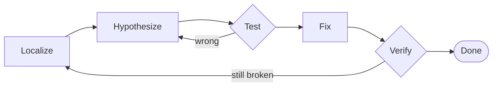

# Theory Authoring Conventions (Phase 20: slide decks)

Theory docs are the **read-first** conceptual explanation for a topic — the *telling* that precedes
SE-Viz's *showing*. A session runs **theory → visualization**. Since Phase 20 theory renders as a
**PowerPoint-style slide deck** (a fixed 16:9 canvas scaled to fit, large type, one slide per
screen) for live teaching and screen-share. Theory is a **separate content type from a `Trace`** — it
is not played by the engine and does not touch the trace format. This file is the contract the theory
content pass authors against.

## File location & naming (unchanged)

One Markdown file per sidebar **topic**, named `theory.md`, in that topic's folder:

```
src/content/<course>/<topic>/theory.md
```

Auto-discovered (a `?raw` glob in [`src/content/theory.ts`](../src/content/theory.ts)) and pinned
**first** within its topic in the sidebar. A topic may have a theory doc, modules, or both; no
`theory.md` simply means no Theory entry. No edit to any shared file is needed to add one.

## Required frontmatter (unchanged)

```markdown
---
course: SE 200
topic: Pointers, Arrays and Strings
title: Pointers, Arrays & Strings
order: 50
---
```

| Field | Required | Meaning |
| --- | --- | --- |
| `course` | yes | Course code — **must match `docs/CURRICULUM.md`** (e.g. `SE 200`). Never fabricate. |
| `topic` | yes | Topic — **must match the topic its modules use** (the sidebar group string). |
| `title` | yes | Deck title — rendered as the **auto title slide** (slide 1). |
| `order` | recommended | Sort hint. Use the topic's module `order` (theory always pins first). |

`course`/`topic` are validated against the catalog by `src/content/theory.test.ts`.

## Slides: the `---` separator

The body is split into slides on a **top-level `---`** (a thematic break on its own line, blank lines
around it). The `---` is a **slide separator** — never a rendered horizontal rule inside a slide.
A `---` inside a fenced code block is left alone.

```markdown
## First concept

- a bullet
- another

---

## Next concept

…
```

- **Slide 1 is auto-generated** from the frontmatter (title + `course · topic`). **Do not** write a
  title slide — start the body with your first concept slide.
- A deck needs ≥1 authored slide; empty slides are dropped.

## Per-slide content budget (keep slides light)

Each slide must fit the 16:9 frame at **large type**. Treat one slide as **one idea**:

- a **`##` slide title**, plus **one** of:
  - ~3–6 short bullets (nesting allowed — see below), **or**
  - one short code block (≈4–8 lines), **or**
  - one callout, **or**
  - a small table (≤6 rows), **or**
  - 2–3 short sentences.

If a slide feels crowded, split it across two. Short lines beat long paragraphs — this is a slide,
not a page. (The renderer will internally scroll an over-long slide as a last resort, but author to
fit.)

## Recommended deck arc

1. **(auto title slide)**
2. **Why it matters** — the hook, in a few bullets.
3. **Mental model** — the picture to hold.
4. **Syntax / the rules that matter** — a table or a short list.
5. **Common patterns.**
6. **Pitfalls / misconceptions** — great as `watch-out` callout slides.
7. **A worked example** — one code-block slide.
8. **Recap** — a `recap` callout.
9. **See it run** — name the topic's modules; close with the continue bridge.

## Supported Markdown

Rendered by [`src/engine/markdown.ts`](../src/engine/markdown.ts) → a typed AST → React (**never an
HTML string**, so it is safe by construction; raw HTML in the source shows literally and is not
executed).

- Headings `#`–`###` (use `##` for a slide title, `###` for a sub-head), paragraphs, **nested**
  lists, GFM pipe tables, blockquotes.
- Inline: `**bold**`, `*italic*`, `` `code` ``, `[text](https://…)` (http/https/mailto/in-page only).
- **Underscores are not emphasis** — C identifiers like `node_t` read literally. Use `*…*` for
  italics; wrap C in backticks/fences regardless.

### Nested lists (Phase 20)

Indent **2 spaces** per level. A more-indented run of items becomes a sub-list of the item above it:

```markdown
- top item
  - nested item
  - another nested item
- second top item
```

### Code blocks

Fenced blocks with a `c` (also `h`/`cpp`) info string get **C syntax highlighting** in `.se-code`
with **ligatures off** (`->`, `!=`, `<=`, `*p` render literally). Keep them short for slides:

````markdown
```c
int *p = &x;   /* p holds the address of x */
*p = 7;        /* write through the pointer */
```
````

### Callouts (shared visual language with in-viz coaching)

A blockquote whose first line is `> [!variant] Optional title` becomes a **callout** styled with the
**coach variant tokens** (same color + glyph as the in-visualization coach notes). Continuation lines
must each start with `>`. The set is small and fixed:

| Syntax | Use for |
| --- | --- |
| `> [!idea]` | the key insight / mental model |
| `> [!watch-out]` | a pitfall, misconception, or UB warning |
| `> [!predict]` | a "what do you think happens?" prompt |
| `> [!recap]` | a short summary of what to retain |

An unknown `[!type]` falls back to a plain blockquote.

### Diagrams (Phases 22, 26 & 27)

Fenced blocks with a **diagram info-string** render to **SVG with the design tokens** (no library, no
raw HTML; the `call-tree` layout uses the headless `d3-hierarchy`). They scale natively on the slide.
Four in-house types — `call-stack`, `call-tree`, `pipeline`, `symbol-table` — extend by adding a
`kind` in `markdown.ts`'s `Diagram`, a case in `parseDiagram`, and a case in `Diagram.tsx`. A fifth,
` ```mermaid `, is the general-purpose escape hatch. See
[When to use which diagram](#when-to-use-which-diagram-phase-27).

**`call-stack`** — a vertical stack of frame boxes (declared top→bottom; put the outermost frame
first, the deepest last, matching the memory view where the newest frame is at the bottom). One frame
per line, pipe-separated: `LABEL | field | field | active`. `active` (any position) highlights the
frame (amber); other parts are field lines. An optional `caption:` line adds a caption.

````markdown
```call-stack
caption: factorial(3) at its deepest
main()
factorial(3) | n = 3 | return = 3 * factorial(2)
factorial(2) | n = 2 | return = 2 * factorial(1)
factorial(1) | n = 1 | base case | active
```
````

**`call-tree`** — a tree of calls, **indentation = parent→child** (2 spaces per level; the first line
is the root). A trailing ` *` marks a **repeated subproblem** (highlighted amber — e.g. `fib(2)`
computed twice). An optional `caption:` line adds a caption.

````markdown
```call-tree
caption: fib(2) is computed twice — naive fib is exponential
fib(4)
  fib(3)
    fib(2) *
    fib(1)
  fib(2) *
```
````

**`pipeline`** (Phase 26) — a left→right staged build flow, in the same visual language as the
Build-pipeline visualization: **artifacts** (files) are solid cards with a folded corner, **processes**
(tool runs) are dashed pills, edges are azure arrows. One item per line:

- **Node** — any line containing `|`: `ID[: LABEL] | part | part …`. The label defaults to the ID; use
  `ID: LABEL` when two nodes share a label (three `cc -c` runs → `cc1: cc -c`, `cc2: cc -c`, …). Each
  part is one of:
  - `@N` — the **stage**, i.e. the column (required). Columns are ordered by `N`; gaps are closed up.
  - `artifact` (default) or `process` — the shape.
  - `highlight` — amber node and amber **outgoing** edges. Highlight several nodes to draw a path;
    when anything is highlighted, everything else is **dimmed**.
  - `accent` — the teal final-product treatment the visualization gives `app`.
  - any other text — the small uppercase **sublabel** (at most one).
- **Edge** — `a -> b`, or a chain `a -> b -> c`, between declared IDs. An edge that skips columns runs
  level at its source's row and bends only before its target.
- `caption: …` — optional.

````markdown
```pipeline
caption: amber = re-runs after editing circle.c
circle.c | source | @0 | highlight
cc: cc -c | process | compile | @1 | highlight
circle.o | object | @2 | highlight
main.o | object | @2
ld | process | link | @3 | highlight
app | executable | @4 | highlight
circle.c -> cc -> circle.o -> ld -> app
main.o -> ld
```
````

**`symbol-table`** (Phase 26) — file boxes listing the symbols each **defines** and **needs**, with
resolve arrows from a need to the definition that satisfies it. Boxes sit side by side; boxes that
share a column stack vertically.

- `file NAME [@N]` — starts a box. `@N` is its column (default: its position in the list). Names have
  no spaces (`libshapes.a(circle.o)` is fine).
- `defines: a, b` / `needs: c, d!` — the box's symbols, comma-separated. A trailing `!` marks a need
  as **unresolved** (danger style, with an `UNRESOLVED` tag) — needs only.
- `FILE:SYM -> FILE:SYM` — a **resolve edge**, from a `needs` entry to another box's `defines` entry
  (split at the last `:`). Write `-x` instead of `->` for a **failed** edge: dashed danger, crossed
  out, no arrowhead (link order gone wrong).
- `caption: …` — optional.

````markdown
```symbol-table
caption: every need found a home — except area_triangle
file main.o @0
defines: main
needs: area_circle, area_triangle!
file libshapes.a(circle.o) @1
defines: area_circle
main.o:area_circle -> libshapes.a(circle.o):area_circle
```
````

**`pipeline` and `symbol-table` are strict.** An unrecognized line, a node without a stage, a
duplicate ID or file, or an edge to something that isn't declared makes the whole block fall back to a
plain code block, so a typo shows up as raw text on the slide rather than as a quietly wrong picture.
(`call-stack` and `call-tree` are lenient, as they were in Phase 22.)

Keep diagrams light so they fit the 16:9 slide at large size (a handful of frames / a small tree /
≤ 7 pipeline stages / ≤ 4 symbol boxes).

### When to use which diagram (Phase 27)

Two families, one rule: **if an in-house kind can draw it, use the in-house kind.**

| Picture | Use |
| --- | --- |
| Memory: stack frames, a call at its deepest | `call-stack` |
| Calls: a recursion tree, repeated subproblems | `call-tree` |
| Builds: `.c → .o → .a → app`, what re-runs | `pipeline` |
| Symbols: defines / needs, link errors, link order | `symbol-table` |
| **Everything else** — a decision flow, a state machine, a `fork`/`wait` sequence, a struct relationship sketch | `mermaid` |

The in-house kinds are the core teaching pictures. They speak the visualization's visual language
(frame boxes, amber = current, teal = heap, danger red) and cost nothing to load. Mermaid is the
general-purpose escape hatch for the long tail, so a one-off picture doesn't need an engine phase.
Mermaid is **never** a replacement for an in-house kind.

**` ```mermaid `** — standard [Mermaid](https://mermaid.js.org) source. If the first non-blank line
is a Mermaid comment `%% caption: …`, it becomes the slide caption, as on the other kinds:

````markdown

````

**Supported subset:** `flowchart`, `sequenceDiagram`, `stateDiagram-v2`, `classDiagram` and
`erDiagram`. Mermaid can parse other kinds too, but only these five are the authoring contract;
anything else is unsupported, even if it happens to render.

**How it renders:**

- **Themed from the design tokens.** Shapes use the neutral surfaces with hairline borders, text is
  Manrope at slide size, and every line and arrow is azure. The diagram re-renders live when the
  theme flips. Don't add colors: no `style`/`classDef` fills and no `%%{init}%%` themes. The theme
  and security keys are locked anyway, so a diagram's own directive can't change them.
- **Strict security:** `securityLevel: 'strict'`, so there are **no click callbacks** and no links
  out of the diagram. **No HTML labels** (`htmlLabels: false`): labels are plain SVG text, so `<b>`,
  `<i>`, `<br>` and Markdown inside labels are not a feature. Write short plain labels instead.
- **Layout is dagre,** the classic Mermaid layout. Mermaid 12's default ELK engine is a separate
  ~1.4 MB download, so it is switched off. A diagram may opt back in with frontmatter
  (`config: layout: elk`), but treat that as a last resort.
- **Loaded lazily.** Mermaid is fetched the first time a slide with a Mermaid block opens, about
  230 kB gzipped. Decks without one never download it.
- **Strict at render time.** Invalid Mermaid shows its **source as a plain code block** on the slide,
  and the browser console names the deck and slide. Like the strict in-house kinds, a typo shows up
  as raw text rather than as a quietly wrong picture.

**Fitting the slide:** a Mermaid diagram is drawn at its natural size and shrinks to the 1120 px
slide column if it is wider. Each extra column costs legibility, so aim for **≤ 6 nodes in a row**.
Labels on forward edges add width, so label only the edges that need it (usually the back edges).
Self-loops in `stateDiagram-v2` lay out poorly under dagre, so put a refused or no-op transition in
the caption or the prose instead. Check the slide in presentation mode (`f`).

## The visualization bridge

The deck always shows a persistent **"Continue to the visualization →"** button (it jumps to the
first module of the same topic — derived from the catalog, not authored). Close the deck with a "See
it run" slide that names the topic's modules so the hand-off reads naturally.

## Navigation & presentation (for reference)

The deck renderer ([`src/components/TheoryDeck.tsx`](../src/components/TheoryDeck.tsx)) provides
`Slide k / N`, prev/next, progress dots, `←/→` (Home/End) keys, and a fullscreen presentation surface
(`f`, `Esc` to exit) — the primary screen-share view. Works in dark + light; no slide-transition
animation (reduced-motion safe). Authors don't wire any of this; just write good slides.
