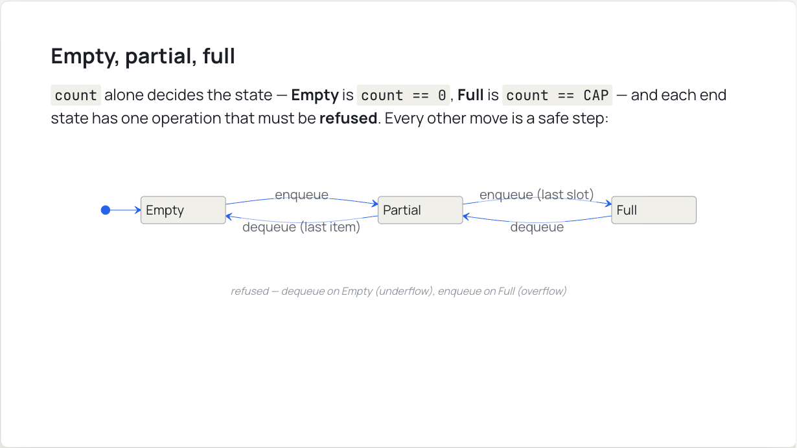
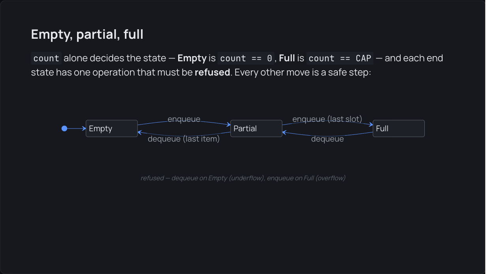
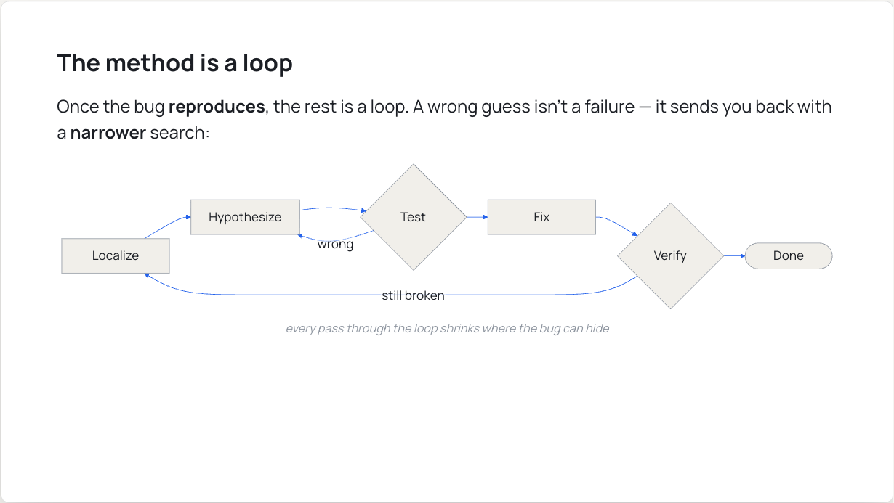
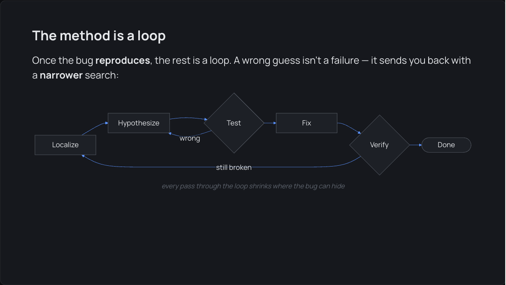
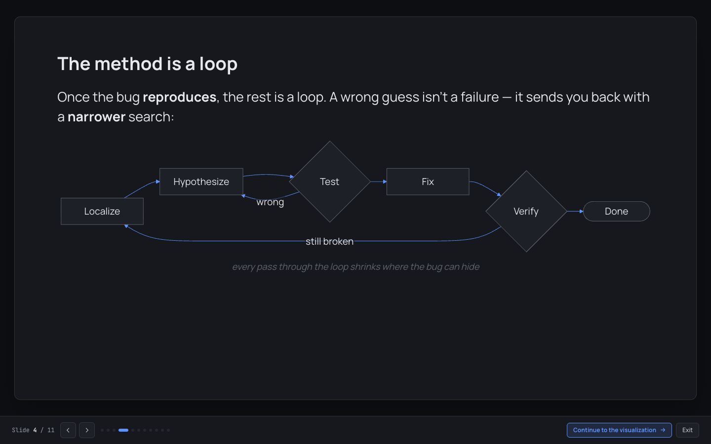
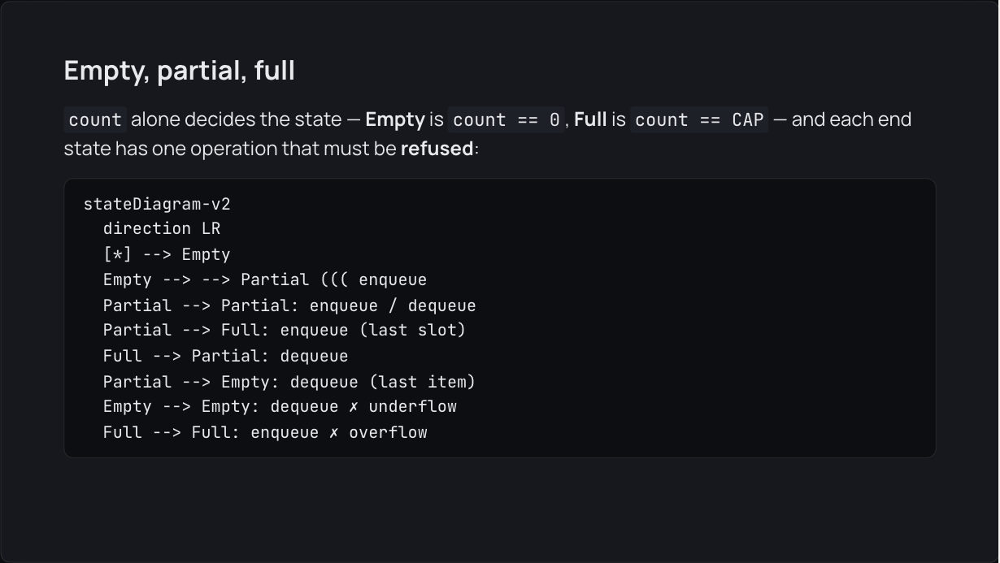

# Phase 27 Report — Mermaid as a general-purpose diagram block (lazy, strict, token-themed)

## 1. Summary

Theory decks can now use a ` ```mermaid ` fence alongside the four in-house diagram kinds. The fence
renders as a token-themed SVG that re-renders live when the theme flips, and broken Mermaid falls back
to a visible code block.

- **The cost is contained.** Mermaid (`mermaid@12.0.0`, exactly pinned, the only new dependency)
  sits behind two lazy chunks. Decks without a Mermaid block never download it; I checked this in the
  production build's network log. The main chunk grew **+2,496 B of code** (min). Counting the two
  exemplar slides' Markdown, which is bundled into the main chunk, it grew **+3,414 B**.
- **Security is strict.** `securityLevel: 'strict'`, no HTML labels, no click callbacks. The SVG is
  mounted with `DOMParser` + `replaceChildren`, and there is no `dangerouslySetInnerHTML` anywhere.
- **The in-house kinds are unchanged.** The Phase 26 snapshot file and `Diagram.test.tsx` are
  untouched and pass.
- **Two exemplar slides were added.** One is a `flowchart` of the debugging loop (SE 200 Debugging).
  The other is a `stateDiagram-v2` of a queue's Empty / Partial / Full states (SE 201 Stacks & Queues
  Part 1).
- **Gates pass:** `typecheck`, `lint`, `test` (**311/311**, 19 files) and `build`.

Branch: `phase-27-mermaid-diagrams`, cut from `55168b1` (the Phase 26 tip). **Not merged, not
pushed.**

**Read §5 before reviewing.** Mermaid 12 changed several defaults (ELK layout, `neo` look, per-diagram
`redux-color` theme, a 120 px wrap width). Each one would have broken the "native, flat, cheap" goal,
so each is overridden explicitly.

## 2. What I built

**Engine (stays dependency-free and synchronous):** `src/engine/markdown.ts`
- New `Diagram` member `{ kind: 'mermaid'; caption: string | null; source: string }`.
- `'mermaid'` added to `DIAGRAM_LANGS`.
- `parseMermaid`:
  - If the first non-blank line is `%% caption: …`, it becomes the caption and is removed from the
    source.
  - Everything else is kept verbatim. Only leading and trailing blank lines are dropped, so
    indentation survives.
  - It never returns `null`. Whether the source is valid is only known at render time.

**Renderer:**
- `src/components/MermaidDiagram.tsx` is the only part of the feature in the main chunk. It is a thin
  React wrapper:
  - On mount it lazy-loads the runtime, waits for `document.fonts.ready`, renders, and mounts the
    SVG into a ref'd `<div>` that React never renders children into.
  - It reserves `min-height: 220px` and keeps the last SVG up while a theme re-render is in flight.
  - It watches `data-theme` and re-renders when it changes.
  - On failure it shows `fallback` and `console.warn`s naming the deck, the slide and the failed
    stage.
- `src/components/mermaidRuntime.ts` is lazy (its own chunk) and does all the Mermaid work as plain
  functions:
  - `loadMermaid` holds the app's **only** `import('mermaid')`.
  - `themeVariablesFromTokens` / `TOKEN_THEME_VARIABLES` map about 55 Mermaid `base`-theme variables
    to `--se-*` tokens. Surfaces are neutral, borders are hairlines, and **every line and arrow is
    azure**. It sets `useGradient: false` and `dropShadow: 'none'`, and skips empty tokens.
  - `buildMermaidConfig` produces the full config (§5).
  - `SECURE_KEYS` lists the keys a diagram's own frontmatter or `%%{init}%%` cannot override.
  - `nextMermaidId` gives a fresh CSS-safe `se-mermaid-N` per render.
  - `svgProblem` is a defence-in-depth check after strict mode. It rejects `<foreignObject>`,
    `<script>`, inline event handlers and `javascript:` URLs.
  - `renderMermaid` runs import → initialize → `mermaid.parse` → `mermaid.render` → check. It never
    throws; it returns `{ok:false, stage}`. Calls go through a one-at-a-time queue, because Mermaid's
    config is global.
  - `ensureInitialized` re-initializes only when the theme variables change.
  - `watchTheme` is a `MutationObserver` on `data-theme` that fires only on a real change.
  - `parseSvg` / `mountSvg` parse with `DOMParser` (XML first, HTML as a fallback) and mount with
    `importNode` + `replaceChildren`.
- Wiring:
  - `Diagram.tsx`: `DiagramView` gains a `mermaid` case. The four in-house renderers are untouched.
  - `Markdown.tsx`: a mermaid diagram block renders `MermaidDiagram`, with the scale-styled
    `CodeBlock` as its fallback. There is a new optional `place` prop, passed down through a context.
  - `TheoryDeck.tsx`: passes ``place = `"${doc.title}" slide ${n}` ``.

**Exemplars** (one new slide each; no existing slide rewritten, no in-house diagram replaced):
- `src/content/se200/debugging/theory.md`, slide 4, "The method is a loop". A `flowchart LR`:
  Localize → Hypothesize → Test, with "wrong" looping back to Hypothesize, then → Fix → Verify, with
  "still broken" looping back to Localize, then → Done. It sits right after "The method" (the numbered
  list), and draws the loop that the list can't show.
- `src/content/se201/linear-adts/stacks-queues-part-1/theory.md`, slide 5, "Empty, partial, full". A
  `stateDiagram-v2` of the queue's three `count`-driven states. The refused operations (underflow,
  overflow) are in the caption. It sits right after the slide that introduces `count`.

**Tests:**
- `src/engine/markdown.test.ts`: 5 new parser tests (verbatim source; caption lift; only the first
  line is a caption; never falls back at parse time; Mermaid `---` frontmatter stays inside the fence
  and on one slide).
- `src/components/mermaidRuntime.test.ts`: 16 new tests, with Mermaid mocked via `vi.mock`:
  - the lazy-import guarantee;
  - the token mapping, empty-token skipping, and dark vs light;
  - the config (strict / base / classic / dagre / no HTML labels / secure keys);
  - unique ids, including two concurrent renders;
  - the fallback stages (parse rejection never reaches `render`; import failure; render rejection;
    `<foreignObject>` output);
  - queue serialization, `svgProblem`, `watchTheme` with a fake observer, and a theme flip that
    re-initializes and re-renders with a fresh id;
  - initialize-once-per-theme.

**Build check:** `scripts/check-bundle.mjs` (run after `npm run build`) checks that:
- `mermaid.core-*.js` and `mermaidRuntime-*.js` are their own chunks;
- the main chunk reaches them only through a dynamic `import()`, contains no Mermaid identifiers, and
  `index.html` doesn't preload them;
- main-chunk code growth is ≤ 3,072 B.

**Docs:** `docs/THEORY_AUTHORING.md` has a new section, "When to use which diagram". It contains a
picture → kind table, the ` ```mermaid ` syntax with a caption, the supported subset (flowchart,
sequence, state, class, ER), the strict-mode limits, the dagre/ELK note, the lazy-load cost, the
failure behaviour, and slide-fit advice.

## 3. Acceptance criteria — self-assessment

- [x] **1. Gates pass; `mermaid` is the only new dependency, exactly pinned; no
  `dangerouslySetInnerHTML`; `securityLevel: 'strict'`.**
  - `typecheck`, `lint`, `test` (311/311) and `build` all pass.
  - `package.json` has exactly one new line, `"mermaid": "12.0.0"` (no caret). No React wrapper.
  - `grep -rn dangerouslySetInnerHTML src` finds only two doc comments saying it isn't used.
  - Strict mode is pinned by a test, and `securityLevel` is in `SECURE_KEYS`.
- [x] **2. Mermaid is code-split: decks without a Mermaid block never download it (verified in the
  network panel); main-chunk growth ≤ ~3 kB, with before/after numbers.**
  - **Code growth is +2,496 B.** Total growth is **+3,414 B** once you count the 918 B of exemplar
    deck Markdown, which ships in the main chunk because every deck does. See §4.2 and §5, item 1.
  - Network, production build via `vite preview`: walking all 20 slides of the Static Libraries deck
    requested **only** `index-*.js`. Opening the Debugging Mermaid slide then fetched
    `mermaidRuntime-*.js`, `mermaid.core-*.js` and their dependencies.
- [x] **3. A ` ```mermaid ` block renders token-themed in both themes and switches live with the
  theme; invalid Mermaid falls back to a visible code block.**
  - Setting `document.documentElement.dataset.theme` swapped the SVG within about 1.5 s (a new id,
    e.g. `se-mermaid-2` → `-3`). Computed stroke was `rgb(91,147,255)`, the dark `--se-pointer`.
    Screenshots: `phase27-queue-{light,dark}.png`, `phase27-debug-{light,dark}.png`.
  - Fallback: temporarily broke the queue source. Status became `failed`, the source showed as a code
    block, and the console said: `[se-viz] Mermaid diagram on "Stacks & Queues (Array-Backed)" slide 5
    could not render (parse); showing its source instead.` plus Mermaid's parse error. Screenshot:
    `phase27-fallback-dark.png`.
- [x] **4. In-house diagram kinds are byte-identical; no in-house diagram was replaced.**
  - `git diff 55168b1 -- src/components/Diagram.test.tsx src/components/__snapshots__/` is empty, and
    both pass.
  - The only edits to `Diagram.tsx` are a doc comment, an import, and one new `case`.
- [x] **5. 1–2 exemplar Mermaid slides exist, fit the 16:9 budget, and are legible in presentation
  mode.**
  - Two slides, as listed in §2. Every slide of both decks has `scrollHeight == clientHeight` (checked
    in dev and in production).
  - Presentation mode: `phase27-present-dark.png`.
  - The queue diagram renders 1:1 (972 px natural width). The flowchart is 1,304 px natural, so it is
    scaled to 0.86, which puts labels at about 18 px on the 1280×720 canvas, on par with the in-house
    kinds' labels.
- [x] **6. `docs/THEORY_AUTHORING.md` explains when to use Mermaid vs the in-house kinds.**
  - See the new section, linked from the Diagrams intro.

## 4. How to run & verify

```sh
npm ci
npm run typecheck && npm run lint && npm test && npm run build
node scripts/check-bundle.mjs        # code-split + main-chunk budget (needs dist/)
npm run dev                          # or: npx vite preview  (after build)
```

- **SE 200 → Debugging → Theory**, slide 4: the flowchart.
- **SE 201 → Stacks, Queues, LIFO, FIFO Part 1 → Theory**, slide 5: the state diagram.
- Toggle the theme: the diagram re-renders in the new tokens. Press `f` for presentation mode.
- To see the fallback, break the Mermaid source in either deck. You should get a code block on the
  slide and a `[se-viz] Mermaid diagram on …` warning in the console.
- Network: open **Static Libraries → Theory** and walk every slide. No `mermaid*` request should
  appear.

### 4.1 Mermaid version — `12.0.0`, and why

- `npm view mermaid time` (on 2026-10-15) lists these recent releases:
  - **12.0.0 — 2026-09-10T07:43Z**
  - 12.1.0 — 2026-10-02
  - 12.2.0 — 2026-10-13, now `latest`
- The rule was "newest published on or before 2026-10-01", so **12.0.0** (five weeks old). Installed
  with `npm install --save-exact mermaid@12.0.0`.
- **It is a new major.** The conservative alternative would have been `11.17.2` (2026-08-25). 12.0.0
  works, but its defaults differ in ways that matter here (§5, item 3).

### 4.2 Bundle numbers

All numbers are minified bytes. "gzip" is Node `zlib` at its default level; Vite's printed gzip
figures run about 1.5 kB higher.

| Build | main `index-*.js` | gzip | Δ vs Phase 26 |
| --- | --- | --- | --- |
| **Before**, `55168b1` (Phase 26 tip) | 712,384 B (`index-DXE8Xas9.js`) | 206,917 B | — |
| After, code only (exemplar decks reverted) | 714,880 B | 207,855 B | **+2,496 B** (gzip +938) |
| **After**, final | 715,798 B (`index-UqITQHYX.js`) | 208,213 B | **+3,414 B** (gzip +1,296) |

Where the main-chunk bytes come from:
- `MermaidDiagram.tsx` is about 1.4 kB.
- The parser, the `DiagramView` / `Markdown` / `TheoryDeck` wiring and the dynamic-import stub make up
  the rest of the code delta.
- The two exemplar slides' Markdown is 918 B.

Mermaid-side chunks (lazy):
- `mermaidRuntime-*.js`: 5,733 B. `mermaid.core-*.js`: 35,376 B.
- The first Mermaid slide in a session fetches about 35 chunks: **821 KB** decoded for the flowchart.
  Flowchart and state diagram together are **863 KB min / 234 KB gzip** (36 files). After that, a new
  diagram kind only adds its own module (`stateDiagram-v2-*.js` is 42 KB).
- `elk-*.js` (1,459,030 B) is built but **never fetched** (§5, item 3).

Before the dagre fix, one flowchart pulled in **2.24 MB** decoded, including ELK.

Total `dist/assets` JS+CSS on disk went from 1.24 MB (3 files) to 6.33 MB (105 files). Almost all of
that is Mermaid's per-diagram and layout chunks, which are only fetched on demand.

## 5. Key decisions & deviations

1. **The main chunk grew +3,414 B in total, which is over a literal 3 kB.**
   - The code delta is **+2,496 B**. The remaining **918 B is the exemplar slides' Markdown**. Theory
     decks are bundled into the main chunk as raw strings, so any new slide grows it.
   - `scripts/check-bundle.mjs` therefore gates **code** growth. Its default baseline is the Phase 26
     number plus that measured 918 B, and it says so in a comment. Later phases pass `--baseline`.
   - If you read "≤ ~3 kB" as total bytes, this is 342 B over. The way to close that is trimming deck
     text, not Mermaid code.
2. **The runtime is lazy too, so there are two hops.** `MermaidDiagram.tsx` does
   `import('./mermaidRuntime.ts')`, and the runtime does `import('mermaid')`. My first version kept the
   runtime in the main chunk, which added +7.7 kB. Moving it out got the code delta to 2.5 kB. The
   cost is one extra small round trip (5.7 kB) before Mermaid's core starts loading.
3. **Mermaid 12 defaults I override.** The spec's config list (`startOnLoad: false`, `strict`, `base`,
   token `themeVariables`, fonts) wasn't enough. Without these overrides, v12 renders off-design or
   heavy:
   - `look: 'classic'`. v12 defaults `flowchart.look` to `neo` and `flowchart.theme` to `redux-color`.
     Root-level `look` and `theme` win over those per-diagram defaults in v12's `resolveAppearance`.
   - `useGradient: false`, `dropShadow: 'none'`. The v12 `base` theme turns both on, against the flat
     design rule.
   - **`layout: 'dagre'`**. v12 defaults to the **ELK** engine, a 1.46 MB chunk fetched for every
     diagram. Dagre is ~0.1 MB. Authors can still opt into `layout: elk` in a diagram's frontmatter.
   - `flowchart: { nodeSpacing: 30, rankSpacing: 36, wrappingWidth: 220 }`,
     `state: { wrappingWidth: 220 }`, `fontSize: 21` with matching `themeVariables.fontSize`. v12's
     120 px wrap width split "Hypothesize" mid-word at slide font size, and the tighter spacing lets a
     6-node flow fit the 1120 px column.
   - `suppressErrorRendering: true`, so Mermaid throws instead of drawing its "syntax error" bomb. We
     show the source instead.
   - `htmlLabels: false` is set explicitly at the root, which takes precedence in v12.
4. **"Initializes once" means once per theme.** `themeVariables` must change on a theme flip, so
   `ensureInitialized` re-runs `initialize` only when the token-derived variables differ.
5. **`SECURE_KEYS` was extended beyond Mermaid's defaults** with `htmlLabels`, `theme`,
   `themeVariables`, `themeCSS`, `darkMode`, `look` and `fontFamily`. A diagram's own directive
   can't turn on HTML labels or re-theme itself. `layout` and the spacing knobs stay overridable on
   purpose.
6. **Extra defence after strict mode.** `svgProblem` refuses any SVG containing `<foreignObject>`
   (HTML labels), `<script>`, `on*=` or `javascript:`. A refused SVG takes the same fallback path as a
   parse error.
7. **Space reservation is partial.** The figure keeps `min-height: 220px` while loading and afterwards.
   Both exemplars fit inside it: the queue diagram is about 100 px tall and the flowchart about
   197 px at slide scale. So neither jumps when it finishes loading. A diagram taller than 220 px will
   still grow once on first load, because its height isn't known until Mermaid lays it out.
8. **The queue diagram was redesigned under dagre.** My first draft had self-loops for the refused
   operations and for "Partial stays Partial". It looked right under ELK, but dagre tangled the loops
   and labels. The final version draws the four real transitions and puts "refused — dequeue on Empty
   (underflow), enqueue on Full (overflow)" in the caption. The lead sentence says every other move is
   a safe step. The docs now warn that self-loops lay out poorly.
9. **Renderer tests stop at the DOM.** Vitest runs in `node`, and no DOM environment is installed. I
   didn't add one, since that would be a second dependency. So the tests cover all decision logic as
   plain functions with Mermaid mocked. The theme test drives `watchTheme` and `renderMermaid` the
   same way the component's effect does, but it doesn't mount `MermaidDiagram`. `parseSvg` /
   `mountSvg` and the effect wiring were verified **in the browser only**.
10. **The build check is a script, not part of `npm test`.** It needs `dist/`. I didn't add it to
    `package.json` `scripts`, to keep the `package.json` diff to the one dependency line.
11. **New optional `place` prop on `Markdown`.** It is only used to name the slide in the warning.
12. **The spec's "Status: draft for operator review" banner was removed** from
    `prompts/phase-27-mermaid-diagrams.md`, since the operator approved it. The rest of the file is
    verbatim.
13. **Markdown files are not Prettier-formatted.** `docs/THEORY_AUTHORING.md` and both decks already
    failed `prettier --check` at `55168b1`; the repo doesn't format its Markdown. I left them rather
    than reformat whole files. Every TS/JS file I touched, plus `package.json`, passes.
14. **Lockfile side effect.** Adding Mermaid bumped the dev-only `tinyexec` from 1.2.4 to 1.3.1,
    because it is now also a transitive dependency of Mermaid. No other existing package changed.

## 6. Trace format / API notes

**No trace-format change.** Shared-interface changes, all in the theory/Markdown layer:

- `Diagram` gains `{ kind: 'mermaid'; caption: string | null; source: string }`.
- `DIAGRAM_LANGS` gains `'mermaid'`.
- `parseDiagram('mermaid', …)` never returns `null`.
- `Markdown` takes an optional `place?: string`.
- New components and modules: `MermaidDiagram` (`diagram`, optional `fallback`, optional `context`)
  and the lazy `mermaidRuntime.ts`.

Mermaid is never reachable from the trace engine or Live Coding.

## 7. Known issues / follow-ups

- **Only `flowchart` and `stateDiagram-v2` were checked in the browser.** `sequenceDiagram`,
  `classDiagram` and `erDiagram` are in the documented subset, and their theme variables are mapped
  (actor, signal, class and relation colors), but **I did not visually verify them**. The next deck to
  use one should check both themes.
- **The first Mermaid slide costs about 234 KB gzip** across about 35 chunks. Rolldown splits Mermaid
  finely, so there is a request waterfall. It happens once per session.
- **`npm audit` reports advisories that arrive with Mermaid:**
  - `chevrotain` → `lodash-es` (high): `_.template` code injection;
  - `katex` (low): prototype-pollution trust bypass;
  - `mermaid` itself is flagged high because of those two.

  Input is repo-authored Markdown only, and we never call `_.template` or render KaTeX math, so I
  judge these unreachable. They are worth re-checking when bumping Mermaid. The other advisories
  (`postcss`, `nanoid`, `vitest`, …) existed before this phase.
- **The fallback screenshot shows an earlier draft of the queue diagram** (the self-loop version)
  broken on purpose. The fallback path didn't change after it was taken.

## 8. File map

```
package.json, package-lock.json                       (changed — + "mermaid": "12.0.0", exact)
src/engine/markdown.ts                                (changed — mermaid Diagram kind + parseMermaid)
src/engine/markdown.test.ts                           (changed — 5 parser tests)
src/components/MermaidDiagram.tsx                     (new — React wrapper, the only main-chunk part)
src/components/mermaidRuntime.ts                      (new — lazy: import('mermaid'), config, tokens, queue, mount)
src/components/mermaidRuntime.test.ts                 (new — 16 tests, Mermaid mocked)
src/components/Diagram.tsx                            (changed — `mermaid` case only; in-house renderers untouched)
src/components/Markdown.tsx                           (changed — mermaid block + CodeBlock fallback, `place` prop)
src/components/TheoryDeck.tsx                         (changed — passes `place`)
src/content/se200/debugging/theory.md                 (changed — +1 slide: flowchart)
src/content/se201/linear-adts/stacks-queues-part-1/theory.md (changed — +1 slide: stateDiagram-v2)
scripts/check-bundle.mjs                              (new — code-split + main-chunk budget check)
docs/THEORY_AUTHORING.md                              (changed — "When to use which diagram")
prompts/phase-27-mermaid-diagrams.md                  (added — the phase spec, draft banner removed)
reports/phase-27-mermaid-diagrams.md                  (added — this file)
reports/assets/phase27-{queue,debug}-{light,dark}.png, phase27-present-dark.png, phase27-fallback-dark.png
```

Screenshots:







