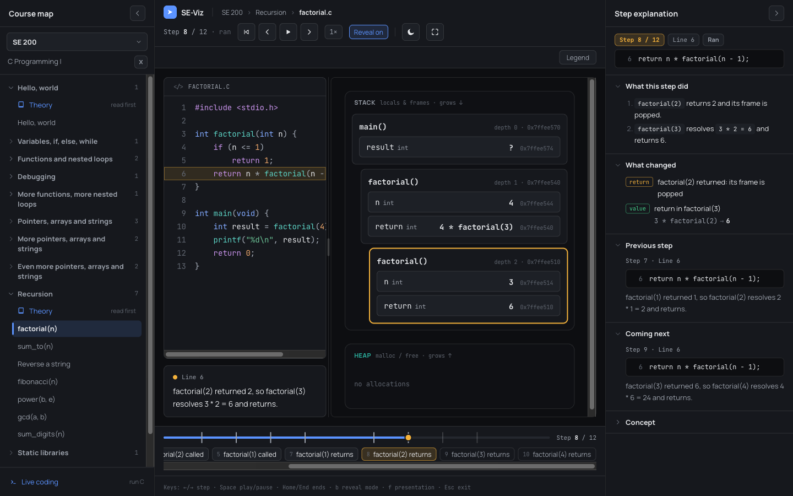
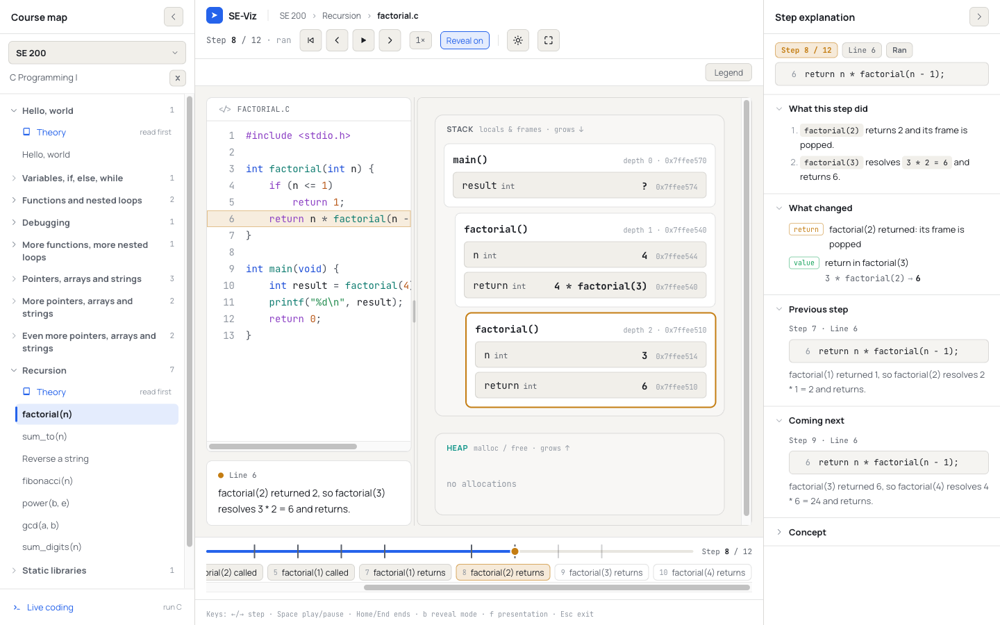
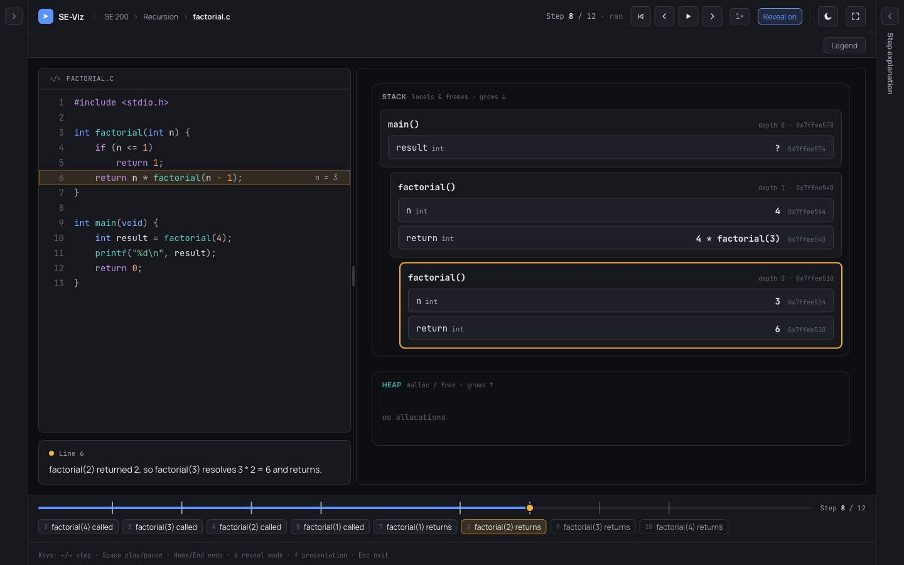
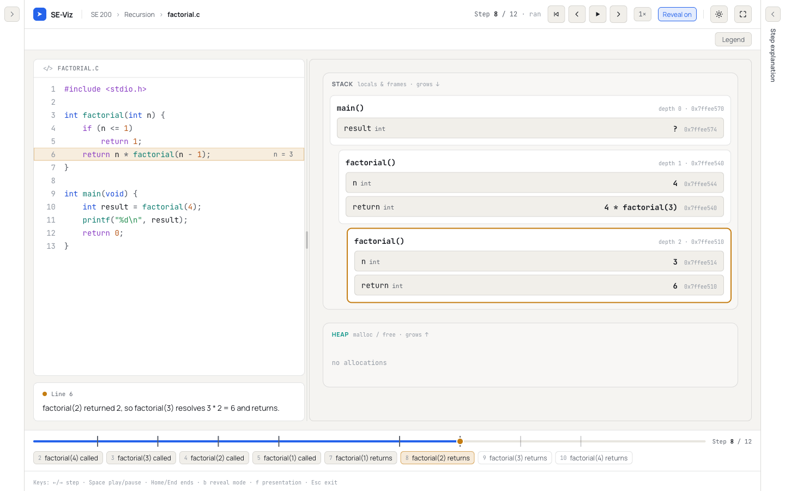
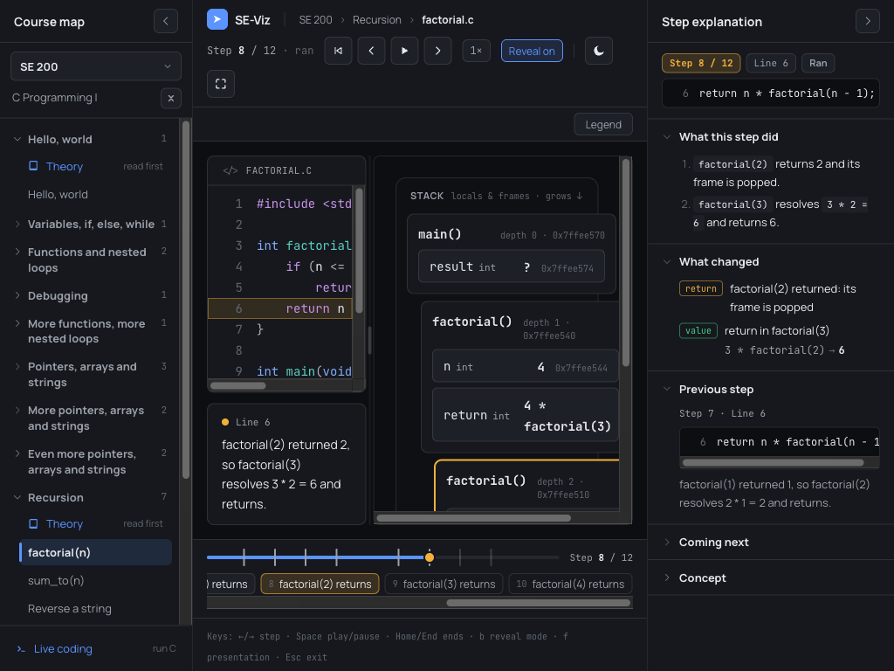
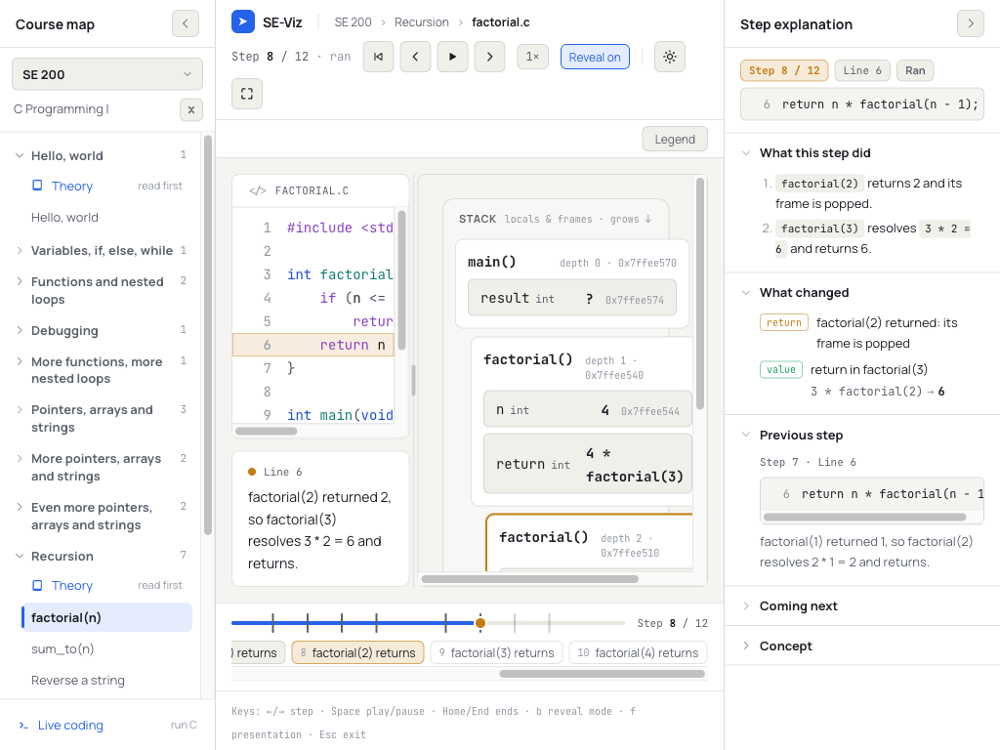
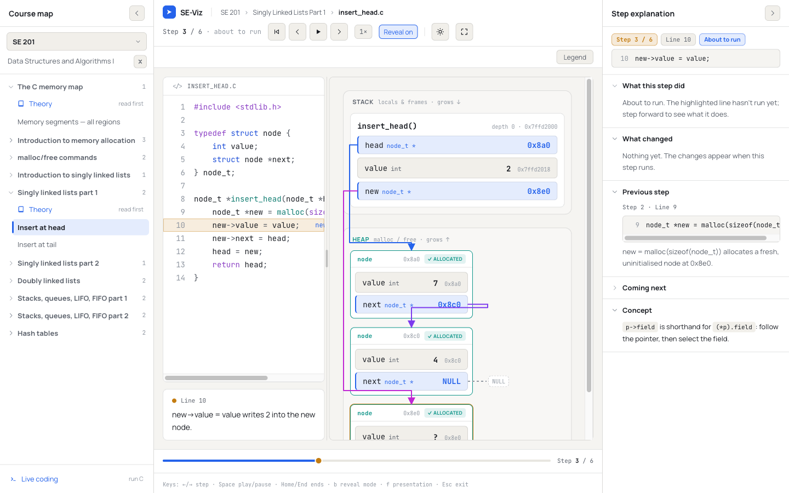
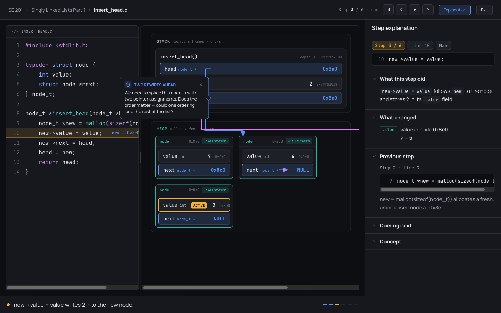

# Phase 28 Report — Studio shell (resizable workspace and step explanation panel)

## 1. Summary

The C player now uses the "Studio" layout: one horizontal panel group of **course map | stage | step
explanation**.

- **Both side panels resize and collapse.** They resize by pointer and keyboard, collapse to a slim
  rail, and their widths and collapsed states persist across reloads.
- **A new step explanation panel** explains the current beat. It uses authored `explain` data when
  the step has it, and otherwise falls back to the narration and the step diff.
- **The narration moved** into a card under the code panel.
- **A timeline runs along the bottom of the stage.** It is a step bar with labeled, clickable event
  markers ("factorial(3) called", "loop iteration 2") derived from the trace.
- **The course map got polish:** sentence-case labels, 13 px type, no truncation, and an azure bar on
  the current item.
- **Two exemplar modules have authored explanations on every step:** SE 200 `factorial(n)` and
  SE 201 "Insert at head".
- **The trace format change is additive and optional:** `Step.explain`.
- **Presentation mode is unchanged**, except for one new header toggle that can show the explanation
  panel. It is hidden by default, and the choice persists.
- **Theory decks and Live Coding still work.** They get a two-panel layout (course map | stage).

**Gates on `phase-28-studio-shell`:** `typecheck`, `lint`, `test` (**435/435**, 27 files) and `build`
all pass. `check-bundle` reports the main chunk at **742,443 B**, **+24,704 B** against the 717,739 B
baseline (budget 25,000 B). See §5, item 9.

**No new dependencies.** Branch `phase-28-studio-shell` is cut from `ds-python` at `5981ef5`. It is
**not merged and not pushed**.

## 2. What I built

**Trace format (additive):** `src/engine/trace/types.ts`
- `StepExplanation { did?: string[]; concept?: string }`, and `Step.explain?: StepExplanation`.
- Both fields accept inline Markdown only.
- `validateTrace` flags empty `did` entries and an empty `concept`
  (`src/engine/trace/validate.ts`).

**Engine (pure, React-free):**
- `src/engine/trace/explain.ts` — `explainBeat(trace, index, beat, mode)` returns everything the panel
  shows:
  - the header (step number, sorted highlighted lines, their source text);
  - `did` (authored, else the narration);
  - `changes`, derived from `diffSteps` plus heap and output: values old → new, pointer retargets
    (target named), frames pushed and popped, new variables in an existing frame, heap blocks
    allocated / freed / leaked, and printed output;
  - `previous` / `next`;
  - `concept`.

  On an `arrive` beat (two-beat mode), `did`, `changes` and the next step's narration are `null`.
  The first step returns a note instead of a diff (see §5, item 6).
- `src/engine/trace/labels.ts` — shared labels:
  - `functionParams` reads a C function definition's parameter names;
  - `frameLabel` gives `factorial(3)` when every parameter is a known scalar, else the bare name;
  - cell paths and owners (`value in node 0x8e0`), block labels, and source line text.
- `src/engine/trace/timeline.ts` — `deriveTimelineMarkers(trace)`:
  - calls and returns (frame push / pop; never on step 0);
  - loop back-edges: a backwards jump to a `for` / `while` header in the same frame, **only when that
    step carries the loop `condition`**. This gives `loop iteration k`, or `loop exits` when the
    condition is false. The counter resets when the loop is re-entered from above, so nested loops
    count correctly.
  - It handles `for` loops traced as two steps on the header (the increment, then the test).
  - Concept views get no markers.

**Studio shell UI** (`src/components/studio/`):
- `StudioLayout.tsx`:
  - one `react-resizable-panels` `Group` holding the course map `Panel`, a `Separator`, the stage
    `Panel` (`minSize` 520 px), and, for views with a player, a `Separator` plus the explanation
    `Panel`;
  - side panels are `collapsible` with a 44 px `collapsedSize` and `groupResizeBehavior:
    'preserve-pixel-size'`;
  - handles are 1 px hairlines with a 10 px (fine) / 28 px (coarse) hit area;
  - the explanation rail shows an expand button and a vertical "Step explanation" label;
  - the explanation content is portalled in from the keyed `Workbench`, which owns the player.
- `panelLayout.ts` — the pure layout rules:
  - specs: course map 280 px default (220–440), explanation 340 px (280–560), 44 px rail, stage at
    least 520 px;
  - `clampWidth`, `keyboardResize` (←/→ 16 px, Shift 64 px, Home / End, Enter toggles collapse; the
    direction depends on which side the panel is on);
  - `collapse` / `expand` / `toggleCollapsed`, which keep the width so a restore is exact;
  - `sanitizeState` for persisted data, and `stateFromPixels`.
- `useSidePanel.ts` — wires those rules to the library and to `usePersistentState`:
  - keys are `se-viz-course-map` and `se-viz-explanation`, each storing `{ width, collapsed }`;
  - a `Separator` `onKeyDownCapture` pre-empts the library's 5 % keyboard steps;
  - after a pointer drag settles, the width is read back from the panel;
  - two guards are explained in §5, item 4.
- `ExplanationPanel.tsx`:
  - an `<aside aria-label="Step explanation">` with a labeled collapse button;
  - the header chips (Step k / N, Line(s), About to run / Ran) and the source line(s);
  - five `<details>` sections. "What this step did", "What changed" and "Previous step" are open by
    default; "Coming next" and "Concept" are closed. Concept is hidden when nothing is authored.
  - change rows carry colour-coded badges (value = green, pointer = azure, call / return = amber,
    malloc = teal, leak = red, free / new / output = neutral);
  - authored text is rendered with the new `InlineMarkdown` export of `Markdown.tsx`.
- `Timeline.tsx`:
  - a range input as the step bar (keyboard operable, `aria-valuetext`);
  - a track, a progress fill and event ticks drawn under the thumb;
  - a row of marker chips (`aria-current="step"` on the event you are in) that auto-scrolls to the
    current chip;
  - thumb styling is in `src/index.css` (`.se-timeline`).
- `useCourseMapNav.ts` — the course map's navigation state (course, open topics, scroll offset),
  held in `App` so it survives the group remount (§5, item 2).
- `sentenceCase.ts` — sentence case for topic and module labels. It keeps acronyms, single capitals
  and code (`LIFO`, `C`, `malloc/free`).

**Changed components:**
- `App.tsx` — the Studio layout, `useSidePanel` ×2, the explanation slot and portal.
- `Stage.tsx`:
  - normal view: `NarrationCard` under the code panel (under the view for concept traces) and the
    `Timeline` at the bottom;
  - presenting: unchanged, with the `NarrationBar`.
- `NarrationCard.tsx` (new) — the line reference, the condition chip, and the polite live region.
- `ContentSidebar.tsx`:
  - sentence case, 13 px type, wrapping instead of truncating, and the current item marked;
  - the rail has only an expand button;
  - the course picker shows the code, with the course title wrapping beneath it;
  - nav state is lifted out.
- `TopBar.tsx` / `Transport.tsx` — new `showScrub` prop. The top bar's scrub is replaced by the
  timeline, and the transport cluster wraps at narrow widths.
- `PresentationMode.tsx` — the "Explanation" toggle (`se-viz-present-explanation`, default off).
- `LiveCodingView.tsx` — `showScrub={false}`, because its stage now has the timeline.

**Content:** `src/content/se200/recursion/factorial.ts` (12 steps) and
`src/content/se201/linked-lists/insertHead.ts` (6 steps).
- Every step has `explain.did`.
- `concept` is set where it adds something (9 of 12 and 5 of 6 steps).
- No narration, memory or step id was changed.

**Docs:**
- `docs/TRACE_FORMAT.md` — new section "Phase 28 additions" (the `explain` shape, derivation rules,
  two-beat behaviour, validation, timeline markers).
- `docs/CONTENT_AUTHORING.md` — new section "Step explanations".

## 3. Acceptance criteria — self-assessment

- [x] **1. Gates pass; no new dependency; trace changes are additive and documented.**
  - `typecheck`, `lint`, `test` (435/435) and `build` pass, and `check-bundle` passes (+24,704 B).
  - `package.json` and `package-lock.json` are untouched.
  - `Step.explain` is optional. Every existing trace validates and renders: there is a smoke render
    of every catalog trace in `stage.render.test.tsx`, plus the existing catalog validation.
  - Documented in `docs/TRACE_FORMAT.md` and in the `types.ts` TSDoc.
- [x] **2. All three panels resize by pointer and keyboard; course map and explanation collapse to
  rails and restore; state persists across reloads.**
  - Pointer drag goes through the library.
  - Keyboard: the two outer handles use our rules (←/→ 16 px, Shift 64 px, Home / End, Enter
    collapses / restores). The inner code | memory handle keeps the library's behaviour.
  - Checked in the browser:
    - ← ← Shift+← on the explanation handle gave exactly 340 → 436 px, and stored `{"width":436}`;
    - Enter on both handles collapsed them to 44 px rails;
    - after a reload both stayed collapsed, and expand restored the stored widths.
  - Tests: `panelLayout.test.ts` (steps, clamping, collapse / restore, sanitizing),
    `persistence.test.tsx` (hook-level round-trips through `useSidePanel` and `usePersistentState`),
    and `markup.test.tsx` (focusable labeled handles, rails).
- [x] **3. The explanation panel shows correct content for every step of the two exemplar modules, in
  both stepping modes, and sensible fallbacks for every other module.**
  - `explain.test.ts` checks every step of both exemplars:
    - apply in two-beat and single mode → authored `did`;
    - arrive → `did` withheld.
  - Hand-checked `changes` for factorial's `unwind-2` and insert-head's `malloc`.
  - Every step of every catalog module, in both beats → `did` equals authored text or the narration.
  - I read the panel in the browser for several steps of each exemplar (screenshots below).
- [x] **4. Both themes look right on every new surface (screenshots of each in the report).**
  - Dark and light screenshots: recursion mid-trace, collapsed rails, and narrow width (1024 px).
  - Plus SE 201 insert-head in light, and presentation mode with the panel in dark.
  - Every new surface uses `--se-*` tokens through Tailwind (`bg-surface`, `text-ink-muted`,
    `border-hairline`, `text-active`, …). The timeline thumb uses `var(--se-active)` /
    `var(--se-surface)`. No hard-coded colours.
- [x] **5. Live Coding, Theory decks and presentation mode still work.**
  - Checked in the dev server:
    - a Theory deck renders in the two-panel layout;
    - Live Coding opens its editor (no tracer backend locally, so I didn't run a program);
    - presentation mode shows the narration bar, the coach bubble, and the optional explanation
      panel.
  - Switching module ↔ theory ↔ module keeps the course map's open topics and scroll position.

## 4. How to run & verify

```sh
npm ci
npm run typecheck && npm run lint && npm test && npm run build
node scripts/check-bundle.mjs --baseline 717739 --budget 25000
npm run dev
```

1. Open **SE 200 → Recursion → factorial(n)** and press → repeatedly.
   - The explanation panel says "About to run" on arrive beats and lists the authored breakdown and
     "What changed" on apply beats.
   - The timeline chips jump to calls and returns.
   - Press `b` to switch to single-beat stepping; the panel always shows the ran state.
2. Open **SE 201 → Singly linked lists part 1 → Insert at head**.
   - The malloc step lists `new` declared and the node allocated. `head = new` lists the pointer
     retarget.
3. Open **SE 200 → Variables, if, else, while** or **SE 201 → Traverse** to see the loop markers.
4. Focus a side handle (Tab) and use ←/→, Shift+←/→, Home / End and Enter. Reload, and the layout is
   kept.
5. Use the chevron buttons to collapse and expand each side panel.
6. Press `f`, then use the header's **Explanation** toggle. Press Esc. The toggle is remembered.

## 5. Key decisions & deviations

1. **No access to the design canvas.**
   - The prompt refers to Direction A on "SE-Viz Redesign Directions", and says the link would be
     shared. It wasn't available to this unattended run.
   - The layout follows the prompt's written description and the existing tokens. The proportions,
     chip styles and rail treatment are my interpretation. **Please compare against the canvas.**
2. **The group remounts when its panel set changes (DEVIATION, library bug workaround).**
   - `react-resizable-panels` 4.11.2 throws "Maximum update depth exceeded" when a `Panel` and
     `Separator` are *removed* from a mounted `Group`. That happens on every switch from a module to a
     theory deck or live coding.
   - I reproduced it and narrowed it down: it is not our callbacks, `groupResizeBehavior`, ids or the
     portal. Keeping the panel mounted makes it go away.
   - So `StudioLayout` keys the `Group` on whether the explanation panel exists. There is still
     **one** outer group (course map | stage | explanation), but it remounts when you cross between
     player and non-player views.
   - Widths and collapsed states live in our persisted state, so the remount restores them exactly.
   - The course map's navigation state (course, open topics, scroll offset) is lifted into `App`
     (`useCourseMapNav`) so it survives the remount.
3. **The course map's rail has only the expand button,** as the prompt says. The old rail also had a
   vertical "Modules" label and a Live Coding shortcut; both are gone.
   - The old `se-viz-sidebar-collapsed` key is **not migrated**. A user who had the sidebar collapsed
     sees it open once.
4. **Persistence rules beyond the prompt.**
   - **Window resizes:** the library squeezes pixel-preserving panels when the window narrows and
     reports that as a layout change. I don't persist widths for 1 s after a window `resize`, and each
     panel re-applies its chosen width once the resize settles. A trip to a 1024 px projector
     therefore doesn't permanently shrink the panels.
   - **Very narrow windows:** below about 1,020 px the library *collapses* a side panel to keep the
     stage at its minimum, and that collapsed state **is** persisted.
   - **Imperative changes:** the library reports these synchronously, before the panel has its new
     size. `onSettled` ignores layout events fired while we drive the panel ourselves; without this
     guard keyboard steps were read back stale (found in the browser and fixed).
5. **The top-bar scrub was removed** (`Transport showScrub={false}`) because the timeline's step bar
   replaces it. Live Coding's transport lost its scrub for the same reason. Presentation's compact
   transport never had one.
6. **"What changed" goes a little beyond the four categories the prompt lists.**
   - It also lists **new variables** in an existing frame (e.g. `new` after `malloc`), **leaks**, and
     **printed output**. These come from the same snapshot comparison and avoid "Nothing changed" on a
     `printf` step.
   - **The first step** shows a note ("nothing to compare yet") instead of a diff. Several traces
     start mid-program (insert-head starts with a built list), so "everything was allocated" would be
     wrong.
   - **Concept views:** dual-trace lists the rows flagged `changed`. Pipeline and before-after show a
     note pointing at their own highlighted stage or lines; I first derived pipeline node-state rows,
     then cut them for bundle size (item 9).
7. **Two-beat details.**
   - On `arrive` the panel withholds "What this step did", "What changed" **and the next step's
     narration** (it would reveal this step's effects). "Concept" still shows; it describes an idea,
     not this step's effects.
   - **The narration card behaves exactly like the old narration bar.** It shows the logical step's
     narration on both beats. I didn't change that behaviour, so on an arrive beat the card can say
     more than the panel does.
8. **Timeline markers come only from frames and loop back-edges.** The prompt mentions "authored
   `beats` if any", but the trace format has no authored marker or beat field; Phase 16 beats are the
   arrive / apply halves of every step. Rather than invent a field, there are no authored markers.
   Back-edges without a condition chip get **no** marker, following the prompt's "no marker rather
   than a wrong one".
9. **Bundle budget (+24,704 B of 25,000).**
   - The first complete build was +26,436 B. I trimmed until it fit:
     - shared chevron and badge tones;
     - the section open/closed state is no longer persisted (it was extra to the spec; the
       `<details>` are now uncontrolled, so toggles still survive stepping within a module);
     - the pipeline "What changed" rows replaced by a note;
     - tighter exemplar wording.
   - Measured split of the final delta: **+20,618 B code** and **+4,086 B exemplar content**.
   - **Headroom is about 300 B.** The next phase should expect the main chunk at 742,443 B.
10. **The `<details>` sections are uncontrolled.** `open` sets the default, and a learner's toggles
    persist while stepping, because the sections stay mounted. They reset when the module changes or
    presentation mode opens, because the panel remounts.
11. **The course picker shows only the course code;** the title wraps beneath it. "SE 201 · Data
    Structures and Algorithms I" truncated in the select at the default width, and the prompt asks
    for no truncation.
12. **The stage minimum is 520 px.** At 1024 px both side panels give way to their minimums (220 and
    280 px) before the stage drops below that.
13. **Prettier was not run repo-wide.** It reformats about 50 untouched files. I formatted only the
    files I changed, and reverted the incidental reformatting it did to unrelated hunks.

## 6. Trace format / API notes

```ts
interface StepExplanation {
  did?: string[]; // ordered breakdown; inline Markdown; empty/absent → narration
  concept?: string; // inline Markdown; absent → Concept section hidden
}
// Step.explain?: StepExplanation   (Phase 28, optional)
```

Shared interfaces later phases can reuse (Phase 32 "derived explanations" plugs in here):
- `explainBeat(trace, index, beat, mode): BeatExplanation`, with `{ status, total, current, did,
  changes, changesNote, previous, next, concept }`.
  - `ChangeRow { kind: 'value'|'pointer'|'call'|'return'|'alloc'|'free'|'leak'|'declare'|'output';
    subject; from?; to? }`.
  - Phase 32 can add derived "branch taken" / "loop iteration" text here; authored text already wins.
- `deriveTimelineMarkers(trace): { index, kind: 'call'|'return'|'loop', label }[]`.
- `frameLabel(frame, source)`, `functionParams(source, name)` (C-specific; Python will need its own).
- `StudioLayout({ courseMap, sidebar, explanation, onExplanationSlot, children })`, `useSidePanel(spec)`
  and `ExplanationPanel({ player, onCollapse? })` — a Python renderer can sit in the stage unchanged.
- `Transport` has a new optional `showScrub` prop (default `true`).
- `Markdown.tsx` exports `InlineMarkdown({ text })`.
- New localStorage keys: `se-viz-course-map`, `se-viz-explanation`, `se-viz-present-explanation`.

## 7. Known issues / follow-ups

- **The memory canvas is narrower at default widths.** At 1440 px it is about 480 px, against about
  730 px before. Some linked-list arrow routes now loop around the canvas edge; this is the existing
  `ArrowOverlay` routing at a narrower width, visible in the insert-head and presentation screenshots.
  Collapsing either side panel restores the room. A follow-up could route arrows better at narrow
  widths, or default the explanation panel to collapsed on small screens.
- **At 1024 px the stage is usable but tight** (code panel about 180 px). See the narrow screenshots.
- **The Space key on a focused `<summary>` plays / pauses** instead of toggling the section. The global
  keyboard handler only ignores form fields and separators, the same as for buttons today. Enter or a
  click toggles it.
- **The inner code | memory handle keeps the library's 5 % keyboard step.** It is not part of the
  outer layout spec.
- **Loop markers don't say which loop** in nested loops. Both read "loop iteration 2"; the chip's step
  number tells them apart.
- **Live Coding was only opened, not run** (no tracer locally). Its stage now shows the narration card
  and the timeline like any trace.

## 8. File map

```
src/engine/trace/types.ts                 (changed — StepExplanation, Step.explain)
src/engine/trace/validate.ts              (changed — empty explain strings flagged)
src/engine/trace/validate.test.ts         (changed — 3 new tests; nothing else touched)
src/engine/trace/explain.ts               (new — explainBeat)
src/engine/trace/labels.ts                (new — frame/cell/block labels, C param names)
src/engine/trace/timeline.ts              (new — deriveTimelineMarkers)
src/engine/trace/{explain,labels,timeline}.test.ts            (new)
src/components/studio/StudioLayout.tsx    (new — the outer group, handles, rails)
src/components/studio/panelLayout.ts      (new — pure layout rules)
src/components/studio/useSidePanel.ts     (new — persistence + library wiring)
src/components/studio/useCourseMapNav.ts  (new — course map nav state lifted to App)
src/components/studio/ExplanationPanel.tsx (new)
src/components/studio/Timeline.tsx        (new)
src/components/studio/sentenceCase.ts     (new)
src/components/studio/{panelLayout,sentenceCase}.test.ts      (new)
src/components/studio/{persistence,markup,stage.render}.test.tsx (new)
src/components/NarrationCard.tsx          (new)
src/App.tsx, Stage.tsx, ContentSidebar.tsx, PresentationMode.tsx, TopBar.tsx, Transport.tsx,
NarrationBar.tsx (ConditionChip exported), Markdown.tsx (InlineMarkdown), live/LiveCodingView.tsx
src/index.css                             (changed — .se-timeline range styling)
src/content/se200/recursion/factorial.ts, src/content/se201/linked-lists/insertHead.ts (explain data)
docs/TRACE_FORMAT.md, docs/CONTENT_AUTHORING.md
reports/phase-28-studio-shell.md, reports/assets/phase28-*.png
```

**Snapshots and existing tests changed:** none. `src/components/__snapshots__/Diagram.test.tsx.snap`
and every pre-existing test are untouched, except `validate.test.ts`, which gained three tests and had
nothing existing changed. Tests went from 315 to 435.

### Screenshots

Recursion mid-trace (factorial, step 8, "Ran", with "Coming next" opened):




Both side panels collapsed to rails:




Narrow width (1024 × 768):




SE 201 insert at head, arrive beat ("About to run", effects withheld, Concept opened), and
presentation mode with the explanation panel shown:



