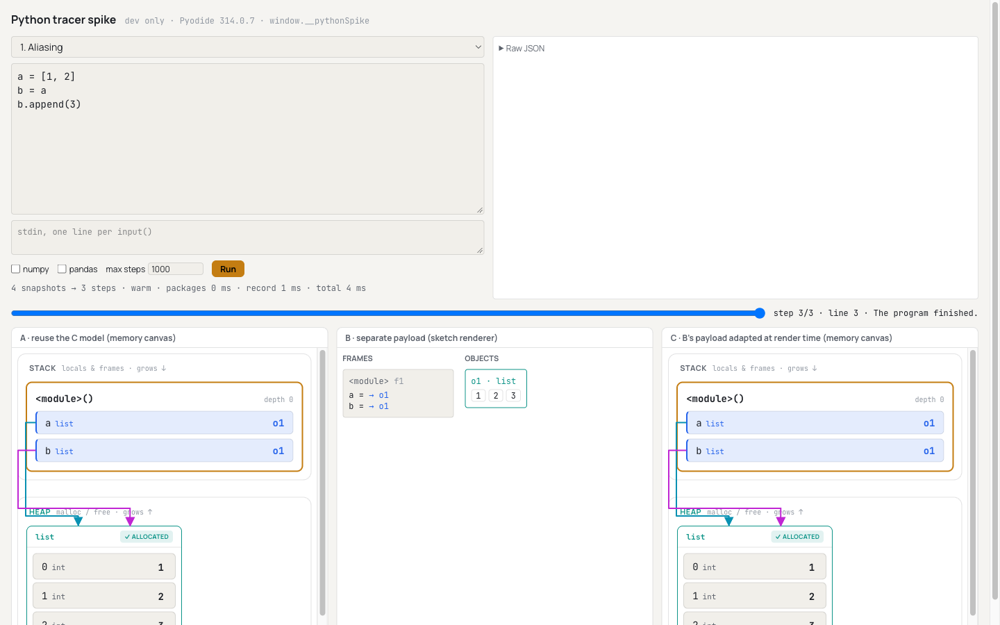
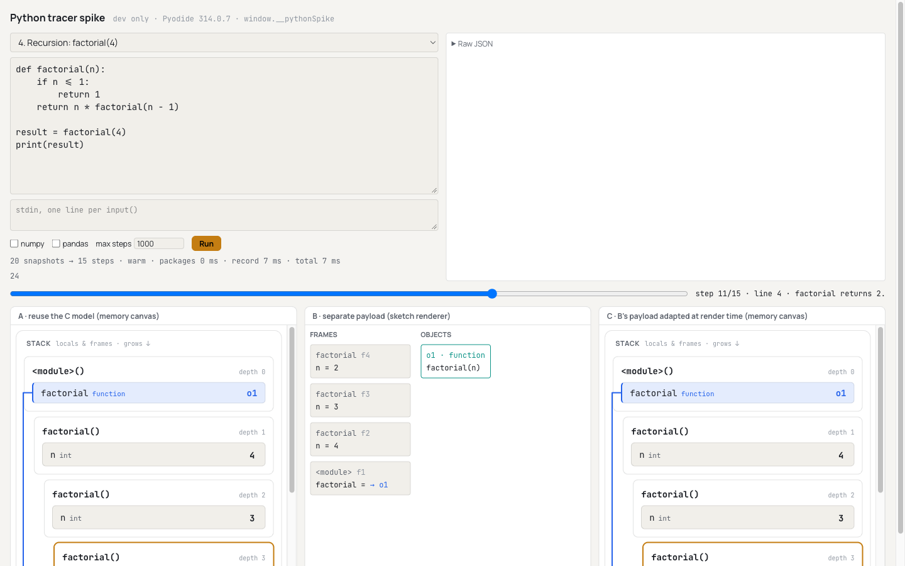

# Phase 29 Report — Pyodide tracer spike (deciding the Python trace shape from evidence)

## 1. Summary

A `sys.settrace` recorder in Pyodide, in a module Web Worker, records correct and bounded step
snapshots. The trace shape is decided: **candidate A ("reuse the C model")**. See
`docs/PYTHON_TRACE_FORMAT.md`.

**What the recorder does:**
- Records all eight samples correctly, including the `KeyError`, the syntax error and the infinite
  loop.
- Keeps object ids stable for the whole run.
- Enforces limits on steps, stdout lines, depth and time; plus a main-thread kill that terminates
  and recreates the worker.
- Feeds `input()` from the supplied stdin lines.

**Decision:**
- **A passes all six criteria.** Python runs become ordinary `Step`s, which the existing memory
  canvas, `diffSteps`, the validator and the explanation panel consume unchanged.
- **C also passes,** but loses the tie-break: it adds an adapter call in every `Step` consumer.
- **B fails criterion 4.** `diffSteps` sees nothing in a separate payload.
- **No stop condition was hit.**

**What changed for users:** nothing. The only new UI is a dev-only debug page at `/?python-debug`,
which production builds drop. The main chunk is byte-identical to `ds-python`: `index-1vDgS8Mp.js`,
**742,443 B**, delta **+0 B**.

**Gates on `phase-29-pyodide-tracer-spike`:** `typecheck`, `lint`, `test` (510/510, 30 files) and
`build` pass, and so does `check-bundle --baseline 742443 --budget 25000`.

**Dependency:** exactly one new direct dependency, `pyodide@314.0.7` (exact pin). The branch is
**not merged and not pushed**.

## 2. What I built

- **`src/python/recorder.py`** — the recorder (loaded as `?raw`). For each event it records:
  - user code only (`"<student>"`), on the `call` / `line` / `return` / `exception` events;
  - frames bottom-first, with names in first-seen order (dunders, `.0` names and modules skipped);
  - objects reachable from the frames, BFS, with stable `oN` ids backed by strong references. Kinds:
    list, tuple, dict, set, frozenset, instance, function (with parameters), class, NumPy/pandas
    summary, and other;
  - inline primitives with a `repr` of at most 80 characters;
  - cumulative stdout, return values, exception info, and an `unwinding` flag;
  - plus the limits, the stdin `input()`, and an import guard.
- **`src/python/protocol.ts`** — the plain-JSON request, result and snapshot types, worker messages,
  `DEFAULT_LIMITS`, `KILL_GRACE_MS` and `ALLOWED_PACKAGES`.
- **`src/python/session.ts`** — loads the recorder into a loaded Pyodide. The worker and the Node
  tests share it.
- **`src/python/worker.ts`** — the module worker:
  - loads Pyodide once, from jsDelivr at the pinned version;
  - loads the allow-listed packages and pre-imports them untraced;
  - posts `loaded` / `running` / `result` / `fatal`.
- **`src/python/client.ts`** — `PythonRunner`:
  - creates the worker on demand and serializes runs;
  - starts the wall clock at `running` and kills the worker at `timeoutMs + 1000`;
  - has a load timeout, and recreates the worker after a kill.
- **`src/python/version.ts`** — `PYODIDE_VERSION` and `PYODIDE_INDEX_URL`.
- **`src/python/samples/*.py` (9 files) and `samples/index.ts`:**
  - the eight samples, with 7 split into 7a (runtime error) and 7b (syntax error);
  - plus `samples/packages/numpy-pandas.py`.
- **`src/python/mappings/`:**
  - `plan.ts` — shared step planning ("after the line ran" timing), `callId`s and stdout lines;
  - `memory.ts` — Python state to C shapes: cells, `PyHeapBlock` with `objectKind`;
  - `candidates.ts` — `mapA`, `mapB`, `mapC` and `adaptC`.
- **Fixtures in `src/python/fixtures/*.json`:**
  - 9 samples and 3 extras, written as file snapshots by `recorder.test.ts`;
  - `packages-numpy-pandas.json`, written by `scripts/record-python-packages-fixture.mjs`
    (`npm run py:record-packages`, opt-in, needs the CDN).
- **`src/python/testPrograms.ts`** — the extra programs: dict keys of every primitive type, a
  NumPy-summary stand-in, and a kind rebind.
- **Tests:**
  - `recorder.test.ts` — 34 tests, real Pyodide in Node, offline;
  - `client.test.ts` — 5 tests, fake worker and fake timers;
  - `mappings/candidates.test.ts` — 36 tests, the criteria on the fixtures.
- **Dev-only debug page:**
  - `src/python/debug/PythonDebugPage.tsx` — textarea, stdin, numpy/pandas toggles, max steps, Run,
    status and timings, raw JSON, and a step slider. A and C render through `MemoryCanvas`; B renders
    through `PythonSketch.tsx`, a throwaway sketch renderer;
  - `measure.ts` — exposed as `window.__pythonSpike`;
  - wired in `src/main.tsx` behind `import.meta.env.DEV && ?python-debug`.
- **`scripts/check-bundle.mjs`** — an additive check 4. It fails if any of these markers appears in
  the main chunk: `loadPyodide`, `pyodide.asm`, `cdn.jsdelivr.net/pyodide`, `python_stdlib.zip`,
  `pyodide-lock.json` or `sys.settrace`. It also fails if `index.html` references Pyodide, or if the
  main chunk statically imports a chunk containing `loadPyodide`. Existing checks are unchanged.
  - I sanity-checked it: appending `"loadPyodide"` to a copy of the main chunk makes it exit 1.
- **Docs:** `docs/PYTHON_TRACE_FORMAT.md` holds the decision, the evidence, the Phase 30 type
  changes, the step and cell-id rules, the raw snapshot shape and the limits.
- **Config:**
  - `vite.config.ts`: `worker: { format: 'es' }` and `optimizeDeps: { exclude: ['pyodide'] }`;
  - `.prettierignore`: `src/python/fixtures/`, so a format run can't break the byte-exact file
    snapshots.

## 3. Acceptance criteria — self-assessment

- [x] **1. Gates pass; `pyodide` is the only new dependency, exactly pinned; Pyodide is never in the
  main chunk.**
  - All five gates pass (§4).
  - `package.json` gains only `"pyodide": "314.0.7"` (plus the `py:record-packages` script).
  - The lockfile also gains `ws` and `@types/emscripten`, which are Pyodide's own dependencies.
  - Pyodide stays out of the main chunk:
    - the production build is byte-identical (same file hash), and contains no Python code at all;
    - the new check-bundle check enforces it;
    - a dev-environment build (`NODE_ENV=development vite build --mode development`, into a scratch
      dir) put the Pyodide loader and recorder only in `worker-*.js` (40 KB), referenced only from
      the lazy `PythonDebugPage-*.js` chunk. The main chunk there had 0 `loadPyodide` and 0
      `settrace` occurrences.
- [x] **2. All eight samples record correctly, including the error and the infinite loop.**
  - Fixtures, plus per-sample tests in `recorder.test.ts`: step counts, stable ids, aliasing,
    callee/caller identity, recursion frame ids `f2`–`f5`, return values 1/2/6/24, the instance
    attribute 100 → 70, and the in-place `counts` dict.
  - `KeyError: 'beans'` at line 5, with user-only traceback lines.
  - `SyntaxError` at line 1 with no steps.
  - The infinite loop ends at exactly 1000 steps (`truncated: 'steps'`).
- [x] **3. `docs/PYTHON_TRACE_FORMAT.md` states the chosen mapping, the evidence for each criterion,
  and the exact additive type changes Phase 30 must make.** It has a per-criterion table and
  evidence, `TraceLanguage | 'python'`, `HeapBlock.objectKind?: PyObjectKind`, and
  `StepDiff.kindsChanged`.
- [x] **4. Measurements table is filled in.** See §6.
- [x] **5. Nothing user-facing changed outside the dev-only debug page.**
  - `git diff ds-python -- src/engine src/components src/content src/App.tsx` is empty.
  - The production main chunk is byte-identical.

Tests also cover the prompt's other points:
- **Limits:**
  - the infinite loop stops at the default 1000 steps;
  - a one-line `while True: pass` also stops;
  - the in-recorder time limit stops a run;
  - deep recursion ends in a `RecursionError` at `maxDepth` (50 in the test; 200 by default, 400
    snapshots);
  - a fake worker that never answers is killed at `timeoutMs + grace`.
- **Bundle check:** passes with Pyodide absent from the main chunk.
- **In the real browser,** `sum(itertools.count())` with a 2 s limit was killed after 3,004 ms, and
  the next run booted a fresh worker in 742 ms.

## 4. How to run & verify

```sh
npm ci
npm run typecheck && npm run lint && npm test && npm run build
node scripts/check-bundle.mjs --baseline 742443 --budget 25000
# → main chunk index-1vDgS8Mp.js: 742443 B; delta +0 B; "✓ … Pyodide is not in the main chunk …"
npm run dev   # then open http://localhost:5173/?python-debug
```

**`npm test` runs real Pyodide in Node, offline.** The npm package ships the interpreter and the
standard library. The Python tests take about 1.5 s of the 1.8 s suite. `CI=1 npm test` fails if a
recorder fixture drifts; `npx vitest -u` rewrites them.

**Optional, needs the network (the pinned jsDelivr only):** `npm run py:record-packages`. It
re-records `packages-numpy-pandas.json` with real NumPy and pandas, taking about 25 s the first time
in Node.

**On the debug page:**
1. Pick **1. Aliasing**, press **Run**, and drag the step slider to the end. Panes A and C show two
   arrows from `a` and `b` into one `list` block with `0 1 2`. Pane B lists `a = → o1`, `b = → o1`.
   See `reports/assets/phase29-debug-aliasing.png`.
2. Pick **4. Recursion** and step to "factorial returns 2". Four `factorial` frames show, with the
   return cell in the top frame. See `reports/assets/phase29-debug-recursion.png`.
3. Pick **7a**, **7b** or **8**. The status line shows the `KeyError`, the `SyntaxError`, and
   `truncated: steps`.
4. Tick **numpy** / **pandas**, paste `samples/packages/numpy-pandas.py`, and run it. The objects are
   summary blocks.
5. In DevTools, `window.__pythonSpike` has the measurement helpers: `coldLoad`, `warmRun`,
   `sampleTimes`, `packageLoad`, `run`.

## 5. Key decisions & deviations

1. **Pyodide version: `314.0.7`, published 2026-09-14** (33 days before today).
   - It is the `latest` dist-tag and the newest version at least two weeks old. Pyodide moved from
     `0.x` to Python-based numbering (`314.x` = CPython 3.14.2).
   - Its lockfile has NumPy 2.4.6, pandas 3.0.2, matplotlib 3.10.8 and SciPy 1.18.0, which covers the
     roadmap's v1 libraries.
   - The alternative was `0.29.5` (2026-09-16, `stable-0.29`, Python 3.13). I rejected it because it
     is the older line.
   - jsDelivr serves `/pyodide/v314.0.7/full/` (checked: `pyodide.mjs` and `pyodide-lock.json` return
     200).
   - Note: pandas 3 reports string columns as the `str` dtype (see the fixture).
2. **The worker bundles the npm loader and points `indexURL` at jsDelivr.** I chose this over
   importing `pyodide.mjs` from the CDN, so the loader version is the npm pin. The loader refuses a
   mismatched runtime, and a test asserts npm pin = `PYODIDE_VERSION` = `pyodide.version`.
3. **Snapshots on every event, mapped to "after the line ran" steps.** The prompt says "per line
   event, snapshot …" and lists the four events, so the recorder snapshots all four. The mapping
   then shifts highlighting so each SE-Viz step is the state *after* its highlighted line ran
   (Phase 16 semantics). The snapshot after a `call` is dropped, because nothing ran. This lives in
   the shared `plan.ts`, so all three candidates are compared on equal terms.
4. **Two extra limits (DEVIATION, small): `maxContainerItems` (100) and `maxObjects` (300).**
   - The prompt lists steps, stdout lines, recursion and wall clock. The phase's goal is *bounded*
     snapshots, and without these one `list(range(10**6))` would serialize a million items per step.
   - Even so, see §7: the default deep-recursion run is 4.3 MB of JSON.
5. **The recursion limit is a user-frame depth cap (`maxDepth`, 200).** The recorder enforces it
   and reports `RecursionError`. Relying only on `sys.setrecursionlimit` would make the recorder's
   own frames hit the limit and switch tracing off. The real interpreter limit stays 100 frames higher
   as a backstop.
   - Consequence: student code can't catch this `RecursionError` with `except RecursionError`.
6. **The time limit has two layers.**
   - The recorder stops itself on its clock (`truncated: 'time'`, steps kept).
   - The main thread terminates the worker after `timeoutMs + 1000` ms. That run loses its steps and
     returns `TimeoutError`.
   - The clock starts at the worker's `running` message, after Pyodide and package loading. A
     separate 120 s load timeout covers a load that hangs.
7. **Imports of `js`, `pyodide`, `pyodide_js`, `_pyodide`, `micropip` and `pyodide_http` are
   blocked** for student code. Packages are allow-listed by name (never URLs), so a run can't reach
   any network but the pinned CDN. This is how I read "no network calls other than the pinned
   Pyodide CDN".
8. **The worker pre-imports requested packages, untraced.** Measured: `import pandas` costs about
   1.4–1.8 s. It would otherwise land inside the student's traced run and its 5 s limit.
9. **`input()` echoes** the prompt and the consumed line, as a terminal would. The prompt says only
   "reads from the supplied stdin lines".
10. **Sets are sorted** in snapshots (`str` hashing is randomized per process, so iteration order
    isn't stable). Return values are omitted for module and class bodies (always `None`). A class
    body appears as a frame while it runs, as in Python Tutor.
11. **Strong references to every seen object and frame** keep `id()` unique, as the prompt says. A
    side effect: `__del__` and weak references behave as if the objects are still referenced.
12. **The debug page lives at `/?python-debug`**, through a `DEV`-only branch in `src/main.tsx`.
    `import.meta.env.DEV` is a build-time `false`, so the branch, the page, the worker and Pyodide are
    all dropped from production. Verified: the main chunk hash is unchanged.
13. **Small config and tooling additions:**
    - `vite.config.ts` gets the worker ES format and the `optimizeDeps` exclude;
    - `.prettierignore` (fixtures only);
    - an npm script, `py:record-packages`;
    - `check-bundle.mjs` gets an additive check. Nothing existing was loosened.
14. **The NumPy/pandas fixture** comes from a Node script (CDN download) rather than the debug page.
    It is the same recorder code (`recorder.py` plus the same JSON entry point).

## 6. Measurements

**Machine:** Apple M4 Pro, 24 GB, macOS 26.6.2.

**Browser:** Chrome 155 (`Chrome/155.0.0.0` user agent), driven by the Playwright MCP, against the
Vite **dev server**. The worker was served unminified by Vite.

**What counts as "cold":** the first load fetched from jsDelivr in that browser session. Later
"fresh worker" loads were HTTP-cached. Times come from `window.__pythonSpike`: `bootMs` and
`packagesMs` are measured inside the worker, and "total" is the main-thread round trip.

| What | Result |
|------|--------|
| Cold Pyodide load (fresh worker, first CDN fetch) | **8,777 ms** (first run end to end: 8,797 ms) |
| Pyodide load, fresh worker, HTTP-cached | **762 ms** (repeat fresh workers: 727–742 ms) |
| Warm run (1-line program, Pyodide loaded) | **0.2 ms** median round trip (0.1 ms recording), 7 runs |
| NumPy load, first fetch (plus untraced import) | **2,861 ms** |
| NumPy load, HTTP-cached | **340 ms** |
| pandas load, first fetch (NumPy wheel already cached; pulls in pandas, dateutil, pytz, six) | **5,424 ms** |
| pandas load, HTTP-cached (mostly `import pandas`) | **1,550 ms** |
| NumPy/pandas sample trace (8 snapshots), packages loaded | 7 ms first, then 0.9–1.1 ms |
| Infinite loop, default limits | 1000 snapshots, `truncated: 'steps'`, **7.9 ms**, 175 KB JSON |
| Deep recursion, default limits | 400 snapshots, `RecursionError` at 200 frames, **128 ms**, **4.3 MB** JSON |
| Wall-clock kill (`sum(itertools.count())`, `timeoutMs` 2000) | Killed after **3,004 ms** (2 s + 1 s grace). Next run: fresh worker, 742 ms boot. |

**Trace time per sample** (warm worker, median of 5):

| Sample | Snapshots → steps | JSON | Recording | Round trip |
|--------|-------------------|------|-----------|------------|
| 1 aliasing | 4 → 3 | 1.1 KB | 0.1 ms | 0.2 ms |
| 2 mutation through argument | 8 → 6 | 3.5 KB | 0.2 ms | 0.3 ms |
| 3 nested containers | 5 → 4 | 3.9 KB | 0.2 ms | 0.3 ms |
| 4 recursion | 20 → 15 | 9.5 KB | 0.4 ms | 0.5 ms |
| 5 class instances | 21 → 16 | 11.2 KB | 0.6 ms | 0.7 ms |
| 6 harvest | 20 → 19 | 14.7 KB | 0.4 ms | 0.6 ms |
| 7a runtime error | 11 → 10 | 8.1 KB | 0.4 ms | 0.5 ms |
| 7b syntax error | 0 → 0 | 0.2 KB | 0.1 ms | 0.1 ms |
| 8 infinite loop (fixture cap 40) | 40 → 39 | 6.9 KB | 0.3 ms | 0.3 ms |

**Node, for reference** (v24.13.0, same machine):
- `loadPyodide()` from `node_modules`: about 0.86 s.
- Downloading and loading NumPy and pandas uncached: 24.7 s.
- First `import numpy, pandas`: 1.76 s.

## 7. Known issues / follow-ups

- **Deep recursion is heavy.** With the default limits it produces 4.3 MB of JSON: 400 snapshots,
  each restating up to 200 frames. That is bounded but large. Phase 31 should consider a lower
  default `maxDepth` (for example 50–100), or a total snapshot-size budget.
- **The panel's "What changed" misses additions inside a block.** On `b.append(3)` it is empty, even
  though `diffSteps` reports `cellsAdded: ['o1[2]']`. `explain.ts` only reports new variables in
  existing frames. This is a Phase 32 item, and it is listed in the trace-format doc.
- **`diffSteps` misses kind changes** (`x = 1` → `x = [x]`). None of the samples hit it; a test pins
  it. Phase 30 adds `StepDiff.kindsChanged` (exact shape in the doc).
- **The canvas shows C chrome on Python traces:** the `✓ ALLOCATED` badge, "malloc / free", and
  `factorial()` frame headers (from C signature parsing). Phase 30's presentation tweaks are listed
  in the doc. All are keyed on `objectKind` or the language; no new renderer is needed.
- **List item ids are positional.** `insert(0, x)` shows as value changes on every shifted index.
- **A killed run loses all its steps.** A program stuck in C-level code (no trace events) gets
  `{ steps: [] , truncated: 'time' }`. Streaming partial steps out of the worker would fix this.
- **A bare `except:` around a loop can swallow the recorder's stop.** Tracing is then off, and only
  the main-thread kill ends the program (with no steps).
- **The cold first load is about 8.8 s** on this machine and connection. Phase 31 should start the
  worker early (for example when the Python editor opens) and show a loading state.
- **The narration is a plain placeholder** ("Line 4 ran."). Phase 32 replaces it.
- **Production has no worker chunk yet,** so check 4's worker scan has nothing to scan until Phase
  31 ships a Python entry. The main-chunk marker checks apply today.

## 8. File map

```
package.json, package-lock.json          (changed — pyodide 314.0.7; py:record-packages script)
vite.config.ts                           (changed — worker.format 'es'; optimizeDeps.exclude pyodide)
.prettierignore                          (new — src/python/fixtures/)
src/main.tsx                             (changed — DEV-only ?python-debug branch)
scripts/check-bundle.mjs                 (changed — additive check 4: Pyodide not in main chunk)
scripts/record-python-packages-fixture.mjs (new — opt-in, network)
src/python/recorder.py                   (new)
src/python/protocol.ts, session.ts, worker.ts, client.ts, version.ts, testPrograms.ts (new)
src/python/recorder.test.ts, client.test.ts (new)
src/python/samples/*.py, samples/index.ts, samples/packages/numpy-pandas.py (new)
src/python/fixtures/*.json               (new — 13 fixtures)
src/python/mappings/plan.ts, memory.ts, candidates.ts, candidates.test.ts (new)
src/python/debug/PythonDebugPage.tsx, PythonSketch.tsx, measure.ts (new, dev only)
docs/PYTHON_TRACE_FORMAT.md              (new)
reports/phase-29-pyodide-tracer-spike.md, reports/assets/phase29-debug-{aliasing,recursion}.png (new)
```

**Existing tests and snapshots changed:** none. Tests went from 435 to 510.

### Screenshots



