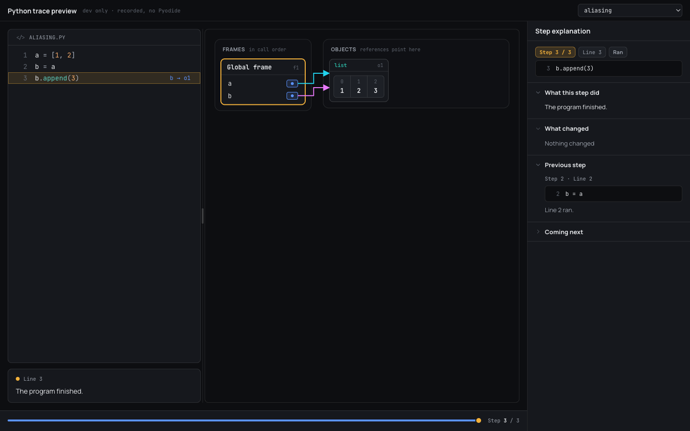
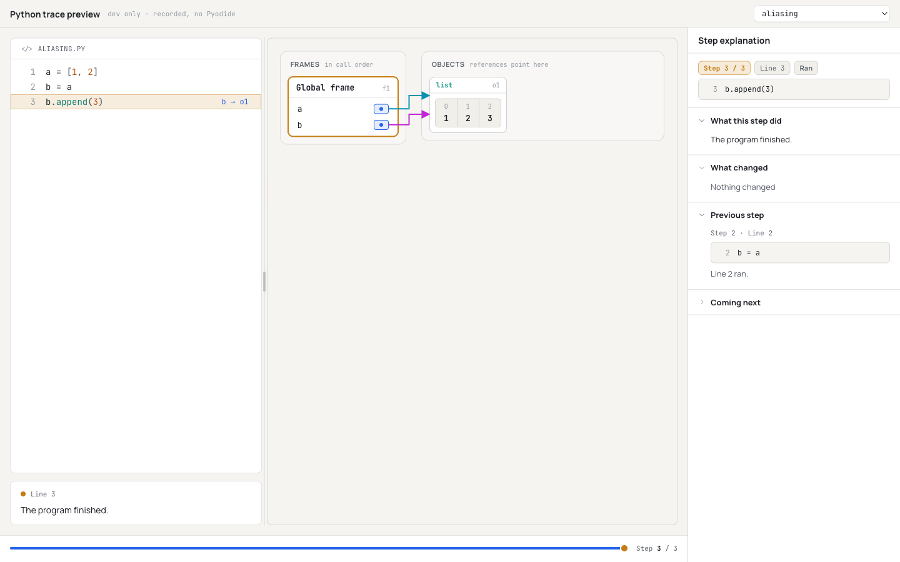
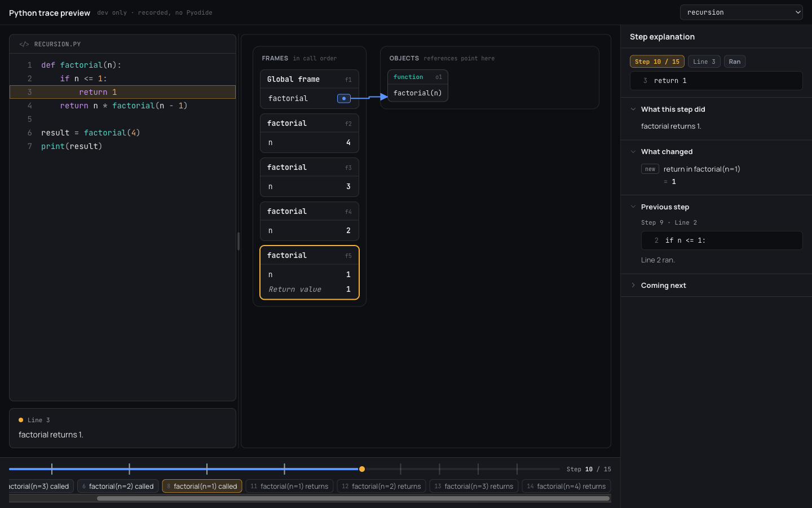
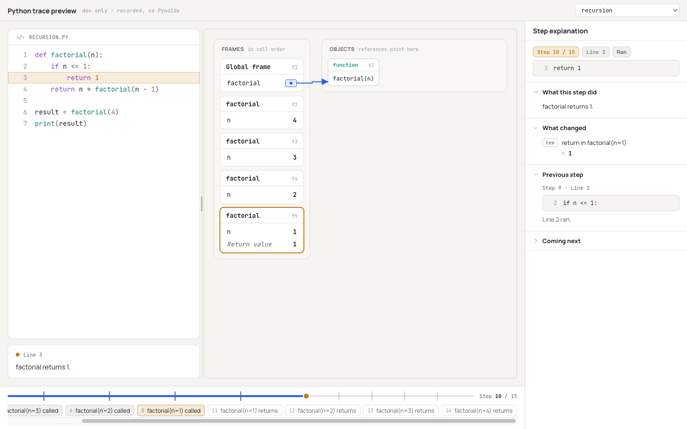
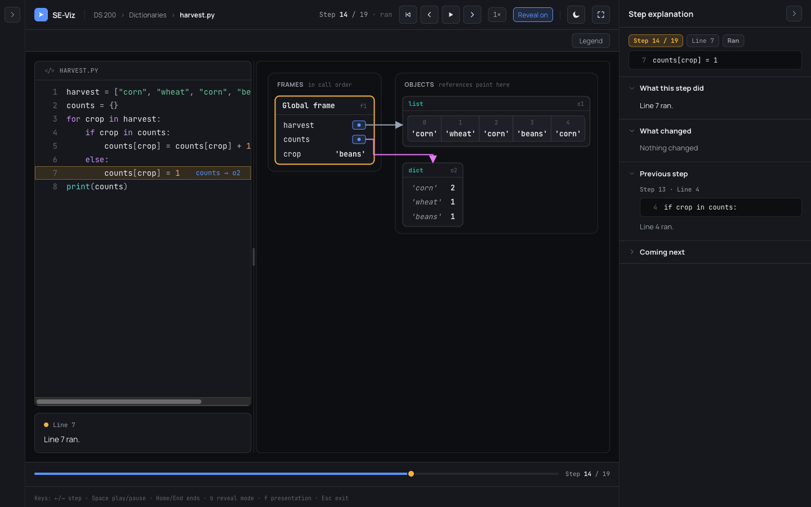
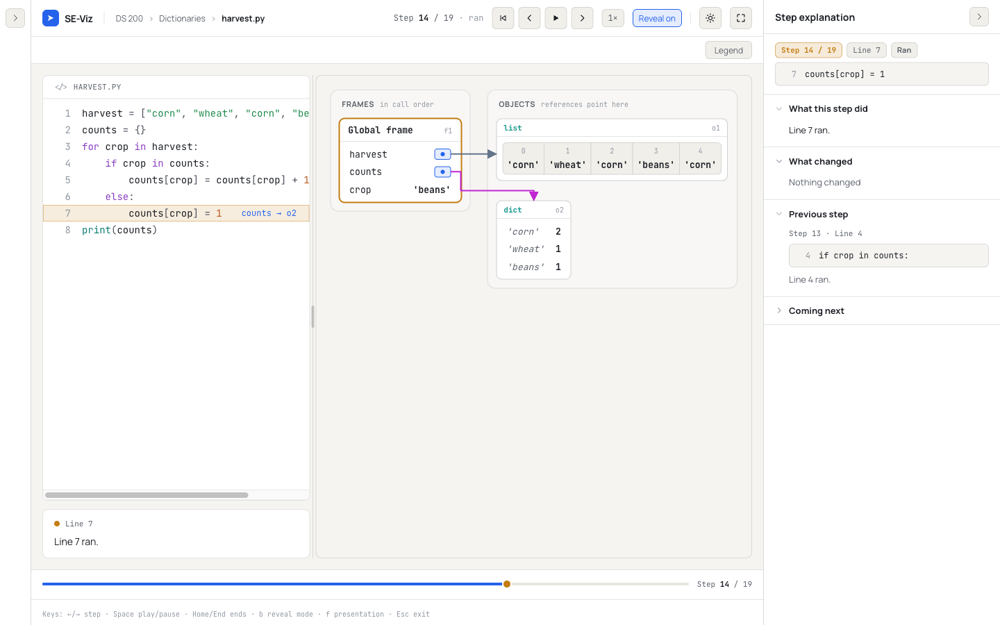
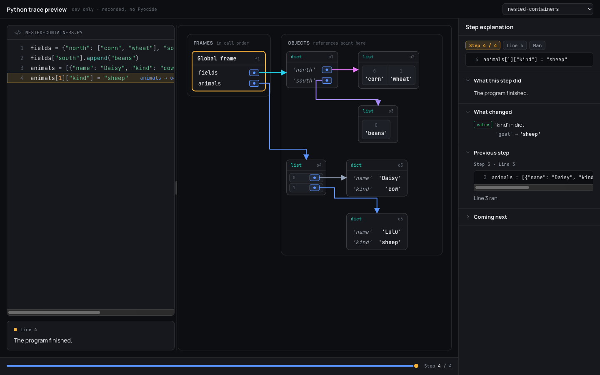
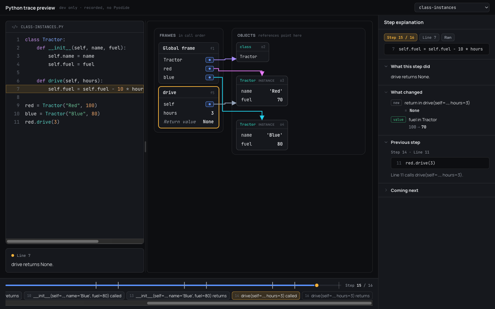
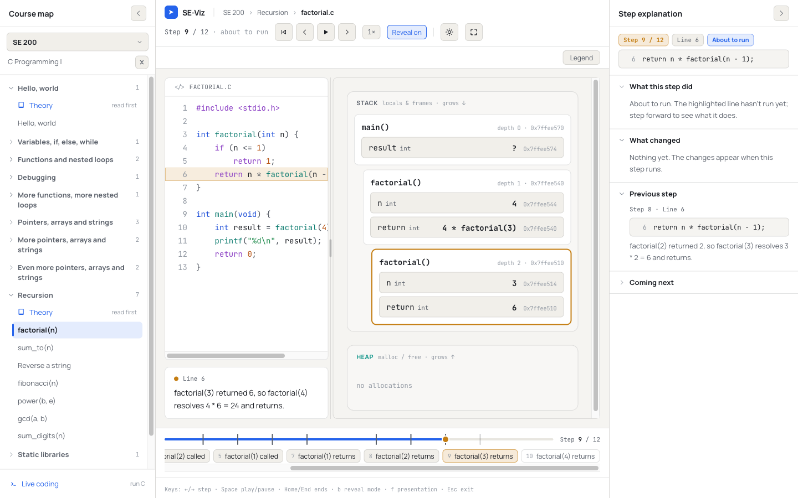

# Phase 30 Report — Python trace contract and renderer (with diff motion)

## 1. Summary

Python traces are now a real part of the trace contract and play in the Studio stage. The type changes are the
additive ones `docs/PYTHON_TRACE_FORMAT.md` specifies:

- `TraceLanguage` gains `'python'`;
- `HeapBlock` gains `objectKind?: PyObjectKind`;
- `StepDiff` gains `kindsChanged`.

`validateTrace` enforces the Python rules. The Phase 29 recordings are committed as mapped traces in
`src/content/fixtures/python/`. The harvest loop is a visible catalog module.

For `language: 'python'` the stage loads a lazily split **Python canvas**:

- frames on the left ("Global frame", then one box per call);
- an objects area on the right, with a body per kind;
- arrows from the shared `ArrowOverlay`.

**Diff motion** comes from a new pure object-level diff (`diffObjects`) between the step shown and the step shown
before it:

- new items slide in, removed items fade out, changed values cross-fade with the green pulse;
- arrows redraw to their new target, and frames push and pop;
- stepping back plays the inverse;
- a jump of more than one step shows the new state without motion;
- `prefers-reduced-motion` turns motion off.

C modules are unchanged.

**Gates on `phase-30-python-renderer`:** `typecheck`, `lint`, `test` (**610/610**, 37 files) and `build` pass. So
does `check-bundle --baseline 742443 --budget 25000`: the main chunk is **764,255 B**, delta **+21,812 B**. The
Python canvas is its own lazy chunk (`PythonCanvas-*.js`, 16.3 KB). **No new dependencies.** The branch is **not
merged and not pushed**. No stop condition was hit.

## 2. What I built

**Contract (`src/engine/trace/`)**
- `types.ts` — `TraceLanguage = 'c' | 'python'`, `PyObjectKind`, and `HeapBlock.objectKind?`, exactly as the
  format doc specifies.
- `diff.ts` — `StepDiff.kindsChanged: { id, from: Cell, to: Cell }[]` and the `KindChange` type. It is always
  empty for C; a test checks every C catalog trace.
- `validate.ts` — Python rules:
  - every block has an `objectKind`;
  - a reference targets an object, never a cell;
  - an object keeps its `objectKind` across steps;
  - a frame id keeps its function name. A frame may leave and come back, as a resumed generator does.
  - It also flags `objectKind` on a non-Python trace. The shared rules (indices, unique ids, references resolve)
    apply as before.
- `src/python/mappings/memory.ts` — imports `PyObjectKind` from `types.ts` and drops the spike-local `PyHeapBlock`
  intersection. A compile-time check keeps the recorder's object kinds and the trace's kinds identical.
- `src/python/toTrace.ts` — `recordingToTrace(result, source, meta)`, the production entry point for a recorded
  run (Phase 31 will use it).

**Object-level diff (`src/engine/trace/objectDiff.ts`)**
- `diffObjects(prev, next)` returns these events:
  - `frame-pushed` / `frame-popped` and `object-created` / `object-released`;
  - `name-bound` / `name-unbound`;
  - `item-added` / `item-removed` (with `index` and `atEnd`; an append is `atEnd`);
  - `value-changed` (a scalar value or a kind change) and `reference-retargeted`;
  - `key-added` / `key-removed` and `attribute-set` / `attribute-deleted`.
- List and tuple items are aligned **by value**: `insert(0, x)` is one `item-added` at index 0, and `pop(0)` is one
  `item-removed` at index 0. When the sequences differ by more than one item, it falls back to positions.
- `invertEvent` / `invertEvents` give the inverse.

**Highlighting**
- `src/engine/highlightPython.ts` uses the same `TokenType` classes as `highlightC.ts`. It covers:
  - keywords, builtin types and exceptions (`type`), builtins and calls (`fn`), `def` names and class names;
  - every string prefix, with f-string / t-string `{fields}` tokenized as code and `!r` / `:fmt` read as string;
  - triple-quoted strings carried across lines;
  - numbers (hex, octal, binary, underscores, exponents, complex), and `True` / `False` / `None` (as `number`,
    like C's `NULL`);
  - comments and decorators (as `preproc`).
- `CodePanel` picks the tokenizer by `trace.language`, and its file fallback reads `.py`. `resolveInlineValues`
  takes an optional `language` so that Python keywords such as `in` are never treated as names.

**Labels and the explanation panel (Phase 29 follow-ups)**
- `labels.ts`:
  - `pythonParams(source, name)` reads parameter names from the `def` line;
  - `frameLabel(frame, source, language = 'c')` gives `factorial(n=3)` (or `…` for a reference parameter) and
    `global frame` for the module. C parsing is unchanged;
  - `indexCells` threads the language through.
- `explain.ts` and `timeline.ts` pass `trace.language`, so "What changed" and the timeline chips read
  `factorial(n=1) called`. `explain.ts` also lists `kindsChanged` rows (`x in global frame: 1 → list`).
- `ExplanationPanel.tsx`: on Python traces an object row says **"object … created"** and **"is no longer
  reachable"**, with `object` / `gone` badges, instead of malloc / free.
- `ConsolePanel` has a `title` prop. Python passes "Output"; the default "Output · heap watch" is unchanged.

**Renderer (`src/components/python/`, lazily loaded)**
- `PythonCanvas.tsx` (default export) wires the parts together:
  - the shared `AnchorProvider`, `MemoryRenderContext` and `ArrowOverlay`;
  - the motion state;
  - the layout.
- `PyViews.tsx` holds the pieces:
  - **`FrameView`:** the header ("Global frame" or the function name, plus the frame id), then name rows with
    primitives inline, references as azure chips (where the arrow starts), and a "Return value" row.
  - **Object box:** a kind label and tag, plus a faint id, so `→ o1` in the inline values maps to a box.
  - **Bodies by kind:**
    - list: indexed cells in a row, or indexed rows when an item is a reference, so arrows leave cleanly;
    - tuple: indexed cells in `( … )` with an "immutable" tag;
    - dict: key → value rows;
    - set and frozenset: unordered chips;
    - instance: the class name with an "instance" tag, then attribute rows;
    - function: `name(params)`; class: its name;
    - summary: type, shape and dtype, marked as a placeholder for Phases 34–35; other: its `repr`.
  - Colour keeps its meaning: references azure, the current element amber, a changed value green. Tokens only.
- `pyLayout.ts`:
  - objects are ordered by first appearance across the trace;
  - an object referenced only from inside other objects sits to the right of its parent, recursively;
  - an object a frame refers to keeps its own row;
  - cycle-only leftovers get a row.
- `pyMotion.ts` is the pure state machine:
  - `initialMotion` / `advanceMotion` remember the shown step and derive events only when the new step is one
    step away;
  - list and tuple **item keys follow the alignment**, so an inserted item gets a fresh React key and the others
    keep theirs;
  - `motionCues` gives the `entering`, `changed`, `retargeted` and `restructured` sets, plus `arrowsKey`, which
    re-mounts the arrows after a jump or under reduced motion so they don't glide.
- `Stage.tsx`: `lazy(() => import('./python/PythonCanvas.tsx'))` is used only when `trace.language === 'python'`,
  inside `Suspense`. The C branch renders `MemoryCanvas` exactly as before.

**Fixtures and module**
- `src/content/fixtures/python/{aliasing, mutation-through-argument, nested-containers, recursion,
  class-instances, harvest, runtime-error, infinite-loop}.json` are data only. `src/python/toTrace.test.ts` writes
  them as file snapshots, so they can't drift from the recordings or the mapping.
- `src/content/fixtures/pythonHarvest.ts` default-exports the module "Python: counting a harvest". It sits in
  Engine fixtures → Python renderer, with breadcrumb `DS 200 › Dictionaries › harvest.py`. It loads the JSON
  through `import.meta.glob`, so no `resolveJsonModule` config change was needed.
- `.prettierignore` gains `src/content/fixtures/python/`.

**Dev-only preview:** `src/python/debug/TracePreview.tsx` at `/?python-preview&trace=<name>`, wired through
`main.tsx`'s DEV-only branch.
- It plays every committed recording in the real `Stage` and `ExplanationPanel`, with the app's keys, and never
  loads Pyodide.
- Production drops it: no `python-preview` string appears in `dist/`.

**Docs**
- `docs/TRACE_FORMAT.md`: a Python section covering the types, cell ids, validation rules, `kindsChanged`, the
  object diff, rendering and fixtures. The `language` row is updated.
- `docs/CONTENT_AUTHORING.md`: "Python modules".

**Tests (+100: 98 written, plus 2 from the catalog-wide `catalog.test.ts` / `stage.render.test.tsx` loops picking up the harvest module):**
- `validatePython.test.ts` (11);
- `objectDiff.test.ts` (38: every kind forwards and backwards, plus an exact-inverse check over every adjacent
  pair of every recording);
- `highlightPython.test.ts` (10);
- `pythonLabels.test.ts` (6) and `toTrace.test.ts` (9);
- `PythonCanvas.test.tsx` (7, including 4 `renderToStaticMarkup` snapshots: aliasing, nested containers,
  recursion, instance) and `pyMotion.test.ts` (15);
- additions to `diff.test.ts` (1) and `candidates.test.ts` (1).

## 3. Acceptance criteria — self-assessment

- [x] **1. Gates pass; no new dependency; type changes are additive, documented, and match
  `docs/PYTHON_TRACE_FORMAT.md`.**
  - All five gates pass (§4).
  - `package.json` and the lockfile are untouched.
  - The type changes are exactly the three in the doc, and C traces never set them.
  - Documented in `docs/TRACE_FORMAT.md` and the TSDoc.
- [x] **2. All Phase 29 samples render correctly: aliasing shows two arrows to one box, mutation changes the same
  box, recursion pushes and pops frames.**
  - Aliasing: `PythonCanvas.test.tsx` checks anchors `f1, f1.a, f1.b, o1` and the values 1 2 3 in the one list.
    See the screenshots.
  - Mutation: `b.append(3)` diffs as `item-added` on `o1` (`objectDiff.test.ts`, "aliasing: …"), and nested
    `animals[1]["kind"]` changes inside `o6`.
  - Recursion: 4 pushes and 4 pops (test); 5 frames in call order with the top one current (render test).
  - Every step of every recording renders without throwing (test). I looked at aliasing, recursion, harvest,
    nested containers and class instances in the browser.
- [x] **3. Motion plays forward and in reverse for every event kind; reduced motion disables it.**
  - **Pure part:** every event kind and its inverse is tested. `pyMotion.test.ts` covers forward, back (equal to
    `invertEvents`), a jump (no events, arrows re-mount), two-beat (arrive shows the pre-state with no events;
    apply plays; back plays the inverse), and reduced motion (`animate` false; changes still marked).
  - **In the browser** I sampled computed styles frame by frame:
    - a dict key slides in (x −14 → 0, opacity 0 → 1, ~250 ms) and, on step back, fades out (x → +10, then
      removed);
    - `corn` 1 → 2 cross-fades with the green background fading out over ~0.9 s;
    - a popped recursion frame fades out over ~240 ms;
    - Home removes the frames within two animation frames (no motion).
  - **Not exercised in a browser:** set add, attribute delete, and list insert in the middle. None of the
    recordings has them, so they are covered by the pure tests only.
  - **Reduced motion:** `useReducedMotion()` gives `animate: false`, so there are no enters, exits, cross-fades
    or glides, and a changed value is shown green statically.
- [x] **4. Both themes look right.** See the screenshots below (aliasing, recursion and harvest in dark and light,
  plus nested containers and instances in dark). Tokens only.
- [x] **5. C modules are visually and behaviorally unchanged.**
  - Every existing test and the existing snapshot pass unchanged.
  - All C-path changes are behind `language === 'python'` or defaulted parameters.
  - The factorial screenshot matches Phase 28: "Stack / Heap · malloc / free", `factorial(3)` labels and chips.

## 4. How to run & verify

```sh
npm ci
npm run typecheck && npm run lint && npm test && npm run build
node scripts/check-bundle.mjs --baseline 742443 --budget 25000
# → main chunk index-DBm_xfcG.js: 764255 B; delta +21812 B (budget 25000 B); ✓
npm run dev
```

1. Open **Engine fixtures → Python renderer → Python: counting a harvest** and step with →.
   - At "counts[crop] = 1" a key slides into the dict on the apply beat.
   - At "counts[crop] = counts[crop] + 1" the value cross-fades with the green pulse.
   - ← plays the inverse; Home / End jump without motion.
2. Open `http://localhost:5173/?python-preview&trace=aliasing` (also `recursion`, `nested-containers`,
   `class-instances`, `mutation-through-argument`, `runtime-error`, `infinite-loop`). It shows the same stage with
   the explanation panel, and uses no Pyodide.
3. In the OS, turn on "reduce motion": stepping then changes the canvas instantly, and a changed value is shown in
   green.

## 5. Key decisions & deviations

1. **The renderer is a new presentation component, not "no new renderer" (CONFLICT NOTED; data shapes follow the
   doc).**
   - `PYTHON_TRACE_FORMAT.md` says candidate A needs "no new renderer, presentation tweaks keyed on
     `objectKind`". The prompt asks for a renderer with a body per kind, a "Global frame", object layout rules and
     diff motion.
   - The doc is binding on **data shapes**, and I followed it exactly; the data is plain candidate-A `Step`s. The
     presentation follows the prompt.
   - `PythonCanvas` reuses the shared pieces: `ArrowOverlay`, the anchor registry, `MemoryRenderContext`,
     `diffSteps` / `pointersByTarget`, the code panel, the explanation panel and the timeline. It is lazy-loaded so
     the C path and the main chunk stay as they were.
   - Because Python traces never reach `MemoryCanvas` / `HeapBlockView` in the app, the doc's suggested tweaks to
     those two files (the badge, "malloc / free" captions) were **not** made. The Python canvas has its own
     captions ("Frames · in call order", "Objects · references point here") and no allocation badge.
   - The Phase 29 debug page's spike panes still use `MemoryCanvas` and so still show C chrome. They are dev-only.
2. **Motion is "what changed since the step on screen", not "since the previous logical step".** The canvas keeps
   the last shown step in state. Moving by exactly one step or beat diffs the two, so step back is the inverse
   naturally. A jump (more than one step: scrub, Home / End, a timeline chip) shows the new state at once.
   - Two-beat stepping falls out of this: arrive shows the pre-state, which is already on screen, so nothing moves
     until apply.
   - The C canvas instead pulses against `displayPrevStep`. For Python I didn't reuse that, because it can't
     express "inverse on step back".
3. **List items are aligned by value.** The doc notes that positional ids make `insert(0, x)` look like a change
   on every index. `diffObjects` aligns a one-item insert or remove, and the React keys follow it, so the new item
   slides in and the others slide over. Cell ids are unchanged (still positional, per the doc).
4. **Arrow routing: frames and objects side by side, with wide gaps between inner objects.**
   - My first layout stacked objects under frames. `ArrowOverlay`'s rail routing then cut through object boxes.
   - I moved to a Python Tutor-style side-by-side layout. The canvas grows sideways and the panel scrolls rather
     than stacking.
   - I also widened the gaps between nested objects (48 px across, 40 px down) so the overlay's lanes stay in
     clear space.
   - `ArrowOverlay` itself is untouched.
5. **A framer-motion detail (fixed in `PyViews.tsx`).** Under `AnimatePresence initial={false}`, framer blocks the
   initial animation of every motion element mounted later *inside* an existing child. The value cross-fade
   therefore didn't play at first; I found this by sampling styles in the browser. The cross-fade now sits in its
   own `PresenceContext` scope.
   - **Possibly relevant to C (not verified, not changed):** `MemoryCanvas`'s `PulseValue` sits inside
     `StackFrame` under the same kind of `AnimatePresence initial={false}`, so the C value pulse may be blocked the
     same way. I didn't touch the C path. Worth a look in a later phase.
6. **The objects area shows faint object ids (`o1`).** They tie the inline values (`b → o1`, which the shared
   inline resolver prints) to the boxes. Python Tutor shows no ids.
7. **`frameLabel` / `indexCells` gained an optional `language` parameter (default `'c'`)** rather than guessing the
   language from the source. Python labels use keyword form, `factorial(n=3)`, as the doc asks, with `…` for a
   reference parameter.
8. **The Python wording in the explanation panel** ("object … created", "no longer reachable") handles the Phase 29
   follow-up about C wording.
   - **Not done:** "What changed" still doesn't list cells added *inside* an existing object, such as `b.append(3)`
     or a new dict key. The format doc assigns that to Phase 32 (derived explanations), so the panel says "Nothing
     changed" there. The canvas animates it.
9. **The harvest module is in Engine fixtures → "Python renderer"**, like the C renderer primitives.
   - Its breadcrumb says `DS 200 › Dictionaries`. "DS 200" is from the roadmap's decisions, not invented, but
     `docs/CURRICULUM.md` doesn't list DS courses yet.
   - DS 200 content proper is Phase 33.
10. **The syntax-error sample has no committed trace** (no steps). A test covers that it maps to zero steps.
11. **Dev-only preview page.** I added `/?python-preview` because the required aliasing and recursion screenshots
    (and a reviewer's check) need those traces in the real stage, and only harvest is a catalog module. Registering
    more modules would exceed the prompt's "one visible module", and would cost about 10 KB of main chunk. The page
    is DEV-only and verified absent from `dist/`.
12. **Bundle.**
    - The main chunk delta is +21,812 B. About **17.5 KB is the harvest trace data** (19 full-state steps); the
      rest is the contract, validation, highlighter and label changes.
    - The renderer, layout, motion and object diff are in the lazy `PythonCanvas` chunk.
    - **Headroom is about 3.2 KB.** Phase 33's Python modules will need their own budget, or lazy data.
13. **Existing tests changed (type-only or additive):**
    - `candidates.test.ts`: the `PyHeapBlock` import and three `(b as PyHeapBlock)` casts are gone (the type was
      dropped as the doc requires), and one test was added. The Phase 29 "known gap" test is unchanged and still
      passes. Its assertions stay true: `valuesChanged` and `pointersRetargeted` are still empty, and the new
      `kindsChanged` field is what reports the rebind.
    - `diff.test.ts`: one test added.

## 6. Trace format / API notes

```ts
type TraceLanguage = 'c' | 'python';
type PyObjectKind = 'list'|'tuple'|'set'|'frozenset'|'dict'|'instance'|'function'|'class'|'summary'|'other';
// HeapBlock.objectKind?: PyObjectKind   (every block of a Python trace; never on C)
// StepDiff.kindsChanged: { id: CellId; from: Cell; to: Cell }[]   (always [] on C)
```

- `diffObjects(prev, next): PyEvent[]`, `invertEvent`, `invertEvents` (`src/engine/trace/objectDiff.ts`). The
  event kinds are listed in §2.
- `recordingToTrace(result, source, { id, title, file? }): Trace` (`src/python/toTrace.ts`).
- `pythonParams(source, name)`, `frameLabel(frame, source, language?)`, `indexCells(step, source, language?)`.
- `resolveInlineValues({ …, language? })` and `ConsolePanel({ step, title? })`.
- `tokenizePython(source): Token[][]` and `tokenizePythonLine(line, state?)`.
- Python canvas internals (`advanceMotion`, `motionCues`, `layoutObjects`) are not shared API.

## 7. Known issues / follow-ups

- **"What changed" misses additions inside an object** (`append`, a new key). This is Phase 32, per the format
  doc.
- **At 1440 px with both side panels open, wide objects scroll sideways** in the viz panel. The harvest list needs
  the course map collapsed to fit; the harvest screenshots are taken that way. It is the same narrowness Phase 28
  noted for C.
- **Arrow lanes are global in `ArrowOverlay`.** A trace with many off-level references (more than 3–4 in one step)
  can still route a lane through a box. A smarter, Python-aware router would fix that; it is left out to keep
  `ArrowOverlay` and the C path untouched.
- **Positional fallback.** A step that changes a list in more than one place (or by more than one item) animates
  position by position.
- **Not exercised in a browser:** a set member added, an attribute deleted and a mid-list insert. None of the
  recordings has them; the pure tests cover them.
- **Unverified:** a possible C pulse suppression by `AnimatePresence initial={false}` (§5, item 5).
- Bundle headroom is about 3.2 KB (§5, item 12).
- The Playwright MCP wrote its page / console logs under `../.playwright-mcp/`, outside the repo. I left them
  there.

## 8. File map

```
src/engine/trace/types.ts, diff.ts, validate.ts            (changed — contract)
src/engine/trace/objectDiff.ts                             (new — object-level diff + inverses)
src/engine/trace/labels.ts, explain.ts, timeline.ts, inlineValues.ts (changed — Python labels/tokenizer)
src/engine/highlightPython.ts                              (new)
src/engine/trace/pythonTestKit.ts                          (new — test-only builders)
src/components/python/PythonCanvas.tsx, PyViews.tsx, pyLayout.ts, pyMotion.ts (new, lazy chunk)
src/components/Stage.tsx, CodePanel.tsx, ConsolePanel.tsx, studio/ExplanationPanel.tsx (changed)
src/python/toTrace.ts                                      (new)
src/python/mappings/memory.ts                              (changed — PyObjectKind from types.ts)
src/python/debug/TracePreview.tsx, src/main.tsx            (new / changed — dev-only preview)
src/content/fixtures/python/*.json                         (new — 8 mapped recordings, data only)
src/content/fixtures/pythonHarvest.ts                      (new — the visible module)
.prettierignore                                            (changed — fixtures/python)
docs/TRACE_FORMAT.md, docs/CONTENT_AUTHORING.md            (changed)
tests: engine/highlightPython.test.ts, engine/trace/{objectDiff,validatePython,pythonLabels}.test.ts,
       components/python/{PythonCanvas.test.tsx (+ __snapshots__), pyMotion.test.ts},
       python/toTrace.test.ts (new); engine/trace/diff.test.ts, python/mappings/candidates.test.ts (changed)
reports/phase-30-python-renderer.md, reports/assets/phase30-*.png
```

**Snapshots changed:** none of the existing ones. `src/components/__snapshots__/Diagram.test.tsx.snap` is
untouched. New: `src/components/python/__snapshots__/PythonCanvas.test.tsx.snap` (4 entries). Tests went from 510
to 610.

### Screenshots

Aliasing, final step: two names, two arrows into one list, mutated in place.




Recursion, step 10 of 15 ("factorial returns 1"): five frames in call order, the top one current, and its return
value.




Harvest loop (the catalog module), mid-trace, course map collapsed:

- dark: step 14 of 19, `counts[crop] = 1` (a key added);
- light: the same step, after `'beans'` was added.




Extra checks: nested containers (inner objects beside their parent), class instances, and a C module unchanged.




