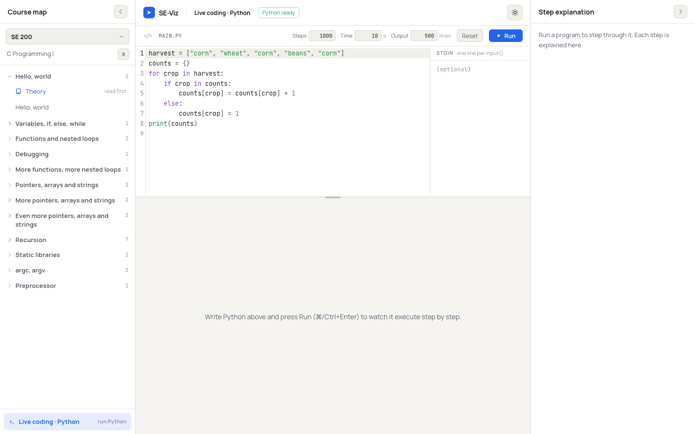
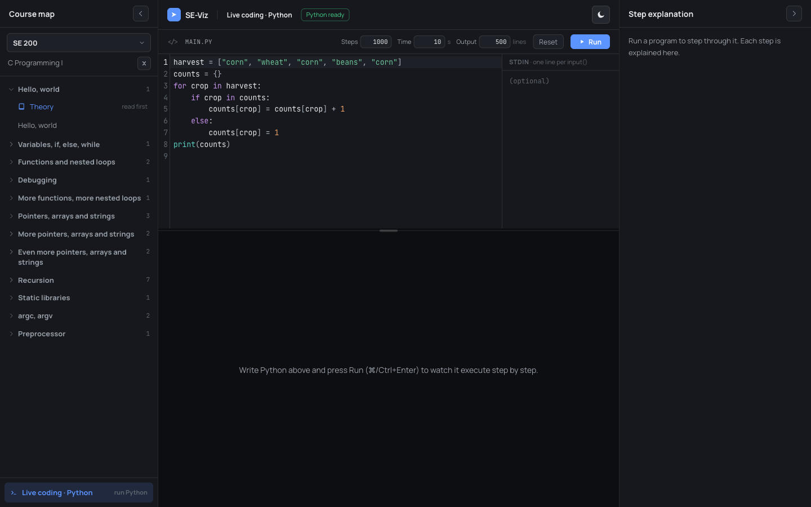
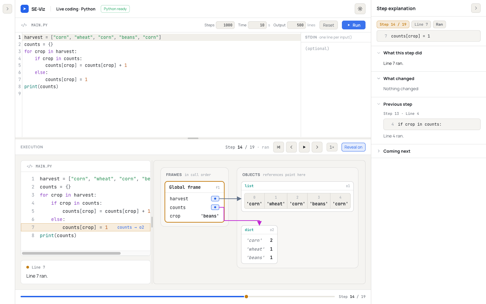
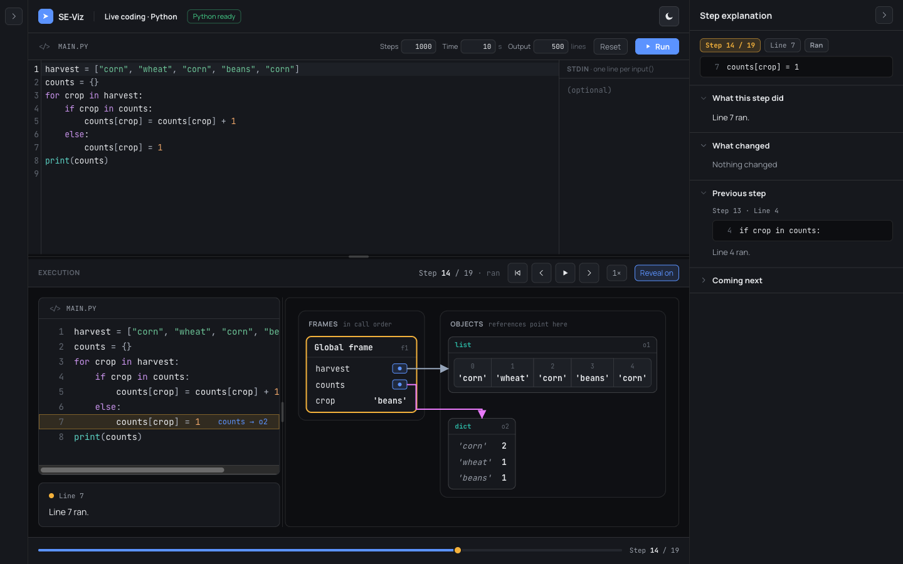
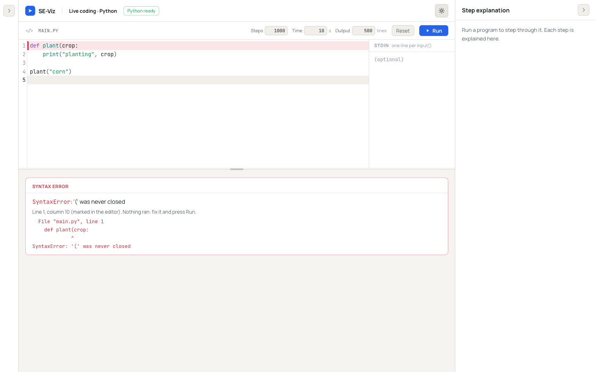
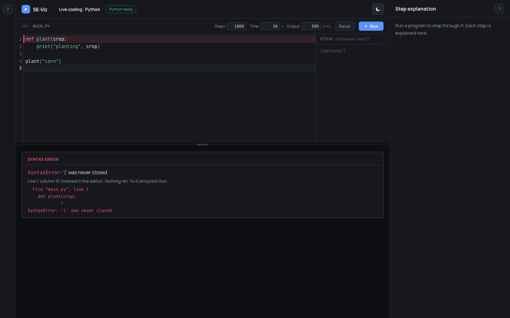
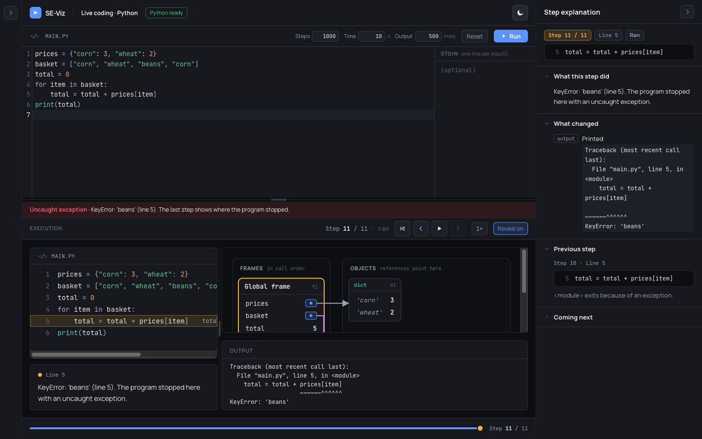
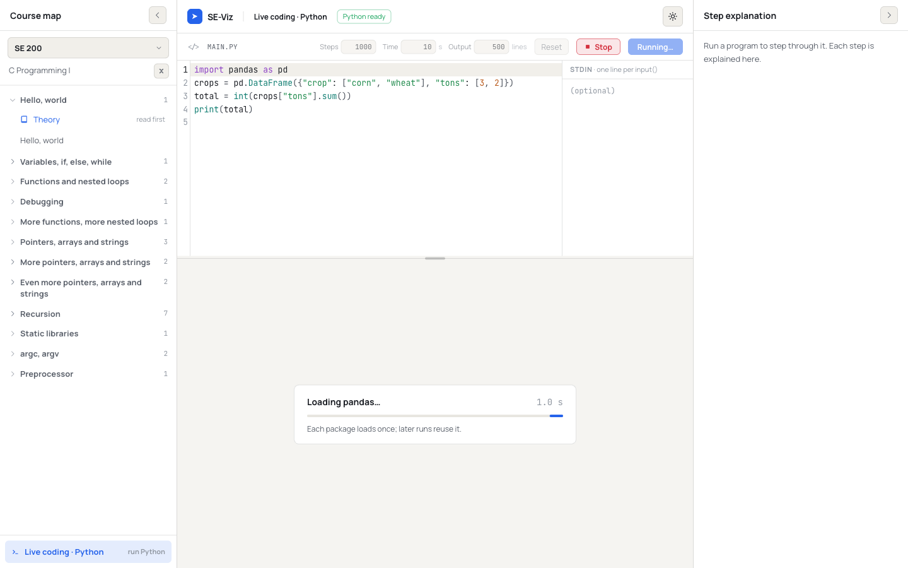

# Phase 31 Report — Python live coding (fully in the browser)

## 1. Summary

A presenter can now open **Live coding · Python** from the course map, type Python, press **Run**
(or ⌘/Ctrl+Enter), and step through the run in the normal player, with the step explanation panel.
Everything runs in the browser: Pyodide in a Web Worker, the Phase 29 recorder, and the Phase 30
mapping and renderer. There is no backend, so unlike C live coding the entry is always present and
ships in production.

**What the mode does:**
- **Preload.** Pyodide starts loading as soon as the mode opens, with a progress card and a header
  chip ("Loading Python…" → "Python ready").
- **Packages on demand.** Imports of numpy, pandas, matplotlib or scipy load those packages once per
  worker, with a visible "Loading pandas…" status.
- **Input and output.** A stdin box feeds `input()`, one line per call. Output appears in the
  console panel per step.
- **Limits.** Steps (default 1000, max 5000), wall clock (default 10 s) and output lines. **Stop**
  terminates the worker; the next Run recreates it.
- **Errors.** A syntax error marks its line in the editor and shows the message with no trace. A
  runtime exception ends the trace on an extra step with the type, message, line and traceback.
  Every truncation ends on "Stopped after N steps: <which limit>".
- **Persistence.** The editor text, stdin and limits survive reloads. **Reset** restores the default
  program (the DS 200 harvest loop).

**Phase 29 follow-ups handled here:**
- **A killed run no longer loses its steps.** Snapshots stream out of the worker as they are taken.
- **Traces are bounded.** There is a total-size budget (`maxTraceChars`), and live runs use a
  100-frame recursion cap.
- **A swallowed stop is reported.** When a bare `except:` swallows the recorder's stop, the kill
  path keeps the steps and names the cause.

**C live coding** keeps its behavior, its `VITE_TRACER_URL` gating and its UI. §5 lists the small
shared-code changes this needed.

**Gates on `phase-31-python-live-coding`:** `typecheck`, `lint`, `test` (**682/682**, 40 files) and
`build` pass. `check-bundle --baseline 764255 --budget 25000` also passes: the main chunk is
**765,413 B**, delta **+1,158 B**.

**Dependency:** exactly one new one, `@codemirror/lang-python@6.2.1`, exactly pinned. The branch is
**not merged and not pushed**. No stop condition was hit.

## 2. What I built

**Dependency**
- `@codemirror/lang-python` **6.2.1** (published 2025-05-14), exact pin.
- Its new transitive packages are `@lezer/python@1.1.19` (2026-05-28) and
  `@codemirror/autocomplete@6.20.3` (2026-06-03). Both are well over two weeks old.
- `npm ls` shows a single `@codemirror/state@6.6.0`, `@codemirror/view@6.43.1`,
  `@codemirror/language@6.12.3` and `@lezer/common@1.5.2`, all deduped.

**Runner (`src/python/`): preload, Stop, streaming, size budget, package status**
- **`recorder.py`:**
  - each snapshot is serialized as it is taken;
  - the final JSON is joined from those strings, so nothing is serialized twice;
  - a new `maxTraceChars` budget (default 8,000,000) stops a run with `truncated: 'size'`;
  - with an `on_chunk` callback, every snapshot is handed to the host at once;
  - when the recorder stops a program, it sends an empty chunk carrying the reason (`steps`, `time`,
    `size`, `stdout` or `depth`).
- **`protocol.ts`** (additive):
  - `RunLimits.maxTraceChars` and `Truncation | 'size'`;
  - `WorkerLoad` / `WorkerMessage`;
  - the `packages` and `steps` responses, `running.loaded`, and `RecorderStop`.
- **`session.ts`:** `run(request, onChunk?)`.
- **`worker.ts`:**
  - a `load` message boots Pyodide without running anything;
  - the packages to load are the request's `packages` plus Pyodide's own `find_imports` on the
    source, restricted to the allow-list;
  - only packages not loaded yet are announced (`packages`) and loaded; each is imported once,
    untraced, with matplotlib on the `Agg` backend;
  - streamed snapshots go out as `steps` messages.
- **`client.ts` (`PythonRunner`):**
  - one dispatcher per worker, with `preload()`, `stop()`, `ready` and `loadedPackages`;
  - run hooks `onPackages`, `onRunning` and `onProgress` (throttled to one call per 100 ms, with a
    trailing call);
  - a run killed at the time limit, or stopped, resolves with the streamed steps, plus
    `stopped` / `recorderStop`.

**Python live coding (pure, `src/python/live/`)**
- `config.ts`: `LIVE_PYTHON_ID = 'live-python'`. This is the only module the main chunk imports.
- `defaultProgram.ts`: the harvest loop (`samples/harvest.py?raw`).
- `packages.ts`: `detectPackages(source)` and `packageList()` ("numpy and pandas").
- `limits.ts`: `LiveLimits`, ranges and defaults, `clampLimit`, `parseStoredLimits`, and
  `toRunLimits` (which adds `maxDepth: 100`).
- `input.ts`: the `localStorage` keys and `stdinLines()`.
- `outcome.ts`: `mapOutcome(outcome, source, limits, id)` returns one of three things:
  - `trace` (with `ending: exception | stopped | null`);
  - `error` (no trace);
  - `stopped`.

  It also exports the headline helpers, plus `displayTraceback()` (`<student>` → `main.py`).
- `runState.ts`: `pyRunReducer`.
  - Phases: `idle`, `loading-runtime`, `loading-packages`, `running`, `done`, `error`, `stopped`.
  - The runtime is tracked separately (`cold`, `loading`, `ready`), with `inFlight` and `seq`.
  - Helpers: `canRun` and `canStop`.
- `runner.ts`: a module-level `PythonRunner`, so leaving the mode and coming back keeps the loaded
  Pyodide and packages.

**UI**
- `src/components/live/PythonLiveView.tsx` (lazy):
  - **header:** "Live coding · Python" and the runtime chip;
  - **editor card:** `main.py`; Steps / Time / Output fields, clamped on blur or Enter; Reset;
    Stop; Run;
  - **editor body:** the CodeMirror editor beside a stdin column;
  - a draggable split;
  - **result area:** a status card (indeterminate bar and elapsed timer), the error panel, an ending
    banner, or the player (`Stage`, `Transport`, presentation mode);
  - **explanation column:** the player portals `ExplanationPanel` into the Studio's right-hand slot;
    before a run, a placeholder.
- `src/components/live/pythonLanguage.ts`:
  - `python()`, plus a small highlight style for the Python tags the shared style doesn't color;
  - `True` / `False` / `None` use the number color and class names the type color, matching
    `highlightPython.ts`.
- `CodeEditor.tsx` changes:
  - the language is now a prop (`language`, plus optional `extensions` and `ariaLabel`);
  - an optional `errorLine` draws a danger-tinted line decoration.
- `LiveCodingView.tsx` passes `cpp()` (one constant). Nothing else changed.
- `App.tsx`:
  - the `live-python` selection renders the lazy view in `Suspense`;
  - it keeps the explanation panel (`hasPlayer` is true for it).
- `ContentSidebar.tsx`: the pinned bottom section always shows the Python entry, and still shows the
  C entry only when `liveCodingEnabled`.
- `ConsolePanel.tsx`: an optional `preserveWhitespace` prop, set by `Stage` for Python traces only, so
  a traceback's `^^^` markers line up.
- `index.css`: the indeterminate progress bar (static under reduced motion).

**Bundle check (`scripts/check-bundle.mjs`, additive check 5)**
- A worker chunk with the Pyodide loader must exist, so check 4 is no longer vacuous.
- The main chunk must not name that worker chunk.
- `@codemirror/lang-python` markers must stay out of the main chunk. The markers are a Lezer node
  name, `DictionaryComprehensionExpression`, and a lang-python snippet.
- The chunk that has lang-python must be lazy (no static import from main) and must not be the C
  editor's chunk.
- At least one chunk must contain lang-python, so a renamed marker can't make the check pass
  silently.
- Sanity-checked on a scratch copy of `dist/`: each of these four failures trips:
  - a marker injected into main;
  - the worker name in main;
  - the worker chunk deleted;
  - lang-python inside a `LiveCodingView-*` chunk.

**Tests (+72; 610 → 682)**
- `src/python/live/live.test.ts` (54):
  - package detection: 11 positive, 8 negative, the default program and the samples;
  - limits;
  - `stdinLines`;
  - `mapOutcome` on the Phase 29 recordings (normal, syntax, runtime, step / time / output / size
    truncation, Stop with and without steps, a kill with and without steps, a swallowed stop,
    recursion, an empty program), with `validateTrace` on the traces;
  - every reducer transition, and stale actions.
- `src/python/clientLive.test.ts` (9): preload (ok, failure, timeout, Stop), hooks and
  `loadedPackages`, Stop mid-run keeping the streamed steps, a time-limit kill keeping steps plus
  `recorderStop`, Stop on an idle warm worker, and progress throttling.
- `src/python/recorder.test.ts` (+5, real Pyodide):
  - streaming equals the final steps, with the reason on the last chunk;
  - streaming doesn't change any sample's result;
  - a swallowed stop is still streamed;
  - the size budget stops a run;
  - recursion at 100 frames stays under 2 M characters.
- `src/components/live/pythonLive.markup.test.tsx` (4):
  - the Python entry is always present and the C entry gated;
  - the Python entry is marked current when selected;
  - the view shell has its parts and restores the stored stdin and the clamped limits.

## 3. Acceptance criteria — self-assessment

- [x] **1. Gates pass; only `@codemirror/lang-python` added, exactly pinned; bundle assertions
  hold.**
  - All five gates pass (§4).
  - `package.json` gains only `"@codemirror/lang-python": "6.2.1"`.
  - check-bundle confirms Pyodide only in `worker-*.js` (43 KB) and lang-python only in
    `PythonLiveView-*.js` (80 KB). Both are lazy.
  - Main chunk +1,158 B.
- [x] **2. In a production build (`npm run build && npm run preview`), Python live coding works with
  no env vars set; C live coding stays hidden without `VITE_TRACER_URL`.**
  - Verified in Chrome through the Playwright MCP against `vite preview` of a production build made
    with an **empty `envDir`**. See §5, item 1: the repo has a git-ignored `.env.local` that sets
    `VITE_TRACER_URL`.
  - In that build `tracerConfig()` compiles to `return null`.
  - The course map shows only "Live coding · Python"; there is no C entry.
  - The only network origins were the app and `cdn.jsdelivr.net/pyodide/v314.0.7/full/`.
  - The only console error was the pre-existing `favicon.ico` 404.
  - Conversely, the normal gate build (which reads `.env.local`) shows both entries. There, C live
    coding opens with its C editor, default program and Options, and no explanation panel, as
    before.
- [x] **3. The eight Phase 29 samples typed into the editor behave correctly, including the error
  cases and the infinite loop (stopped cleanly, app stays responsive).** All eight were typed into
  the editor of the env-free build:

  | Sample | Result |
  |--------|--------|
  | 1 aliasing | 3 steps |
  | 2 mutation through an argument | 6 steps, output `['corn', 'wheat']` |
  | 3 nested containers | 4 steps; "What changed" shows `'kind' in dict 'goat' → 'sheep'` |
  | 4 recursion | 15 steps, output `24` |
  | 5 class instances | 16 steps, `fuel` 70 |
  | 6 harvest (default program) | 19 steps, `{'corn': 3, 'wheat': 1, 'beans': 1}` |
  | 7a runtime error | 11 steps; the last says "KeyError: 'beans' (line 5). The program stopped here with an uncaught exception."; red banner; traceback in Output |
  | 7b syntax error | No trace; "SyntaxError: '(' was never closed — Line 1, column 10"; line 1 marked in the editor |
  | 8 infinite loop | 1000 steps, the last "Stopped after 999 steps: the step limit (1000) was reached."; amber banner |

  - The step counts match the Phase 29 recordings.
  - **Responsiveness:** while a hanging program ran, a 50 ms timer loop on the main thread saw at
    most 2–5 ms of lag.
  - **Kill path:** `sum(itertools.count())`, which the tracer can't see, was killed at the time
    limit plus 1 s. Its 2 steps before the hang were kept: "Stopped after 2 steps: the time limit
    (3 s) was reached".
  - **Swallowed stop:** a bare `except:` swallowing the step-limit stop, then looping untraced, was
    killed. It kept its 999 steps, and the banner says the program caught the stop.
  - **Stop button:** ended a hanging run ("Stopped after 2 steps: you pressed Stop"). The next Run
    rebooted a fresh worker.
  - Also checked: `input()` with stdin "Ada / corn" printed `Farmer? Ada`, `Crop? corn` and
    `Ada grows corn`.
  - Also checked: ⌘/Ctrl+Enter runs; Reset restores the default program; text, stdin and limits
    survive a reload.
- [x] **4. A program importing pandas loads it once and runs; a second run does not reload it.**
  - **First run:** the network shows `pandas-3.0.2`, `numpy-2.4.6`, `python_dateutil`, `six` and
    `pytz` wheels, each fetched once. On a fresh page the status sequence was "Loading Python
    (Pyodide 314.0.7)…" → "Loading pandas…" → "Running…".
  - **Second run:** **no new requests**, and a mutation observer saw only "Running…", with no
    "Loading pandas…".
  - The trace has 4 steps; the DataFrame is shown as a summary box (Phases 34–35 replace it); the
    output is `5`.
- [x] **5. Both themes; screenshots of editor, a running trace, and an error state in the report.**
  - See below. Each one was reviewed.
  - Two visual problems found that way were fixed:
    - the traceback's caret line collapsed (fixed with `preserveWhitespace`);
    - the running card read "1 steps" and showed a stale count (wording fixed, plus a trailing
      progress update).

## 4. How to run & verify

```sh
npm ci
npm run typecheck && npm run lint && npm test && npm run build
node scripts/check-bundle.mjs --baseline 764255 --budget 25000
# → main chunk index-*.js: 765413 B; delta +1158 B; lazy worker-*.js and PythonLiveView-*.js listed; ✓
```

**Production check with no env vars.** The repo's `.env.local` sets `VITE_TRACER_URL`. Build with an
empty `envDir`, without touching that file:

```sh
mkdir -p /tmp/emptyenv
cat > /tmp/vite.noenv.mjs <<EOF
import base from '$PWD/vite.config.ts';
export default { ...base, root: '$PWD', envDir: '/tmp/emptyenv' };
EOF
npx vite build --config /tmp/vite.noenv.mjs --outDir /tmp/dist-noenv --emptyOutDir
npx vite preview --config /tmp/vite.noenv.mjs --outDir /tmp/dist-noenv
```

Or temporarily rename `.env.local`.

**Then:**
1. The course map's bottom section shows only **Live coding · Python**. Open it; the chip turns
   "Python ready".
2. Press **Run** (or ⌘/Ctrl+Enter), then step with ←/→ in the player. The explanation panel follows.
3. Type `def f(x:` and run. Line 1 turns red, and an error panel appears with no player.
4. Run `day = 0` / `while True: day += 1`. It ends on "Stopped after 999 steps".
5. Run `import pandas as pd` (plus anything) twice. The first run shows "Loading pandas…"; the second
   doesn't, and DevTools → Network shows no new wheel requests.
6. Run `import itertools; sum(itertools.count())` and press **Stop**. The run ends and the next Run
   reloads Python.

## 5. Key decisions & deviations

1. **The production check needed an env-free build (environment note).**
   - `se-viz/.env.local` is git-ignored and sets `VITE_TRACER_URL=/tracer-api`, so a plain
     `npm run build` on this machine *shows* C live coding.
   - To check "no env vars" honestly, I built into the scratch dir with `envDir` pointed at an empty
     folder (§4). The user's file was not touched.
   - **The gate numbers** (765,413 B) come from the normal `npm run build`, as the baseline did. The
     env-free main chunk is 765,301 B.
2. **Packages: a TS detector plus `find_imports`, not a raw `loadPackagesFromImports` (small
   deviation).**
   - `loadPackagesFromImports` would load *any* Pyodide package the code imports, not just the
     Phase 29 allow-list.
   - It also can't drive a "Loading pandas…" status before the worker starts.
   - So the main thread predicts from the source (`detectPackages`, tested) and the worker
     double-checks with Pyodide's own `find_imports` (what `loadPackagesFromImports` uses), filtered
     to the allow-list. It then calls `loadPackage` only for packages not yet loaded.
   - Same behavior for the four allowed packages; nothing else is ever fetched.
3. **Streaming every snapshot (scope note: a Phase 29 follow-up, in scope as "Stop" / "truncation").**
   - My first version streamed in 100 ms batches. The browser check showed a program hanging right
     after two traced lines lost both.
   - Streaming each snapshot costs about 5% (Node: 125 ms vs 119 ms for 5000 snapshots). The main
     thread throttles its UI progress updates instead.
4. **Size budget `maxTraceChars` = 8,000,000 (new limit, additive).**
   - The prompt lists steps, wall clock and output lines. Phase 29 §7 asked for a lower depth or a
     size budget, so I added both:
     - the budget in the recorder, defaulting for every caller;
     - a 100-frame depth cap for live runs only. `DEFAULT_LIMITS.maxDepth` stays 200, so the Phase 29
       tests and fixtures are untouched.
   - Measured (Node):

     | Program | Snapshots | JSON | Time |
     |---------|-----------|------|------|
     | Deep recursion, depth 200 | 400 | 4.97 M chars | 151 ms |
     | Deep recursion, depth 100 | 200 | 1.26 M chars | 37 ms |
     | Infinite loop, 5000 steps | 5000 | 1.0 M chars | 40 ms |
     | 100-item list mutated in a loop (stopped by the budget) | 1,626 | 8.0 M chars | 174 ms |

   - `Truncation` gains `'size'`.
5. **"Stopped after N steps" counts player steps.**
   - N is the number of program steps shown before the marker step. For the default limit that is
     999 (1000 recorder snapshots, minus the first, which has nothing before it).
   - The sentence names the limit too: "Stopped after 999 steps: the step limit (1000) was reached."
6. **A runtime exception is an extra final step,** not a rewrite of the recorded ones.
   - It keeps the last state.
   - It highlights the exception's line.
   - It appends the traceback (with `File "main.py"`) to that step's output.
7. **Phase model.**
   - The reducer has exactly the prompt's seven phases. Runtime readiness is a separate field, so
     preloading never hides a trace already on screen.
   - `stopped` is used only when nothing was recorded. A stopped run *with* steps is `done`, with a
     "you pressed Stop" ending, so the player shows them.
8. **Shared-code changes C sees (behavior unchanged):**
   - `CodeEditor` takes the language as a prop. `LiveCodingView` passes a module-level `cpp()`,
     which is the same extension at the same position. The new error-line field is inert without
     `errorLine`.
   - The course map's pinned section is now a flex column, so the Python entry sits above the C entry
     when both show. The C button's markup is unchanged.
   - `ConsolePanel` preserves whitespace only when `preserveWhitespace` is set, which happens only on
     Python traces.
   - **Chunk layout:** CodeMirror core is now a shared lazy `CodeEditor-*.js` (314 KB). C's
     `LiveCodingView-*.js` dropped to 125 KB. Total bytes for C are about the same.
9. **Python live coding keeps the explanation panel** (`hasPlayer` is true for it). C live coding
   keeps its two-panel layout.
10. **After Stop or a kill, the worker is not re-created in the background.** The prompt says "the
    next Run recreates it", so the chip says "Python loads on Run". Reloading Pyodide from the HTTP
    cache took under a second here.
11. **The module-level runner survives leaving the mode.** Leaving mid-run stops the run. Otherwise
    the warm worker (about 0.1 GB of wasm memory) stays alive while the presenter visits C modules.
    That is a deliberate trade-off for fast switching.

## 6. Trace format / API notes

The trace (`Trace` / `Step`) is unchanged: live runs are `language: 'python'` traces from
`recordingToTrace`. The protocol changes are additive; they are documented in
`docs/PYTHON_TRACE_FORMAT.md` (Limits, Streaming, Runtime):

```ts
interface RunLimits { /* … */ maxTraceChars: number }            // default 8_000_000
type Truncation = 'steps' | 'stdout' | 'time' | 'size';
type RecorderStop = Truncation | 'depth';
type WorkerMessage = WorkerRequest | { type: 'load' };
// WorkerResponse additions:
//   { type: 'packages'; id; packages: AllowedPackage[] }
//   { type: 'running'; id; packagesMs; loaded?: AllowedPackage[] }
//   { type: 'steps'; id; chunk: string /* JSON PySnapshot[] */; total: number; stop?: RecorderStop }
// RecorderSession.run(request, onChunk?)
// PythonRunner: preload(), stop(), ready, loadedPackages, run(request, hooks?)
// RunOutcome: + stopped: boolean, recorderStop?: RecorderStop
```

Python's `run_json(source, stdin_json, limits_json, on_chunk=None)` still returns the same JSON
shape. All 13 Phase 29 fixtures are byte-identical.

## 7. Known issues / follow-ups

- **A bare `except:` can still swallow the recorder's stop.** Python turns tracing off when a trace
  function raises, and there is no portable way around that here.
  - **Mitigated:** the steps are kept, and the outcome names the cause.
  - **Not prevented:** the program runs on untraced until the stop or the time limit.
- **The traceback is listed under "Printed"** in the explanation panel's "What changed", because it is
  appended to the final step's output. A distinct stderr / exception row belongs with Phase 32's
  derived explanations.
- **"What changed" misses additions inside an object** (a new dict key, `append`). This is
  pre-existing and assigned to Phase 32; it is visible in the harvest screenshots.
- **The error panel still says "(marked in the editor)"** after the student edits. The mark itself
  clears on the first edit or Reset, by design: it must not land on other text.
- **No byte-level load progress.** Pyodide's loader exposes no progress events, so the card shows an
  indeterminate bar, the stage name and elapsed seconds.
- **NumPy and pandas objects are summary boxes** until Phases 34 and 35. matplotlib figures are not
  shown until Phase 36; the backend is set to `Agg` so importing pyplot in the worker is safe.
- **At 1440 px with both side panels open, wide objects scroll sideways** (as in Phase 30). The
  trace screenshots collapse the course map.
- **Untested in a browser:** matplotlib and scipy imports, and a cold, uncached first load in this
  session. All Pyodide assets were already in Chrome's HTTP cache: preload finished within about a
  second. Phase 29 measured about 8.8 s cold.
- **A note for the reviewer:** this session's Playwright logs went to `Frontier-work/.playwright-mcp/`,
  outside the repo. `se-viz/.playwright-mcp/` is an older, git-ignored folder from June that I left
  alone.

## 8. File map

```
package.json, package-lock.json            (changed: @codemirror/lang-python 6.2.1)
scripts/check-bundle.mjs                   (changed: additive check 5)
docs/PYTHON_TRACE_FORMAT.md                (changed: size budget, streaming, live limits, worker messages)
src/App.tsx                                (changed: live-python selection, lazy PythonLiveView)
src/components/ContentSidebar.tsx          (changed: always-present Python entry)
src/components/ConsolePanel.tsx, Stage.tsx (changed: preserveWhitespace for Python)
src/components/live/CodeEditor.tsx         (changed: language prop, error line)
src/components/live/LiveCodingView.tsx     (changed: passes cpp())
src/components/live/PythonLiveView.tsx     (new, lazy)
src/components/live/pythonLanguage.ts      (new)
src/components/live/pythonLive.markup.test.tsx (new)
src/index.css                              (changed: progress bar)
src/python/recorder.py, protocol.ts, session.ts, worker.ts, client.ts (changed)
src/python/recorder.test.ts                (changed: +5 tests)
src/python/clientLive.test.ts              (new)
src/python/live/{config,defaultProgram,input,limits,outcome,packages,runState,runner}.ts (new)
src/python/live/live.test.ts               (new)
reports/phase-31-python-live-coding.md, reports/assets/phase31-*.png (new)
```

**Existing tests and snapshots changed:** none. `client.test.ts` and the Phase 29 / 30 fixtures are
byte-identical.

### Screenshots

Editor with the default program. Python is preloaded and the explanation column waits for a run.




A run of the harvest loop in the player: step 14 of 19, with `'beans'` just added. The course map is
collapsed.




Error states.
- A syntax error: line 1 marked in the editor, the message and caret display, no trace.
- A runtime `KeyError`: the final step, the red banner, and the aligned traceback in Output.





Loading pandas on the first run of a fresh page.


