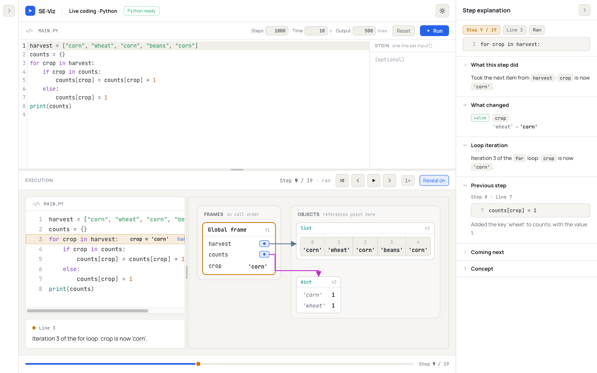
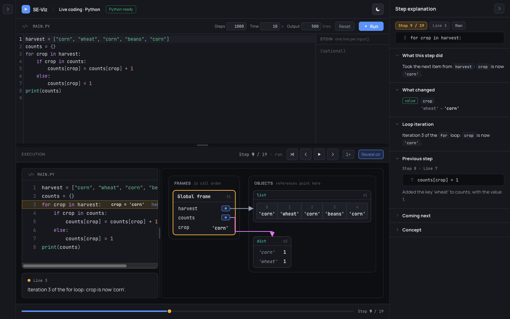
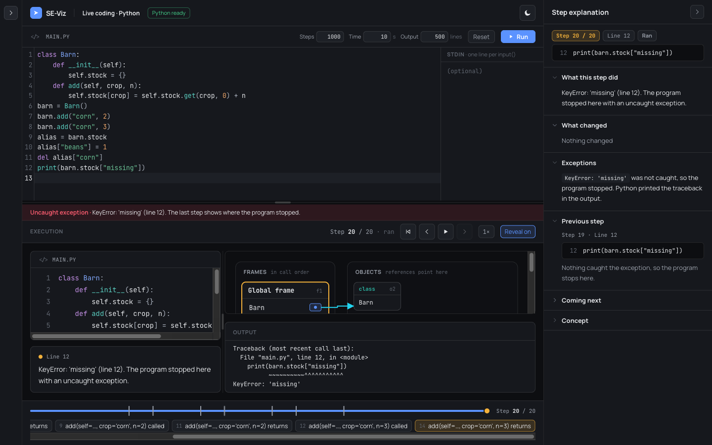

# Phase 32 Report — Derived step explanations (no AI)

## 1. Summary

The step explanation panel now explains every step from the trace itself, with deterministic
templates. There is no AI and no network.

- **Python** (live code and recorded traces). The recorder adds statement facts from Python's `ast`,
  plus call and return info. `deriveExplanation(trace, step, beat)` turns them into:
  - "What this step did": an ordered breakdown, such as *looked up `crop`, read `harvest['beans']`
    (45), added 10 (55), stored it back*;
  - "What changed", one row per Phase 30 object-diff event;
  - "Branch taken", "Loop iteration", "Calls and returns" and "Exceptions";
  - a "Concept" from one reviewed glossary file.
- **C.** C traces get "Branch taken", "Loop iteration" and "Calls and returns" from their
  `condition` chips and frames. "What this step did" stays the authored narration.
- **Authored text wins, section by section.** `Step.explain` gains `changed`, `branch`, `loop`,
  `calls` and `exceptions` alongside `did` and `concept`.
- **Two beats.** On `arrive` the panel says only what is about to run ("About to run line 4: it
  checks `crop in counts` to choose a branch."). Every effect waits for `apply`.
- **The Phase 29–31 gaps are closed:**
  - an addition inside an object (append, a new key) is now a "What changed" row;
  - an uncaught exception's traceback is no longer listed as "Printed". The Exceptions section
    covers it instead.

**Gates on `phase-32-derived-explanations`:**
- `typecheck`, `lint`, `test` (**741/741**, 43 files) and `build` pass.
- `check-bundle --baseline 765413 --budget 25000` passes. The main chunk is **772,840 B**, delta
  **+7,427 B**.
- The Python templates are a new lazy chunk: `python-*.js`, 40,071 B, plus `objectDiff-*.js`,
  3,405 B.

**No new dependencies.** The branch is not merged and not pushed. No stop condition was hit.

## 2. What I built

**Recorder (`src/python/recorder.py`, additive):**
- `_Statements` parses the program once with `ast` and indexes statements by line. A line's facts
  are built lazily, the first time the line runs.
- `stmt` is sent with the first line event of each line:
  - the statement's kind, targets, value and test;
  - a simplified expression tree with source text;
  - the line ranges of the body, the `elif` / `else` clauses, the `except` handlers and `finally`.
- Statements are never attached to a generator-expression, comprehension or lambda frame.
- A line that starts two statements is `Multiple`, and nothing more is claimed about it.
- `call` (call events) carries the function's qualname, the bound arguments, the scope (`function`,
  `generator`, `class`, `lambda`, `comprehension`, `coroutine`) and `resumed`.
- `function` (return events) carries the qualname. `yielded` is set when the return event is a
  `yield` (read from the `YIELD_VALUE` opcode).
- **Recorder fix:** see §5, item 3.

**Trace contract (`src/engine/trace/types.ts`, additive, Python only):**
- `Trace.statements?: Record<string, PyStatement>`;
- `Step.py?: PyStepInfo` (event, `at`, call, function, unwinding, yielded, exception, ending);
- the `PyExpr` / `PyStatement` types;
- `StepExplanation.changed / branch / loop / calls / exceptions`.

**Mapping:**
- `plan.ts`: `stepInfo`, `statementTable`.
- `candidates.ts`: each step carries `py`.
- `toTrace.ts`: fills `statements`, and sets each step's `narration` (a one-line summary) and
  `condition` chip from the derivation.
- `live/outcome.ts`: the extra final step is marked `py.ending` (`uncaught` / `stopped`), carries the
  exception, and drops the copied `condition`.

**Derivation (`src/engine/explain/`):**
- `derive.ts`: `deriveExplanation`, and a lazy registry for the Python deriver.
- `python.ts`: the Python templates and `summarize`.
- `pyState.ts`:
  - which frame a line ran in, whether it finished, and loop passes;
  - reading names, `d[k]` and `obj.attr` from snapshots;
  - object paths.
- `c.ts`: the C sections, reusing the timeline's loop scan.
- `glossary.ts`: 37 entries, one reviewed file.
- `text.ts`: code spans that drop a sentence instead of mis-showing a value.
- `types.ts`: `ChangeRow` (now with `add` / `remove`) and `DerivedExplanation`.

**Engine:**
- `trace/explain.ts`: `explainBeat` merges authored text over the derived sections.
- `trace/timeline.ts`: `deriveLoopTests` comes from the same scan as the markers, which are
  unchanged.

**Panel (`components/studio/ExplanationPanel.tsx`):**
- the new sections "Branch taken", "Loop iteration", "Calls and returns" and "Exceptions", shown
  only when non-empty;
- "about to run" text on arrive;
- Markdown rows, and `added` / `removed` badges;
- it loads the Python deriver for Python traces.

**Tests (+59; 682 → 741):**
- `explain/golden.test.ts` writes 14 Markdown goldens in `src/engine/explain/golden/`: eight Phase 29
  samples, four Phase 32 programs and two C modules.
- `explain/derive.test.ts` (37 tests) and `studio/explanationSections.markup.test.tsx` (4).
- `recorder.test.ts` gains 4 fixture tests from the four new programs below.
- New recorded programs in `testPrograms.ts`:
  - `extra-augassign`, the prompt's reference;
  - `extra-statements`;
  - `extra-exceptions`;
  - `extra-objects`.

**Docs:**
- `docs/PYTHON_TRACE_FORMAT.md`, a new "Statement facts" section;
- `docs/TRACE_FORMAT.md`, "Phase 32 additions";
- `docs/CONTENT_AUTHORING.md`.

## 3. Acceptance criteria — self-assessment

- [x] **1. Gates pass; no new dependency; additive changes documented.**
  - All five gates pass (§1).
  - `package.json` and the lockfile are untouched.
  - **The raw recorder fixtures are additive only.** A scripted check removed the new keys and found
    all 12 Phase 29 fixtures deep-equal to `ds-python`: frames, objects, stdout and events are
    unchanged.
  - **The C traces are untouched.** No C content file changed, and every C test passes unchanged.
- [x] **2. The harvest sample's step 9 reads equivalently to the design canvas (Direction A)
  breakdown. (DEVIATION: the canvas was unavailable; see §5, item 1.)**
  - Against the prompt's own reference, the `harvest[crop] += 10` step of `extra-augassign` (step 7)
    reads exactly:
    1. Looked up `crop`: `'beans'`.
    2. Read `harvest['beans']`: `45`.
    3. Added `10`, giving `55`.
    4. Stored `55` back in `harvest['beans']`.
  - The Phase 29 harvest sample's own step 9 (UI numbering) is a `for` step (quoted in §3a). Its `+=`
    counterpart is step 11, `counts[crop] = counts[crop] + 1`, which reads the same way.
- [x] **3. Every sentence in the golden snapshots is true for its step.**
  - I read all 14 goldens line by line against the program and its state; the harvest and factorial
    texts are quoted below.
  - The sentences I am least sure of are listed in §7.
  - Truth checks are also encoded as tests, for example: no "Looked up" on a line that raised; reads
    on a resumed line only when stable; balanced code spans; no `undefined`, `null` or `NaN`.
- [x] **4. No step shows a contradictory or speculative sentence; missing facts are omitted.**
  - **Contradictions found and fixed during review:**
    - the step after an exception claimed the line finished;
    - a generator "returned `None`";
    - a `with` line said "Entered" when leaving;
    - a `while` test before a `return` said "continues at line 2";
    - class-reachable functions were called "no longer reachable";
    - every global was "removed" during a module-level comprehension (a recorder bug; see §5,
      item 3).
  - **Facts the deriver can't establish are left out:**
    - `Multiple` lines;
    - starred unpacking;
    - `del d[k]`;
    - intermediate results of nested operations;
    - values containing a backtick.
- [x] **5. Live coding shows derived explanations for arbitrary programs without errors.**
  - On a production build (`vite preview`), I ran four programs in Python live coding. Between them
    they cover:
    - closures with `nonlocal`, a context-manager class, generators and `yield`;
    - dict and list comprehensions;
    - `try` / `except` / `finally`, an exception raised through three recursive frames, and a bare
      `except`;
    - `while`/`else`, nested `for` with `for`/`else`, `elif` and `continue`;
    - `with contextlib.nullcontext()`, a set, starred unpacking, f-strings and `dict.pop`;
    - a class with a dict attribute and an alias, `del d[k]`, and an uncaught `KeyError`;
    - `while True`, stopped at the step limit.
  - I stepped every beat (up to 1,200 beats per program) and collected the panel text.
  - **Result:** no `undefined`, `NaN` or `[object` anywhere, and 0 console errors or warnings apart
    from the existing `favicon.ico` 404.
  - **Read sentence by sentence:** the first two programs (72 and 57 steps) and the last 12 steps of
    the third. That reading found two wrong sentences ("Entered the with block" on exit, and
    "Computed `-1`: `-1`"), both fixed and committed.
  - Screenshots are below.

### 3a. Quoted derived text: harvest sample (`harvest.py`, apply beat)

| Step | Line | What this step did (and the derived section) |
|------|------|-----------------------------------------------|
| 1 | 1 | `harvest` now refers to a new list. |
| 2 | 2 | `counts` now refers to a new dict. |
| 3 | 3 | Took the first item from `harvest`: `crop` is now `'corn'`. *Loop:* Iteration 1 of the `for` loop: `crop` is now `'corn'`. |
| 4 | 4 | Looked up `crop`: `'corn'`. Checked `crop in counts`: it is `False`. *Branch:* `crop in counts` is `False`, so line 5 is skipped and the `else` branch (line 7) runs. |
| 5 | 7 | Looked up `crop`: `'corn'`. Added the key `'corn'` to `counts`, with the value `1`. |
| 6–8 | 3, 4, 7 | The same for `'wheat'` (iteration 2, `False`, key added). |
| **9** | **3** | **Took the next item from `harvest`: `crop` is now `'corn'`.** *What changed:* `crop`: 'wheat' → 'corn'. *Loop:* **Iteration 3 of the `for` loop: `crop` is now `'corn'`.** *Concept:* A `for` loop takes the items of a sequence one at a time. Each pass binds the loop variable to the next item, until there are none left. |
| 10 | 4 | Looked up `crop`: `'corn'`. Checked `crop in counts`: it is `True`. *Branch:* … so the body (line 5) runs and the `else` part (lines 6–7) is skipped. |
| 11 | 5 | Looked up `crop`: `'corn'`. Read `counts['corn']`: `1`. Added `1`, giving `2`. Stored `2` in `counts['corn']`. |
| 12–17 | | The same pattern for `'beans'` (key added) and `'corn'` (2 → 3). |
| 18 | 3 | There are no items left in `harvest`, so the loop is done. *Loop:* The `for` loop ends after 5 iterations. |
| 19 | 8 | Called `print(counts)`. Printed `{'corn': 3, 'wheat': 1, 'beans': 1}`. The program has finished. |

The arrive beat of each step, for example step 11: "About to run line 5: it works out
`counts[crop] + 1` and stores the result in `counts[crop]`."

### 3b. Quoted derived text: factorial sample (`recursion.py`, apply beat)

| Step | Line | What this step did · Calls and returns / Branch taken |
|------|------|--------------------------------------------------------|
| 1 | 1 | Defined the function `factorial(n)`; its body runs only when it is called. |
| 2 | 6 | Called `factorial(4)`. Line 6 waits while it runs. · Called `factorial(4)` from line 6. |
| 3 | 2 | Looked up `n`: `4`. Checked `n <= 1`: it is `False`. · `n <= 1` is `False`, so line 3 is skipped. |
| 4 | 4 | Called `factorial(3)`. Line 4 waits while it runs. · Called `factorial(3)` from line 4. *Concept:* recursion. |
| 5–8 | | The same for `n` = 3 and 2, calling `factorial(2)` and `factorial(1)`. |
| 9 | 2 | Looked up `n`: `1`. Checked `n <= 1`: it is `True`. · `n <= 1` is `True`, so the body (line 3) runs. |
| 10 | 3 | `factorial(1)` returns `1`. |
| 11 | 4 | Got `1` back from `factorial(1)`. Looked up `n`: `2`. Multiplied by `factorial(n - 1)` (`1`), giving `2`. `factorial(2)` returns `2`. · `factorial(1)` returned `1` to line 4. |
| 12 | 4 | Got `2` back from `factorial(2)`. Looked up `n`: `3`. Multiplied by `factorial(n - 1)` (`2`), giving `6`. `factorial(3)` returns `6`. · `factorial(2)` returned `2` to line 4. |
| 13 | 4 | Got `6` back from `factorial(3)`. Looked up `n`: `4`. Multiplied by `factorial(n - 1)` (`6`), giving `24`. `factorial(4)` returns `24`. · `factorial(3)` returned `6` to line 4. |
| 14 | 6 | Got `24` back from `factorial(4)`. Set `result` to `24`. · `factorial(4)` returned `24` to line 6. |
| 15 | 7 | Looked up `result`: `24`. Called `print(result)`. Printed `24`. The program has finished. |

The full text of every step, both beats, including "What changed", the concept, the narration and
the chip, is in `src/engine/explain/golden/{harvest,recursion}.md`.

## 4. How to run & verify

```sh
npm ci
npm run typecheck && npm run lint && npm test && npm run build
node scripts/check-bundle.mjs --baseline 765413 --budget 25000
# → main chunk index-*.js: 772840 B; delta +7427 B; ✓
npm run dev
```

1. **Read the goldens:** `src/engine/explain/golden/*.md`.
   - The source comes first, then every step: arrive, What this step did, What changed, the derived
     sections, the concept, the narration and the condition chip.
   - **To regenerate after a recorder change, run these in this order:**

     ```sh
     npx vitest run src/python/recorder.test.ts -u
     npx vitest run src/python/toTrace.test.ts -u
     npx vitest run src/engine/explain/golden.test.ts -u
     ```

   - Note the file filter goes **before** `-u`: in Vitest 4, `-u <path>` takes the path as the
     update mode and updates every snapshot.
2. Open **Live coding · Python**, press **Run** and step with →.
   - The panel shows "About to run line N…" on arrive, and the breakdown and sections on apply.
   - At step 9 you see "Iteration 3 of the `for` loop".
   - At step 5, "What changed" shows "Key `'corn'` added to `counts` = 1"; before this phase it said
     "Nothing changed".
3. Run a program that raises (for example `print({}["x"])`). The last step's "Exceptions" section
   says the exception was not caught and that the traceback is in the output, and "What changed"
   no longer lists the traceback as "Printed".
4. Open **SE 200 → Variables, if, else, while**. The `while` steps show "Loop iteration: Iteration
   k: `i <= n` is `true`…" and the `if` step shows "Branch taken". The narration is unchanged.

## 5. Key decisions & deviations

1. **DEVIATION: no design canvas.**
   - Direction A wasn't available to this run.
   - As instructed, I used the prompt's example as the reference (`harvest[crop] += 10`: looked up
     `crop` ("beans"), read `harvest["beans"]` (45), added 10 (55), stored it back).
   - The Phase 29 harvest sample has no `+=`, so I added the recorded program `extra-augassign`
     (`harvest = {"corn": 30, "wheat": 20, "beans": 45}` / `for crop in harvest:` /
     `harvest[crop] += 10`). Its `beans` step reads exactly as the reference (§3).
   - The harvest sample's step 9, in UI numbering, is a `for` step; its text is quoted in §3a.
   - **Please compare the wording and layout against the canvas.** Values appear as Python reprs
     (`'beans'`), not with double quotes.
2. **Statement facts travel in the snapshots, once per line.**
   - I didn't use one table per run. A run killed at the time limit keeps only its streamed
     snapshots (Phase 31), so a run-level table would be lost exactly when it is needed.
   - The facts cost about 100–400 characters per distinct line.
3. **DEVIATION: recorder bug fix.**
   - Python 3.12+ inlines comprehensions. At module level, while one runs, `f_locals` holds only the
     comprehension's variable, so every global name vanished from the snapshot for those steps.
   - The derived "What changed" would then have said "`sqrt` was removed" and so on, which is false.
   - The recorder now merges `f_globals` with those names for the module frame.
   - No Phase 29 fixture has a module-level comprehension, so none changed.
   - Class-body comprehensions likely have the same issue, but they are not fixed (§7).
4. **Python narration and condition chips are now derived at mapping time.**
   - `recordingToTrace` replaces the "Line 4 ran." placeholder with a one-line summary, and sets
     `condition` for `if` / `elif` / `while` tests.
   - This lets "Previous step", "Coming next", the narration card and the chip read sensibly for live
     code. Precedence is authored `explain.did`, then the derived breakdown, then the narration.
   - The roadmap lists "previous" and "next" text for this phase; the prompt doesn't.
5. **The Python deriver is a lazy chunk.**
   - Python templates, the glossary and the object diff all statically in the main chunk came to
     +50 KB, which is over budget.
   - The panel now loads them (`loadPythonDeriver`) for a Python trace and re-renders when they
     arrive (`useSyncExternalStore`).
   - Until then a Python step shows its narration, which is itself the derived summary. In practice
     the chunk arrives together with the lazy Python canvas.
6. **Steps the recorder's timing creates are named for what they are:**
   - **The step after an exception event** highlights the raising line again. It is explained as
     "Because of the exception, Python leaves line N and goes to line M." It is not treated as the
     line finishing.
   - **Calls inside a line** ("Line 6 waits while it runs"), and the **resumed** step after the
     return ("Got `24` back from `factorial(4)`"). On a resumed line a value is quoted only if it is
     the same before the line started and after.
   - **Comprehension passes on one line:** "Line 27 hasn't finished yet."
7. **"What changed" for Python now comes from the Phase 30 object diff** (`diffObjects`), phrased per
   event, and objects are named by the code's own paths (`counts['corn']`, `self.crops`,
   "`b` (the same list as `a`)").
   - The Phase 28 C rows are unchanged.
   - A released Python object reads "Nothing on screen refers to list o2 (was `p`) any more" rather
     than "is no longer reachable". The recorder doesn't follow a class's methods, so it can't claim
     an object is gone for good.
8. **C: "What this step did" stays the authored narration.** C traces have no statement facts.
   - C gets "Branch taken" from the `condition` chip, with "so line N runs next" only when the next
     step is in the same frame.
   - It gets "Loop iteration" from the timeline's loop scan, refactored to expose `deriveLoopTests`;
     the markers are identical and the timeline tests pass unchanged.
   - It gets "Calls and returns" from frames pushed and popped.
   - No glossary concept is derived for C, so "Concept" stays hidden unless authored.
9. **Arrive and authored text.** When a step has an authored `did`, the arrive beat keeps the
   Phase 28 "About to run" note: the authored breakdown is withheld, and no derived text replaces
   it.
10. **Constant tests** (`while True:`) read "The condition `True` is always `True`, so …" and get no
    "Checked" sentence.

**Existing tests, snapshots and fixtures that changed, and why:**
- **`src/python/fixtures/*.json` (12 recorder fixtures):**
  - re-recorded through `recorder.test.ts`, never hand-edited;
  - the only change is the new keys (`stmt`, `call`, `function`, `yielded`); verified by script
    against `ds-python`;
  - `packages-numpy-pandas.json` was **not** re-recorded (opt-in, network) and simply lacks the new
    keys.
- **`src/content/fixtures/python/*.json` (8 mapped traces):**
  - regenerated by `toTrace.test.ts`;
  - they gain `statements` and `py`;
  - **narration changed on 112 steps** (the placeholder replaced by the derived summary);
  - **`condition` was added on 28 steps**;
  - memory, lines and ids are unchanged (verified by script).
- **`src/python/mappings/candidates.test.ts` (harvest test):**
  - the expected "What changed" row changed from `{ kind: 'value', subject: "'corn' in dict", … }`
    to `{ kind: 'value', subject: "`counts['corn']`", …, markdown: true }`, because the derived row
    replaces the thin fallback;
  - it also imports the Python deriver.
- **`src/engine/trace/explain.test.ts`:**
  - three `did` expectations gain the new `markdown` field (the shape is additive);
  - the "every catalog module" fallback test now expects authored, then derived (Python only), then
    the narration, and it asserts C still derives no `did`.
- **`src/python/recorder.test.ts`, "size budget" test:**
  - the input budget went from 50,000 to 60,000 characters (and the bound from 55,000 to 66,000);
  - the statement facts made 10 instead of 11 snapshots fit the old budget, which tripped `> 10`;
  - the assertions themselves are unchanged. I did weigh this as a possible weakening; it keeps the
    same margin.
- The `PythonCanvas`, `Diagram` and every other snapshot are untouched.

## 6. Trace format / API notes

```ts
// Step.explain (StepExplanation), Phase 32 additions — authored wins per section:
changed?: string[]; branch?: string[]; loop?: string[]; calls?: string[]; exceptions?: string[];
// Python only:
Trace.statements?: Record<string, PyStatement>;
Step.py?: PyStepInfo; // { event, at, call?, function?, unwinding?, yielded?, exception?, ending? }

deriveExplanation(trace, stepIndex, beat: 'arrive' | 'apply'): DerivedExplanation
// { did, changes, branch, loop, calls, exceptions, concept, condition? }
loadPythonDeriver(), pythonDeriverReady(), subscribeDerivers(listener)  // the lazy Python chunk
summarize(trace, stepIndex) / derivePython(...)                        // src/engine/explain/python.ts
deriveLoopTests(trace): Map<number, LoopTest>                           // src/engine/trace/timeline.ts
BeatExplanation += { changedText, branch, loop, calls, exceptions }; did += { markdown }
ChangeKind += 'add' | 'remove'; ChangeRow += { markdown?: true }
```

The snapshot additions (`stmt`, `call`, `function`, `yielded`) and the `PyStatement` / `PyExpr`
shapes are documented in `docs/PYTHON_TRACE_FORMAT.md`, "Statement facts".

## 7. Known issues / follow-ups

**Sentences I am least sure of (please review):**
- **"Got `None` back from `Barn.store(barn, 'wheat')`."** It is true, but it adds little for methods
  that return nothing. `__init__` is special-cased ("finished setting up the new object"). That
  wording assumes the call came from `Class(...)`; a direct `obj.__init__()` call would read oddly.
- **"`countdown(2)` finished: it has no more values."** This is tested only for generators that run
  to the end. A generator abandoned by `break` (closed with `GeneratorExit`) is untested.
- **"Took the next item from `stock.items()`".** "Item" for a dict view is loose but true.
- **C: "`n % 2 == 0` is `true`, so line 9 runs next."** This relies on the authored next step
  highlighting the next executed line. That held in both C modules checked.
- **"Called `lambda(0)`".** A lambda is labelled `lambda(…)`, not by the name it was called through.
- **"Called `print(counts)`" for builtins.** The call happened, but its own steps aren't traced.

**Other follow-ups:**
- **Arguments that are objects** show as `…` in call labels (`Tractor.__init__(…, 'Red', 100)`),
  unless exactly one caller name refers to the object. Positional values follow the prompt's
  `factorial(3)` example, so a parameter that has a default shows the value it received.
- **Python timeline markers** still come only from calls and returns. The C loop regex doesn't match
  Python. The loop pass counts now exist (`analyze().loops`) and could feed markers.
- **Class-body comprehensions:** the same `f_locals` issue as §5, item 3, likely applies. Not fixed or
  tested.
- **Not covered:** `match` statements are `Other`, and decorator lines carry no statement facts.
- **No breakdown is derived for** starred unpacking, `del d[k]`, slices, keyword-only calls (beyond
  "Called …"), and nested operations' intermediate values. By design, those facts are left out.
- **The NarrationCard chip** shows a derived Python condition on the arrive beat too. That is the same
  pre-existing behaviour as C chips.
- **Playwright logs** went to `Frontier-work/.playwright-mcp/` (outside the repo) and to the
  git-ignored `se-viz/.playwright-mcp/`. Neither is committed.

## 8. File map

```
src/python/recorder.py                    (changed — statement facts, call/return info, module-comprehension fix)
src/python/protocol.ts                    (changed — PySnapshot.stmt / call / function / yielded)
src/python/mappings/plan.ts, candidates.ts (changed — stepInfo, statementTable, Step.py)
src/python/toTrace.ts                     (changed — statements, derived narration + condition)
src/python/live/outcome.ts                (changed — ending steps marked)
src/python/testPrograms.ts                (changed — 4 Phase 32 programs)
src/python/recorder.test.ts               (changed — size-budget input, see §5)
src/python/fixtures/*.json                (re-recorded; 4 new extra-*.json)
src/content/fixtures/python/*.json        (regenerated)
src/engine/trace/types.ts                 (changed — PyStatement, PyExpr, PyStepInfo, explain fields)
src/engine/trace/explain.ts               (changed — merges derived sections)
src/engine/trace/timeline.ts              (changed — deriveLoopTests; markers identical)
src/engine/explain/{derive,python,pyState,c,glossary,text,types}.ts      (new)
src/engine/explain/{derive,golden}.test.ts, testTraces.ts, golden/*.md   (new)
src/components/studio/ExplanationPanel.tsx                               (changed)
src/components/studio/explanationSections.markup.test.tsx                (new)
src/engine/trace/explain.test.ts, src/python/mappings/candidates.test.ts (changed, see §5)
docs/PYTHON_TRACE_FORMAT.md, docs/TRACE_FORMAT.md, docs/CONTENT_AUTHORING.md
reports/phase-32-derived-explanations.md, reports/assets/phase32-*.png
```

### Screenshots

Live coding, the default harvest program, step 9 ("Iteration 3 of the `for` loop"):




An uncaught exception at the end of a live run. The Exceptions section names it, and the traceback
appears in Output, not under "Printed":


