# Phase 34 Report — NumPy array view

## 1. Summary

NumPy arrays now record and render as real, steppable arrays instead of a summary box.

- **Recorder.** A `numpy.ndarray` is recorded with its shape, dtype, ndim, the first 200 values
  (flat, C order, with an ellipsis count for the rest), `owndata`, the object id of `arr.base`, and
  where its elements sit in the owning array's memory. A NumPy scalar (`np.int32(20)`,
  `m.sum()`) is a primitive with its dtype.
- **Renderer.** 1-D arrays are a row of cells with indices, 2-D a grid with row and column
  indices, 3-D a stack of 2-D slices labelled `[k, :, :]`. Arrays past the cap, or with more than 3
  dimensions, fall back to a summary with a flat preview. A view has a dashed teal "view of" link
  to its base, and a write through a view outlines the shared cell in **both** arrays.
- **Motion.** Changed cells pulse. A new view (slice, `reshape`, `.T`) flies its cells in from the
  elements it shares. An in-place reshape (`a.shape = …`) slides each element to its new place and
  plays back in reverse. An array made by arithmetic sits beside its first array operand.
- **Explanations.** Derived text covers creation, indexing and slicing (which cells), elementwise
  arithmetic, broadcasting (both shapes and the result shape), aggregation with and without `axis`,
  reshape, transpose, boolean masks (which cells are `True`), and view versus copy.
- **Samples.** Nine recorded NumPy samples, mapped to traces in
  `src/content/fixtures/python/numpy/`, each with a golden explanation file.

**Gates on `phase-34-numpy-view`:** `typecheck`, `lint`, `test` (**809/809**, 47 files) and `build`
pass. `check-bundle --baseline 772840 --budget 25000` passes: the main chunk is **773,158 B**, delta
**+318 B**. The NumPy rendering and explanation code is in the existing lazy chunks: `PythonCanvas`
is 28,392 B (it was 16.3 KB in Phase 30) and the Python deriver chunk `python-*.js` is 60,032 B
(40,071 B in Phase 32).

**No new dependencies.** NumPy comes from Pyodide's package set at the pinned 314.0.7. The branch
is not merged and not pushed. No stop condition was hit.

## 2. What I built

**Recorder (`src/python/recorder.py`)**
- `_ndarray`: exact `ndarray` type, dtype kinds `b i u f U` →
  `{ kind: 'ndarray', shape, dtype, ndim, values (≤ 200, C order, via arr.flat[:200].tolist()),
  omitted?, owndata, base?, layout? }`.
  - `layout` = `{ offset, strides, itemsize }`. `offset` is in bytes from the owning array's data.
    The owner is the end of the `base` chain, and the offset is computed from
    `__array_interface__['data']`.
  - Other dtypes (complex, datetime, object, bytes) and subclasses (masked arrays, matrices) stay
    `summary`.
  - An array-like the recorder can't read falls back to a summary instead of stopping the program.
    The offline stand-in found this: a snapshot taken inside `__init__`.
- `_numpy_scalar`: a NumPy scalar becomes `{ kind: 'prim', type, repr, dtype }` (from `.item()`).
- Statement facts:
  - `subscript` keeps slice and tuple indices (new `PyExpr` `slice`);
  - `call` gains `kwargs: [{ name, value }]` (for `axis=0`).
- `NDARRAY_CAP = 200`. A test checks that it matches `protocol.ts`.

**Trace contract (additive)**
- `PyObjectKind` gains `'ndarray'`.
- `HeapBlock.ndarray?: NdarrayInfo` holds `shape, dtype, size, ownsData, base, layout?`.
- `PyExpr` gains `slice`, and a call gains `kwargs`.
- `PyEvent` gains `array-reshaped`.
- The protocol gains `PyNdarray`, `PyPrim.dtype` and `NDARRAY_CAP`.
- **Mapping** (`src/python/mappings/memory.ts`):
  - element cells are `o3[1,2]`, named `1, 2`, typed by dtype, plus the `o3[…]` "N more" cell;
  - NumPy scalar cells are typed `np.int32`.
- **Validator:** `ndarray` facts go exactly with `objectKind: 'ndarray'`, there are at most `size`
  element cells, and `base` is an object in the step.

**Shared memory (`src/engine/trace/ndarray.ts`, new):** `memoryOwner`, `bytePositions`,
`sharedCells(step, a, b)` (cell → cell at the same memory), `writeThrough`, `unravel`, `shapeText`.

**Object diff (`objectDiff.ts`):** an in-place shape change with every element where it was is one
`array-reshaped { from, to }` event (inverse: swapped). Everything else is the existing
fixed-slot diff.

**Renderer (`src/components/python/`)**
- `NdarrayView.tsx` (new, components):
  - `NdarrayHeading` (shape and dtype in the box header);
  - `NdarrayBody`: the grid or the summary, plus a "view of oN: shares its memory, no copy" or "uses
    memory it does not own" footer;
  - `ViewLinks`: the dashed "view of" SVG links.
- `ndLayout.ts` (new, pure): `gridPlan` (CSS grid lines for 0- to 3-D plus labels), `cellText`
  (long floats shortened to 6 significant digits and marked `…`), `viewLinkPath`, and
  `CanvasElementContext`.
- `PySlot.tsx` (new): `SlotValue` and `ValueContent`, moved out of `PyViews.tsx` unchanged apart
  from an optional `format` prop. The markup is identical; the Phase 30 snapshots pass untouched.
- `pyMotion.ts`: new cues `shared` (written cell plus the same element in another array) and
  `flights` (new view cell → source cell); `array-reshaped` restructures.
- `pyLayout.ts`: `besideOperands(trace)` places an array made by `binop` / `compare` / `unary` on
  arrays beside its first array operand.
- `PythonCanvas.tsx`:
  - provides the canvas element;
  - renders `ViewLinks`;
  - adds right padding when views exist, and a wider frames-to-objects gutter on steps that show
    arrays;
  - passes `bandPerTarget` to `ArrowOverlay`.
- `ArrowOverlay.tsx`: an opt-in `bandPerTarget` prop (default off, so C is unchanged). A rail's
  band is indexed per target, not globally, so bands no longer climb through the boxes above.

**Explanations (`src/engine/explain/`)**
- `numpy.ts` (new): `numpyStatement(ctx, stmt)` returns `{ did, lead, concept }` for:
  - `np.array` / `asarray` / `arange` / `zeros` / `ones` / `linspace`;
  - element reads (`a[1]`, `a[-1]`, `m[0, 2]`);
  - slices, rows and columns, which cells they take via `sharedCells`;
  - boolean masks by name or inline;
  - elementwise binop and compare, with broadcasting;
  - `sum` / `mean` / `max` / `min` with and without `axis` (method or `np.` function);
  - `reshape`, `.T` / `transpose`, `.copy()`, `a.shape = …`, and in-place `a += 1`;
  - stores into arrays: which cells changed, which other arrays saw the write, or "no other array
    shares these elements".
  - Any other line that makes a new array gets a shape / dtype / memory sentence.
- `broadcastSentence` is exported and tested on its own.
- `python.ts`:
  - uses the NumPy reading for "What this step did", the concept and the narration lead;
  - "What changed" says the shape (and "a view of …") for a new array, and an `array-reshaped`
    row;
  - more than 6 changed elements of one array collapse into one row.
- `pyState.ts`: `slotPath` names array elements (`grid[1, 2]`).
- `glossary.ts`: 12 NumPy entries (`np-create` … `np-mask`).

**Samples and fixtures**
- `src/python/samples/numpy/*.py` (9 programs): `create`, `index-slice`, `views`, `arithmetic`,
  `aggregate`, `reshape`, `masks`, `capped`, `mixed`.
- `samples/numpy/index.ts` lists them.
- `scripts/record-python-packages-fixture.mjs` (`npm run py:record-packages`, opt-in, network: the
  pinned jsDelivr Pyodide only) now records them into `src/python/fixtures/numpy/*.json` and
  re-records `packages-numpy-pandas.json`.
- `toTrace.test.ts` maps them into `src/content/fixtures/python/numpy/*.json` (file snapshots).
- `extra-ndarray-standin` (in `testPrograms.ts`) exercises the recorder's ndarray path offline on
  every `npm test`: the cap, the base link, the layout offset and a scalar.
- The dev preview `/?python-preview&trace=numpy/<name>` lists the NumPy traces.

**Tests (+68; 741 → 809)**
- `src/python/numpyRecorder.test.ts` (17): shape, dtype, ndim, the cap and `omitted`, base ids,
  layout, scalars, slice / tuple / kwargs facts, and the stand-in.
- `src/engine/trace/ndarray.test.ts` (12):
  - shared cells and validation;
  - diff events for a cell change, a write through a view, an in-place reshape (and its inverse),
    and a reshape that makes a view;
  - motion cues (shared, flights, restructured, reduced motion).
- `src/components/python/NdarrayView.test.tsx` (7): snapshots of 1-D, 2-D, 3-D, the view-of link
  (with a fake anchor registry) and a capped array, plus `cellText` and `gridPlan`.
- `src/engine/explain/numpy.test.ts` (13): broadcasting for four shape pairs plus the scalar case,
  view and copy writes, slices, masks, axis aggregation, the mixed sample, and "every NumPy step has
  a derived breakdown".
- `golden.test.ts`: 9 new goldens, `golden/numpy-*.md`.
- `toTrace.test.ts`: 9 new mapped traces.
- The fixture-wide Python tests now also cover the NumPy traces: the `objectDiff` exact-inverse
  check, PythonCanvas "every step renders" and `pyMotion`.

## 3. Acceptance criteria — self-assessment

- [x] **1. Gates pass; additive and documented; caps enforced.**
  - The gates pass (§1).
  - The type changes are additive: new kinds, fields and variants only. C traces are untouched,
    and the Phase 29–32 Python traces and goldens are byte-identical.
  - Two existing fixtures changed; both are listed in §5.
  - Documented in `docs/PYTHON_TRACE_FORMAT.md` ("NumPy arrays (Phase 34)") and
    `docs/TRACE_FORMAT.md` ("Phase 34 additions").
  - **Caps:**
    - 200 values per array: `capped.json` records 200 of 500 with `omitted: 300`, and the stand-in
      200 of 250 (`numpyRecorder.test.ts`);
    - grids only up to 3-D: `hyper` (4-D) and `big` / `grid` (500 values) render the summary
      (`NdarrayView.test.tsx`, "capped array").
- [x] **2. View vs copy is unmistakable: modifying a slice view visibly changes the base; modifying
  a `.copy()` does not.**
  - **`views.py`, `view[0] = 100`:**
    - `base[1]` and `view[0]` both turn 100;
    - both cells get a dashed teal outline, and the view has a dashed "view of" link to `base`;
    - the text says "`view` is a view of `base`, so `base[1]` changed too: the two arrays share that
      element."
  - **`copy[1] = -1`:** only `copy` changes; `base` still shows 100. The text says "No other array
    shares these elements (`copy` owns its data), so only `copy` changed."
  - Screenshots are below; tests are in `numpy.test.ts` and `ndarray.test.ts`.
- [x] **3. The broadcasting explanation states shapes correctly for at least three shape pairs.**
  From `golden/numpy-arithmetic.md` (recorded with real NumPy):
  - `shifted = m + a`: "Broadcasting: `m` has shape `(2, 3)` and `a` has shape `(3,)`, so the
    result has shape `(2, 3)`: lined up from the right, `a` is repeated along axis 0."
  - `table = col * a`: "Broadcasting: `col` has shape `(3, 1)` and `a` has shape `(3,)`, so the
    result has shape `(3, 3)`: lined up from the right, `col` is repeated along axis 1 and `a` is
    repeated along axis 0."
  - `outer = col + row`: "Broadcasting: `col` has shape `(3, 1)` and `row` has shape `(1, 2)`, so
    the result has shape `(3, 2)`: lined up from the right, `col` is repeated along axis 1 and `row`
    is repeated along axis 0."
  - Scalar case, `scaled = a * 2`: "Broadcasting: `a` has shape `(3,)` and `2` is a single value
    (shape `()`), so the result has shape `(3,)`: `2` is used for every element."
  - A 3-D pair, `(2, 1, 3)` with `(4, 1)` → `(2, 4, 3)`, is in `numpy.test.ts`.
  - **The result shape is read from the recorded result**, and the operand shapes from the
    recorded operands; nothing is computed except which axes repeat (NumPy's right-aligned rule
    applied to those recorded shapes).
- [x] **4. Both themes; screenshots in the report.** See below. Tokens only (`heap` teal for views,
  `changed` green, `pointer` azure, `active` amber).

## 4. How to run & verify

```sh
npm ci
npm run typecheck && npm run lint && npm test && npm run build
node scripts/check-bundle.mjs --baseline 772840 --budget 25000
# → main chunk index-*.js: 773158 B; delta +318 B; ✓
npm run py:record-packages   # optional, network (pinned Pyodide CDN): re-records the NumPy fixtures
npm run dev
```

1. **Dev preview** at `/?python-preview&trace=numpy/views` (also `numpy/create`,
   `numpy/index-slice`, `numpy/arithmetic`, `numpy/aggregate`, `numpy/reshape`, `numpy/masks`,
   `numpy/capped`, `numpy/mixed`). Step with →; it is two-beat.
   - On `view[0] = 100` both cells are outlined.
   - On `turned = grid.T` (`numpy/reshape`) the cells fly from `grid`.
   - On `flat.shape = (3, 2)` the cells glide; ← plays it back.
2. **Live coding · Python:** paste a NumPy program (for example `src/python/samples/numpy/mixed.py`)
   and Run. Pyodide loads NumPy from the pinned CDN.
3. **Regenerate after a recorder change**, in this order:
   1. `npm run py:record-packages` (network);
   2. `npx vitest run src/python/recorder.test.ts -u`;
   3. `npx vitest run src/python/toTrace.test.ts -u`;
   4. `npx vitest run src/engine/explain/golden.test.ts -u`.

**Browser check (Playwright MCP, Chrome, dev server, 1440 and 1920 px):**
- Every NumPy sample was stepped in the preview.
- Animations were checked by sampling computed transforms frame by frame:
  - a transpose cell flew from `(-40, -150)` px to rest over about 0.5 s;
  - an in-place reshape cell glided from `(48, -22)` to `(0, 0)`, and played back in reverse;
  - `End` (a jump) showed no transform.
- Python live coding ran two NumPy programs:
  - `mixed.py`: every beat read sensibly;
  - a dtype program: 30×30 random (summary), `np.eye`, `<U5` strings, complex (stays a summary),
    and a broadcasting `ValueError` reported under Exceptions.
- No console errors apart from the existing `favicon.ico` 404. (Some `target.closest` errors came
  from my own synthetic key events dispatched on `document`; they are not app errors.)

## 5. Key decisions & deviations

1. **DEVIATION (interpretation): "larger arrays fall back to the summary".**
   - The recorder always captures up to 200 values, with an ellipsis count.
   - The renderer draws a grid only when the array has at most 3 dimensions **and** all its values
     were captured.
   - Otherwise it shows the summary fallback: the size, "flat, in C order", the first 24 captured
     values and "… N more", and a line saying why.
   - So a capped array is a summary, not a partial grid. A small view of a big array (`big[:5]`) is
     a grid again.
2. **Memory layout facts (beyond the prompt's list).**
   - Besides the base id, each array records `layout { offset, strides, itemsize }`.
   - Without it the renderer can't tell which cells a view shares with its base (for
     "highlights the shared cells in both", "which cells" a slice takes, and the
     reshape / transpose flights).
   - Element sharing is exact: same owner and the same byte position.
3. **DEVIATION (one existing fixture changed meaning): slice and tuple indices are now kept.**
   - `a[1:4]`, `m[0, 1]` and `m[:, 1]` were `{ type: 'other' }` in the statement facts; NumPy
     indexing needs them.
   - `src/python/fixtures/extra-dict-keys.json` changed for this reason alone: the target of
     `inventory[(1, 2)] = …` is now a subscript with a tuple index. It was regenerated by
     `recorder.test.ts`, not hand-edited.
   - No golden and no Phase 29–32 content trace changed. The derived concept for that one line can
     now be the dict-store entry (it is not a golden).
4. **`packages-numpy-pandas.json` re-recorded** (network script, as the brief asked). It changed in
   three ways:
   - the NumPy array is an `ndarray` object with values;
   - `best = yields.max()` is a primitive with `dtype: 'float64'` instead of a summary;
   - it gains the Phase 32 statement facts it was missing.
   - **Existing test changed:** `candidates.test.ts`, "A: real NumPy and pandas objects…". Its
     expected rows were updated to the new kinds; pandas rows are unchanged. It now also asserts
     the array's shape / dtype and that `best` is an `np.float64` scalar cell.
5. **`ArrowOverlay` change (opt-in, C unchanged).**
   - NumPy programs bind a name per array. With the global rail lanes, bands climbed through
     the boxes above their targets, and drop columns ran through boxes.
   - I added `bandPerTarget` (default `false`; only the Python canvas passes it).
   - The Python canvas also widens the frames-to-objects gutter, **only on steps that show
     arrays**, so the Phase 30 layout of other programs, and its snapshots, are unchanged.
6. **"New arrays from arithmetic appear next to their operands" is a layout rule.**
   - The array sits beside its **first** array operand (`m + a` by `m`). It is stable for the
     trace, so it is visible in any step, not only during the motion.
   - I first tried the last operand; it piled every broadcast result next to `a`.
7. **NumPy's default integer in Pyodide is `int32`** (32-bit WebAssembly). The recordings and the
   text say `int32`; a desktop shows `int64`.
8. **`np.linspace` returns a view.** In NumPy 2.4.6 its result is a view of an array made inside the
   function. The canvas shows that hidden array and the link honestly. The text says "It is a view
   of ndarray o6, an array NumPy made along the way that no name refers to." The same happens for
   `np.arange(12).reshape(3, 4)`.
9. **Two extra programs:**
   - the ninth sample `mixed` is the live-coding program I tested, kept so its explanations
     (chained calls, a view of an unnamed array, a 3-D slice write) are goldens;
   - the offline stand-in, so `npm test` exercises the recorder's ndarray code without the
     network.
10. **No catalog module.** The prompt asks for committed samples, not modules. Adding the trace data
    to the main chunk would cost 19–230 KB per sample, over budget. The NumPy view is reached through
    Python live coding (production) and the dev preview.
11. **In-place reshape motion.**
    - Array cells keep framer `layout="position"` on, keyed by memory position and triggered only
      by a shape change (`layoutDependency`). It is instant unless motion plays, and off under
      reduced motion.
    - Switching `layout` on in the same render that moves the cell does nothing. I found this in
      the browser: no transform.
    - **Possibly relevant to Phase 30 (not changed):** its list items toggle `layout` the same way,
      so a list insert's glide may never play. Phase 30 reported that case as not exercised in a
      browser.
12. **Test globs widened.** The `objectDiff`, `PythonCanvas` and `pyMotion` fixture-wide tests now
    read `fixtures/python/**/*.json`. The tests are broadened, not weakened.

**Existing snapshots, fixtures and tests that changed:**
- `src/python/fixtures/extra-dict-keys.json` (item 3);
- `src/python/fixtures/packages-numpy-pandas.json` (item 4);
- `src/python/mappings/candidates.test.ts`, one test's expectations (item 4);
- the three glob widenings (item 12).
- `PythonCanvas.test.tsx.snap`, `Diagram.test.tsx.snap`, every Phase 29–32 golden and every
  Phase 30 content trace are **unchanged**.

## 6. Trace format / API notes

See `docs/PYTHON_TRACE_FORMAT.md` → "NumPy arrays (Phase 34)" and `docs/TRACE_FORMAT.md` →
"Phase 34 additions". In short:

```ts
type PyObjectKind = … | 'ndarray';
interface NdarrayInfo { shape: number[]; dtype: string; size: number; ownsData: boolean;
  base: BlockId | null; layout?: { offset: number; strides: number[]; itemsize: number } }
// HeapBlock.ndarray?: NdarrayInfo; element cells o3[1,2] (name "1, 2"), o3[…] past the cap
// NumPy scalar cells: type 'np.<dtype>'
// PyExpr: + { type: 'slice'; lower?; upper?; step? }; call.kwargs?: { name; value }[]
// PyEvent: + { kind: 'array-reshaped'; objectId; from: number[]; to: number[] }
// raw: PyNdarray { kind:'ndarray', library, type, shape, dtype, ndim, values, omitted?, owndata, base?, layout? }
//      PyPrim.dtype?   NDARRAY_CAP = 200
// ndarray.ts: sharedCells(step, a, b), writeThrough(step, changed), memoryOwner, bytePositions
// numpy.ts:   numpyStatement(ctx, stmt) → { did, lead, concept } | null; broadcastSentence(l, r, result)
```

Phase 35 (pandas) can follow the same pattern: an object kind, a facts field on `HeapBlock`, and a
body in the lazy canvas.

## 7. Known issues / follow-ups

- **Not verified in a browser:** reduced motion. It is covered by tests: no flights, shared cells
  still marked. Two-beat and jumps were verified.
- **Crowded arrows.** With many arrays and both side panels open at 1440 px, the canvas scrolls
  sideways, and some rails still cross boxes. That is the Phase 30 `ArrowOverlay` limitation,
  eased but not solved.
- **Operands that are not plain names** (`grid + np.array([…])`, `a * 2 + 1`) get the generic
  "made a new ndarray of shape …" text, with no broadcasting sentence: the temporary's shape is
  not recorded.
- **Flight start position.** It is measured while the new box is still popping in (scale 0.92 → 1),
  so the start is a few pixels off.
- **Wording I am least sure of:**
  - "`row` and `grid` share memory" when both are views of an unnamed array;
  - "`[6]` of ndarray o2", the path of an element of an unnamed array;
  - a write into a copy gets the `np-index` concept, not `np-copy` (the copy concept's text assumes
    an original exists).
- **Values.** Values use Python's `repr` (`2.3333333333333335`); the cells shorten long floats with
  a trailing `…`, and the full value is in the cell's title.
- **Fixture size.** The NumPy fixtures add about 1 MB to the repo (raw recordings 420 KB, mapped
  traces 604 KB). None of it is in the bundle.
- `.playwright-mcp/` logs were written under `Frontier-work/` and `se-viz/` (git-ignored). They are
  not committed.

## 8. File map

```
src/python/recorder.py, protocol.ts, testPrograms.ts                       (changed)
src/python/mappings/memory.ts                                              (changed)
src/python/samples/numpy/{9 programs}.py, index.ts                        (new)
src/python/fixtures/numpy/*.json (9), extra-ndarray-standin.json          (new, recorded)
src/python/fixtures/packages-numpy-pandas.json, extra-dict-keys.json      (re-recorded, see §5)
src/python/numpyRecorder.test.ts                                           (new)
src/python/toTrace.test.ts, mappings/candidates.test.ts                   (changed)
src/python/debug/TracePreview.tsx, PythonSketch.tsx                       (changed, dev only)
src/content/fixtures/python/numpy/*.json (9)                              (new, generated)
src/engine/trace/types.ts, validate.ts, objectDiff.ts                     (changed)
src/engine/trace/ndarray.ts, ndarray.test.ts                              (new)
src/engine/trace/objectDiff.test.ts                                       (glob widened)
src/engine/explain/numpy.ts, numpy.test.ts, golden/numpy-*.md (9)         (new)
src/engine/explain/python.ts, pyState.ts, glossary.ts, golden.test.ts, testTraces.ts (changed)
src/components/python/NdarrayView.tsx, ndLayout.ts, PySlot.tsx            (new)
src/components/python/NdarrayView.test.tsx (+ __snapshots__)              (new)
src/components/python/PyViews.tsx, PythonCanvas.tsx, pyLayout.ts, pyMotion.ts (changed)
src/components/python/PythonCanvas.test.tsx, pyMotion.test.ts             (glob widened)
src/components/memory/ArrowOverlay.tsx                                    (opt-in bandPerTarget)
scripts/record-python-packages-fixture.mjs                                (records the NumPy samples too)
docs/PYTHON_TRACE_FORMAT.md, docs/TRACE_FORMAT.md                         (changed)
reports/phase-34-numpy-view.md, reports/assets/phase34-*.png              (new)
```

### Screenshots

Write through a view: `view[0] = 100` changes `base[1]`; both cells are outlined, with the dashed
"view of" link.

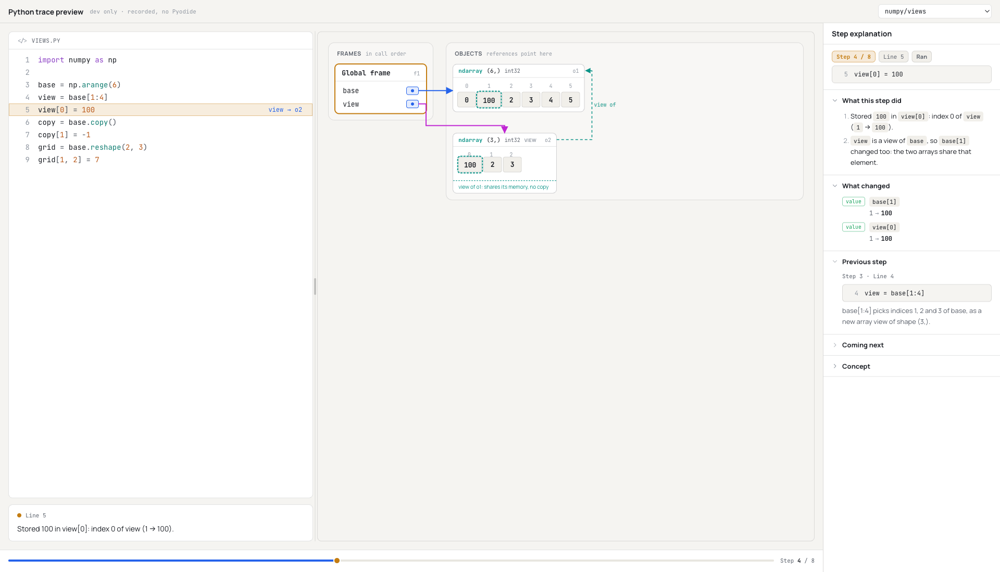
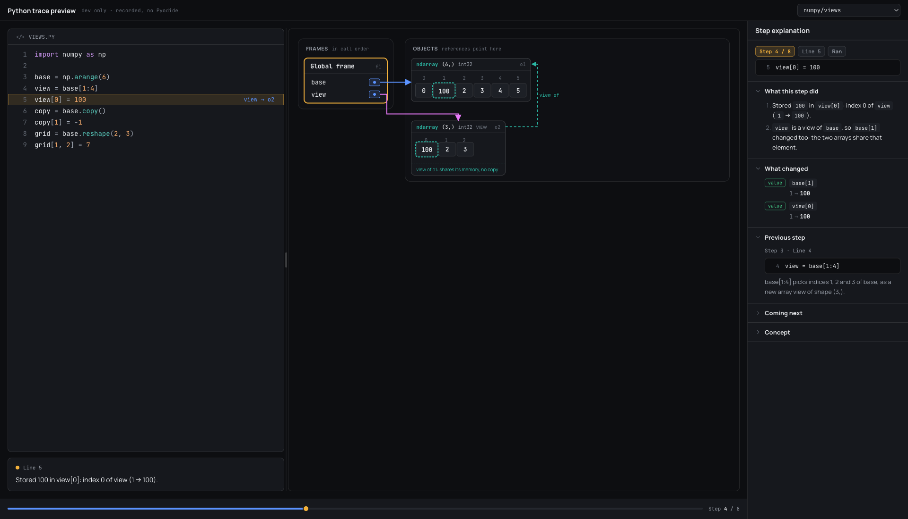

A write into a copy: only `copy` changes, and `base[1]` still shows 100.

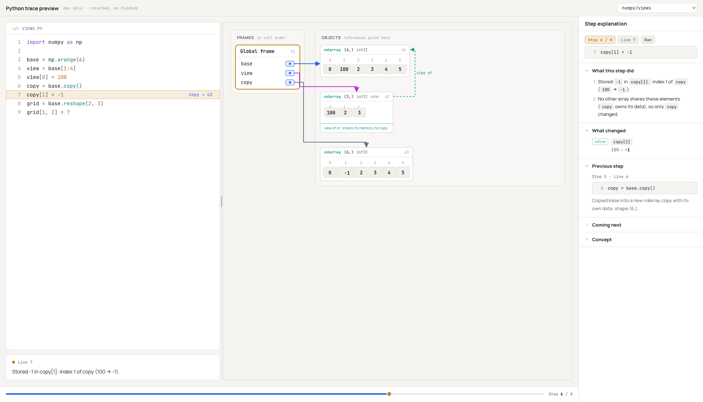
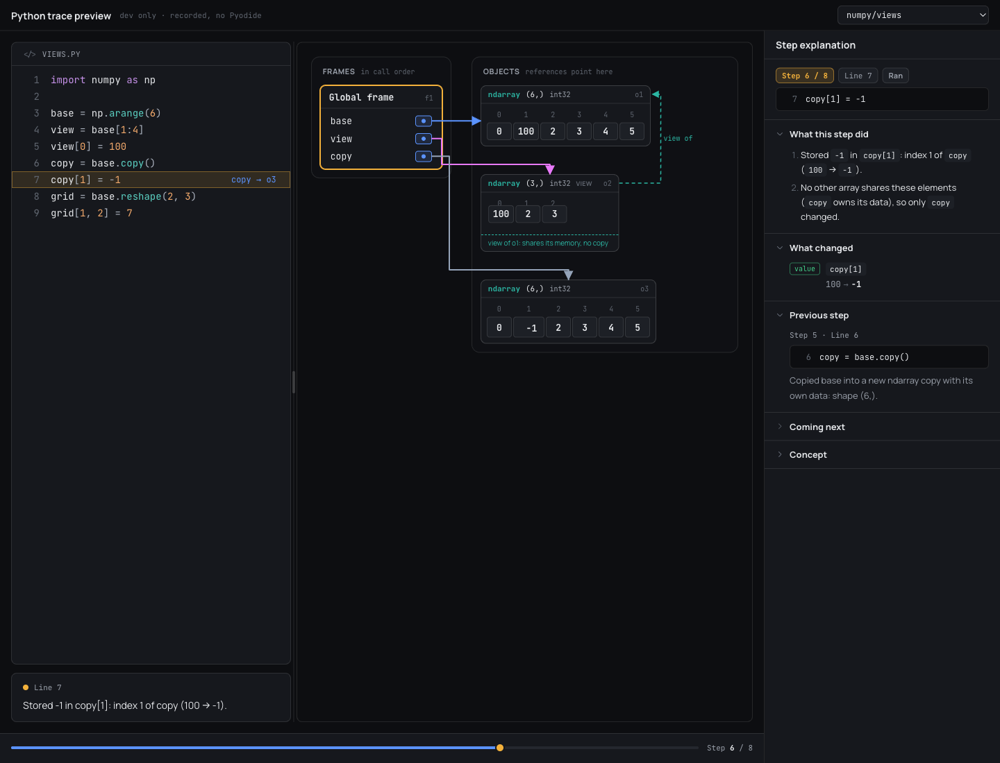

Creating arrays: 1-D and 2-D grids, `linspace`'s view of an unnamed array (light); scrolled to the
3-D slice stack (dark).

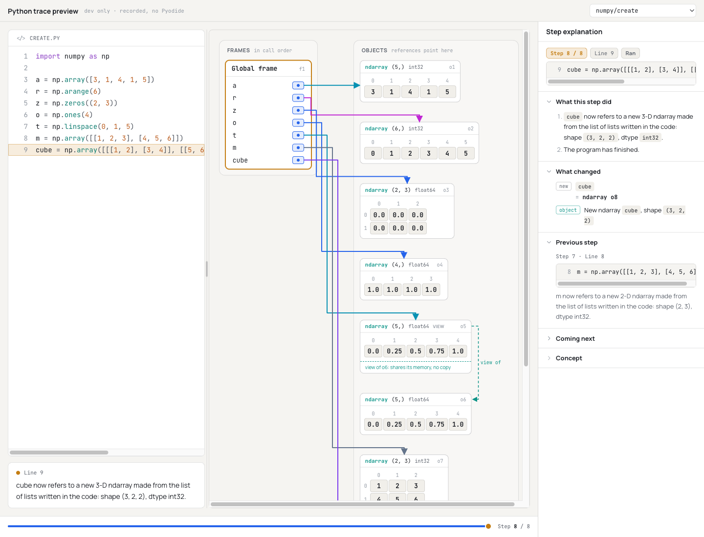
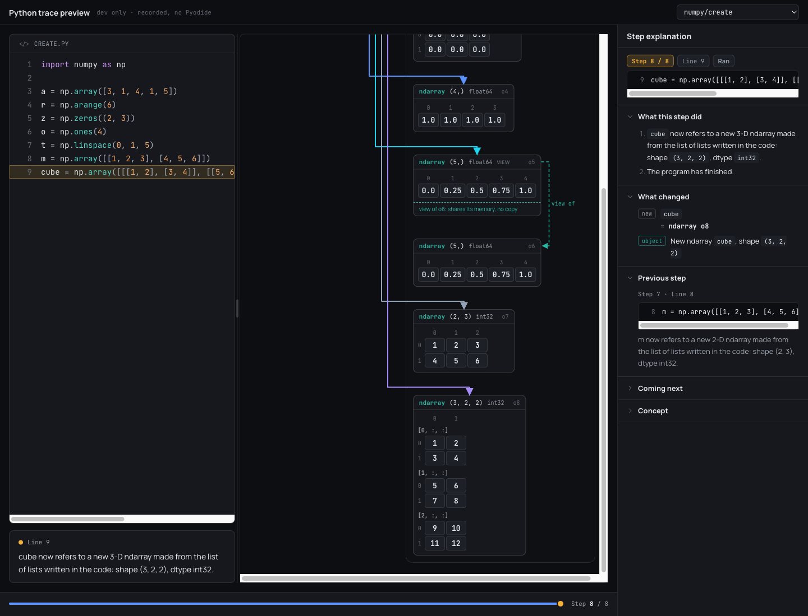

Broadcasting: `outer = col + row`, results beside their first operand (1920 px).

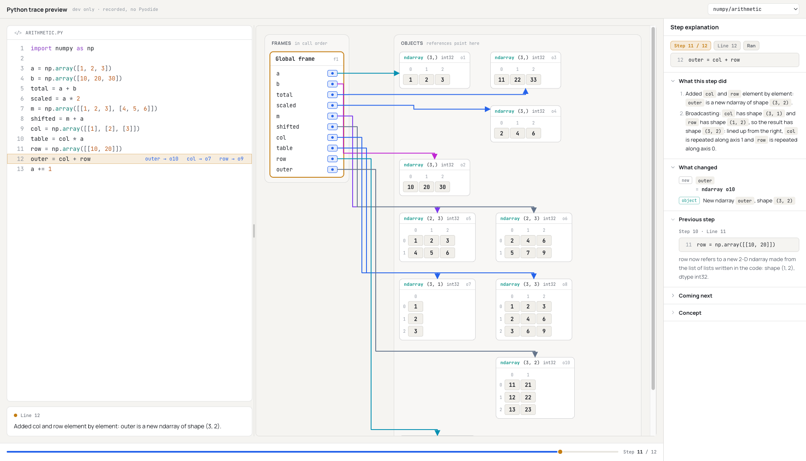
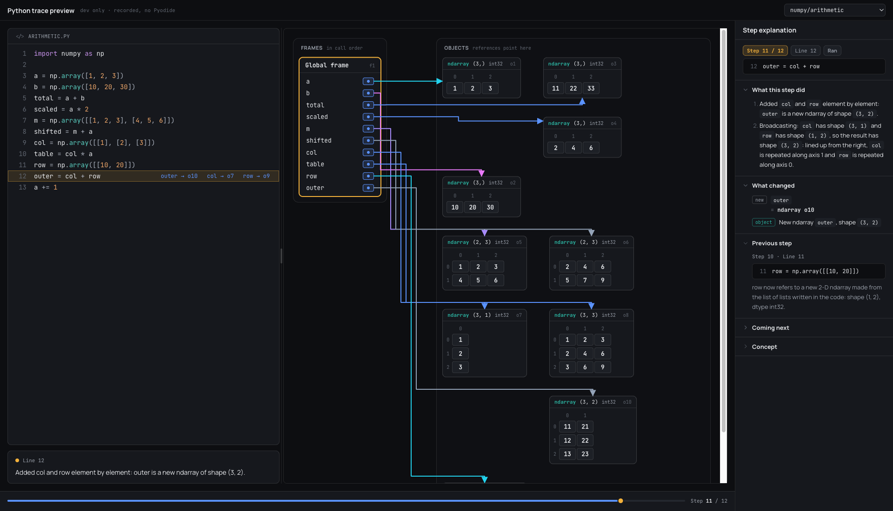

Reshape and transpose: `grid` and `turned` are views of `flat`; `flat` reshaped in place; `back`
is a copy.

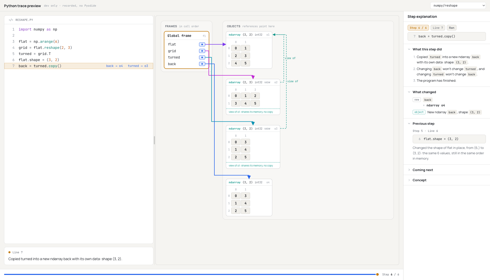
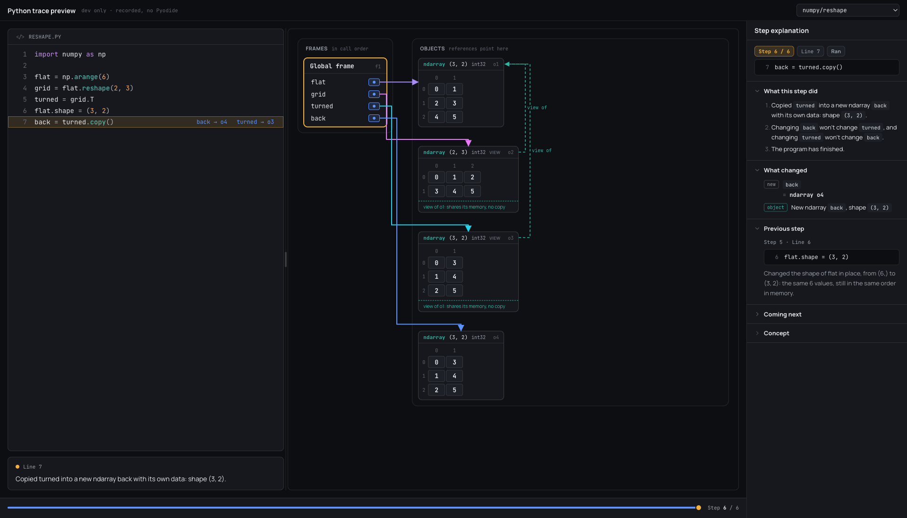

Capped (500 values) and 4-D arrays fall back to the summary; `big[:5]` is a grid.

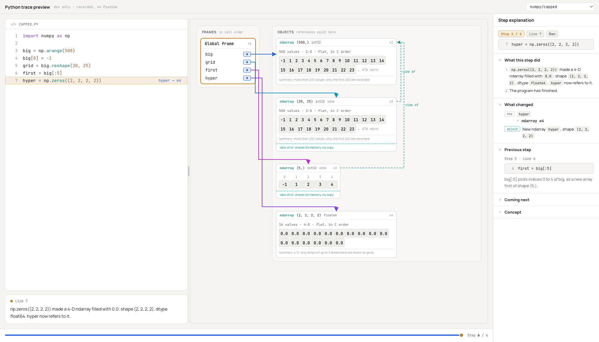
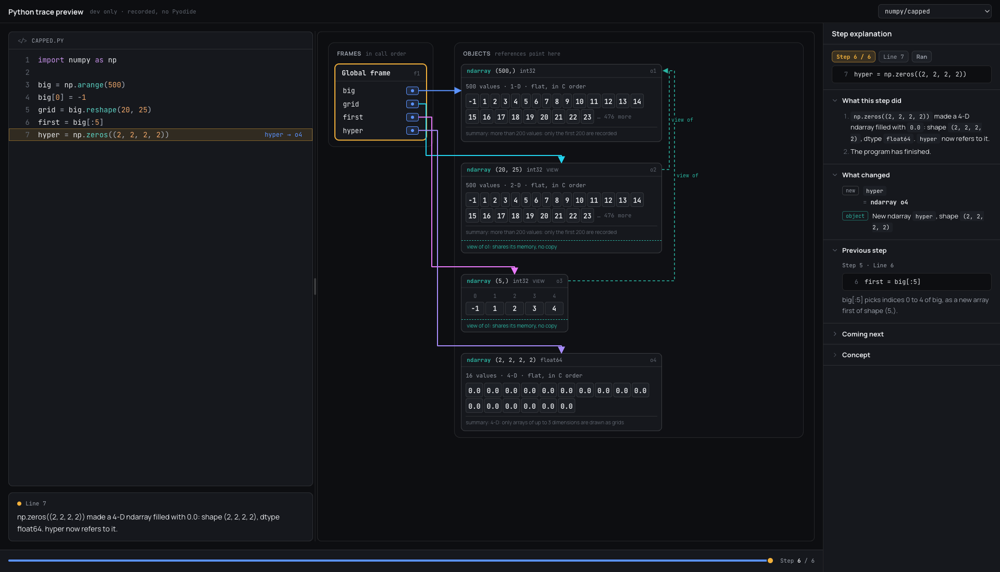

Python live coding with NumPy. `row[2] = -5` writes through to `grid` and to the unnamed array
both are views of; and a second program showing other dtypes (a 30×30 summary, `np.eye`, strings,
complex as a summary).

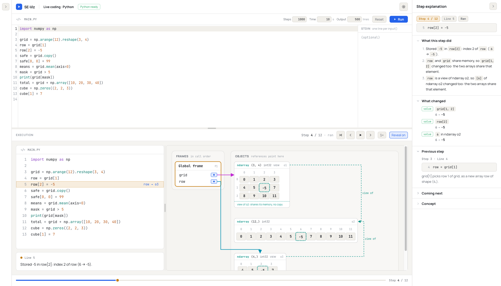
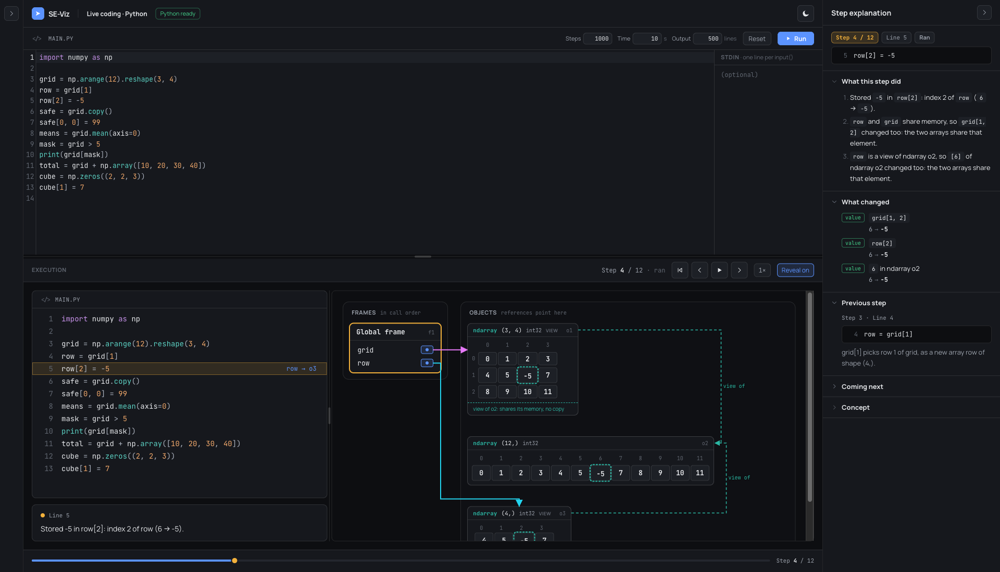
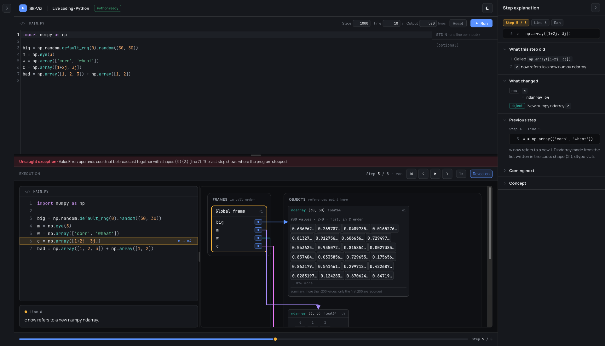
