# Phase 36 Report — matplotlib figure output

## 1. Summary

matplotlib figures now appear as step output in the Python player, at the step that produced them.

- **Capture (recorder).** During a run the recorder replaces `plt.show()` (and `fig.show()`) with a
  capture of every open figure, which it then closes. It also captures any figure still open when
  the program ends. Each figure is attached to the snapshot taken right after the line that showed
  it, with an id, matplotlib's number, its title (if set), its size, its format and, per axes, the
  chart calls made (`plot`, `scatter`, `bar`, `barh`, `hist`, `pie`, `boxplot`), the title, the axis
  labels and the legend entries. matplotlib runs on the non-interactive **Agg** backend.
- **Caps.** At most 6 figures per run are rendered. A figure is an SVG if that is under 300 KB, else
  a PNG at 100 dpi (if that is under 300 KB too). Anything larger becomes a "figure too large"
  note with no image. The 7th and later figures are listed as "not kept" notes.
- **Display.** The console panel ("Output") shows a row of thumbnails: every figure produced at or
  before the current step, cumulative like printed output. Figures produced by this step are
  marked **NEW**. Clicking a thumbnail opens a larger view over the visualization panel (Close / Esc).
  Stepping back past a figure's step hides it, and closes its large view. Figures keep
  matplotlib's own colours on a white surface in both themes.
- **Security.** Figure SVG is treated as hostile.
  - It is parsed by a strict XML parser of my own (`sanitizeSvg.ts`), filtered to an allow-list of
    SVG drawing elements and attributes, and re-written.
  - It is then parsed with `DOMParser` (`image/svg+xml`), re-checked on the DOM with the same rules,
    and imported into its container with `importNode` / `replaceChildren`.
  - A PNG is shown only from a validated `data:image/png;base64,` URL.
  - There is no `dangerouslySetInnerHTML` (or `innerHTML`) anywhere in `src`.
- **Explanations.** Derived text names the chart type from the call (`Drew a line plot of
  `rain_mm` against `months` on the current axes.`). It also covers titles, axis labels,
  `suptitle`, `legend`, `plt.figure` / `plt.subplots`, `plt.show()` and `savefig`, plus one sentence
  per figure the step produced, read from the recorded figure. "What changed" gains a `figure` row.
- **Samples.** Five recorded samples: line, scatter, bar (captured at the end, never shown),
  histogram (two figures at two steps), and one figure with two subplots. Mapped traces are in
  `src/content/fixtures/python/matplotlib/`; each has a golden explanation file.

**Gates on `phase-36-matplotlib-output`:** `typecheck`, `lint`, `test` (**960/960**, 56 files) and
`build` pass.

- `node scripts/check-bundle.mjs --baseline 773158 --budget 25000` passes. The main chunk is
  **774,621 B**, a delta of **+1,463 B**.
  - That is the stage wiring, the console slot, the 26-line `figuresAt` selector, the `figure`
    badge and the CSS.
  - The figure display and the sanitizer are a new lazy chunk, `FigureOutput-*.js` (12,654 B).
  - The matplotlib explanations are in the existing lazy Python deriver chunk, `python-*.js`
    (95,309 B; it was 86,604).
  - The worker chunk grew from 74,678 to 87,075 B (the recorder's figure code).

**No new npm dependencies.** matplotlib 3.10.8 comes from the pinned Pyodide 314.0.7 jsDelivr CDN.
No existing snapshot, golden or fixture changed (§5). Nothing was merged or pushed, and no stop
condition was hit.

## 2. What I built

**Recorder (`src/python/recorder.py`)**
- `_Figures`. It does nothing unless `matplotlib` is already in `sys.modules`, so the recorder still
  imports nothing third-party.
  - `setup()` runs before the clock starts. It sets Agg (`plt.switch_backend("Agg")`), runs
    `rcdefaults()` and `plt.close("all")`, so an earlier run can't leak figures or style. It then
    patches `pyplot.show` and `Figure.show`, and wraps the `CHART_CALLS` methods of `Axes`.
  - `teardown()` restores everything (an inherited attribute is deleted again) and closes all
    figures.
  - The chart wrappers count only the outermost call, so `hist` (which draws with `bar`) is a
    histogram.
  - `capture(trigger)` takes each open figure's facts and image, then runs `plt.close("all")`.
  - `_render` does the following:
    - It writes an SVG with `svg.fonttype: none`, `svg.hashsalt: se-viz` and no metadata, so
      recordings are stable.
    - Under 300 KB, the SVG is used. Over 9 M pixels at 100 dpi, the figure is "too large" without
      trying a PNG. Otherwise a PNG at 100 dpi is tried, and over 300 KB that is "too large" too.
    - `savefig` failing gives `reason: 'error'`.
    - Warnings are suppressed, so they never reach the program's output.
- Captured figures wait in `pending` and are sent on the next snapshot (`snap["figures"]`).
  Figures still open are captured just before the module's own `return` snapshot.
- matplotlib objects (`Figure`, `Axes`, `Line2D`, …) are one opaque `kind: 'other'` object each.
  Their repr is used, or `<Line2D>` when the repr would contain a memory address. Their
  `__dict__` (matplotlib internals) is never walked.
- `plt.show` is replaced by a plain function, not a bound method. pyplot sets `__signature__` on
  its `show` when it resolves the backend, and the first version broke `plt.bar` because of this.
  The recording caught it.

**Protocol / trace contract (additive)**
- `protocol.ts`:
  - `PySnapshot.figures?: PyFigure[]`, plus `PyFigure` and `PyFigureAxes`;
  - `ChartCall`;
  - the caps `FIGURES_CAP`, `FIGURE_BYTES_CAP`, `FIGURE_PNG_DPI` and `FIGURE_MAX_PIXELS`.
- `types.ts`:
  - `Trace.figures?: TraceFigure[]`, plus `TraceFigure`, `FigureAxesInfo` and `ChartKind`;
  - figures are trace-level, so each image is stored once.
- `mappings/figures.ts` (new): `traceFigures(result, planned)` attaches each figure to the step of
  the snapshot that carried it. A snapshot that makes no step hands it to the next step that has
  one, else to the last step. `PlannedStep` gains `snapIndex`.
- `toTrace.ts`: `recordingToTrace` sets `trace.figures` when there are any, before deriving the
  narrations.
- `validate.ts`, Python rules:
  - figure ids are unique;
  - each figure's `step` exists;
  - figures are in step order;
  - `svg` / `png` figures have `data`, and a `png` must be a `data:image/png;base64,` URL;
  - `none` figures have a `reason` and no `data`.
- `engine/trace/figures.ts` (new, main chunk, tiny): `figuresAt(figures, stepIndex)`, the pure
  selector, and `figuresMadeAt(trace, k)`.

**Worker (`src/python/worker.ts`):** when matplotlib is loaded it also imports `matplotlib.pyplot`
once, untraced, so the import doesn't count against the program's time limit.

**Display (`src/components/python/figure/`, lazy chunk `FigureOutput`)**
- `sanitizeSvg.ts`: the sanitizer (§5, item 1), `verifySvgDom` and `safePngDataUrl`.
- `svgDom.ts`:
  - `mountSvg(container, text, prefix)` sanitizes, runs `DOMParser.parseFromString(…,
    'image/svg+xml')`, rejects on `parsererror` or a non-SVG root, runs `verifySvgDom`, then
    `importNode` / `replaceChildren`;
  - `nextFigurePrefix` gives a fresh id prefix per mounted copy.
- `FigureOutput.tsx`:
  - `FigureImage`: sanitized SVG, a validated PNG ``, or a note;
  - `FigureStrip`: the thumbnails, with "NEW", "PNG" and "NOTE" badges;
  - `FigureViewer`: the large view, with a header line such as "line plot · SVG · 12 KB · step 8 ·
    shown by plt.show() · 1 of 2 shown so far". Esc (with `stopPropagation`, so presentation mode
    doesn't also exit) or Close shuts it, and focus goes to Close on open.
- `figureText.ts`: labels.
- `Stage.tsx`:
  - computes `figuresAt(trace.figures, displayStep.index)` and passes the lazy `FigureStrip` into
    `ConsolePanel`;
  - lays the lazy `FigureViewer` over the visualization panel;
  - forgets the open figure when it is no longer visible or the trace changes.
  - Only traces with figures get the extra wrapper `div`; C traces render exactly as before.
- `ConsolePanel.tsx`: an optional `figures` slot. The panel also shows when a step has figures but no
  output, and grows from `max-h-40` to `max-h-72` when there are figures. C markup is unchanged.
- `index.css`:
  - `.se-figure-surface` is white in both themes;
  - `.se-figure svg` fills its box;
  - `.se-figure svg *` restores matplotlib's `stroke-linejoin: round; stroke-linecap: butt` default,
    scoped to figures.

**Explanations (`src/engine/explain/`)**
- `matplotlib.ts` (new):
  - `matplotlibStatement(ctx, stmt)` returns `{ did, lead, concept }` for chart calls, labels,
    `suptitle`, `legend`, `figure` / `subplots` (with "`fig` refers to the figure and `left` and
    `right` to its 2 sets of axes", checked against the recorded objects), `show` and `savefig`.
  - A receiver counts only when it is `pyplot`, as the program's import line named it, or a
    recorded `Axes` / `Figure`.
  - `figureSentence` and `figureRow` describe the figures a step produced, from the recorded facts.
- `python.ts`:
  - matplotlib is the first library reading (before pandas and NumPy);
  - `didApply` adds the figure sentences: figures from `plt.show()` before "The program has
    finished.", end-of-run figures after it;
  - "What changed" gets a `figure` row per figure.
- `types.ts`: `ChangeKind` gains `'figure'`. `ExplanationPanel.tsx` gives it a badge.
- `glossary.ts`: `mpl-chart`, `mpl-labels`, `mpl-figure` and `mpl-show`.

**Samples, recordings and fixtures**
- `src/python/samples/matplotlib/{line,scatter,bar,histogram,subplots}.py` and `index.ts`.
- `scripts/record-python-packages-fixture.mjs` (`npm run py:record-packages`) now:
  - loads matplotlib too;
  - imports it with Agg and imports pyplot, as the worker does;
  - records `samples/matplotlib/*.py` into `src/python/fixtures/matplotlib/*.json`.
- Mapped traces: `src/content/fixtures/python/matplotlib/*.json` (file snapshots in
  `toTrace.test.ts`).
- Offline stand-in: `MATPLOTLIB_STANDIN` and `MATPLOTLIB_STANDIN_PROGRAMS` in `testPrograms.ts`.
  - It is a pure-Python fake `matplotlib` / `pyplot` / `figure` / `axes`, installed into
    `sys.modules`. Its `savefig` writes as many bytes as the program asks.
  - It is recorded on every `npm test` into `fixtures/extra-matplotlib-standin.json` and
    `extra-matplotlib-end.json`.
- The dev preview `/?python-preview&trace=matplotlib/<name>` lists the five traces automatically
  (it globs the fixtures folder).

**Tests (+75; 885 → 960)**
- `src/components/python/figure/sanitizeSvg.test.ts` (27). Adversarial inputs:
  - `script` in five spellings (CDATA, upper case, namespaced `svg:script`, inside a group);
  - event handlers (`onclick`, `ONLOAD`, root `onload`);
  - `foreignObject` with HTML, `iframe` and `img onerror`;
  - external `href` / `xlink:href` (`https:`, `data:image/svg+xml`, `javascript:`, `file:`), and
    links on `a`, `g` and `text`;
  - `image` with a non-PNG or non-JPEG data URL, and an attribute-breakout attempt;
  - CSS `url()` to external resources (quoted, `//`, escaped `u\72l(`), `behavior`,
    `-moz-binding`, `expression()`, comments, `@import`;
  - `style`, `metadata`, `set` / `animate` (an href rewrite), `filter` / `feImage`, namespaced HTML;
  - DOCTYPE internal subsets (billion laughs, external entities), undefined entities, a bare `&`,
    `&#0;`, surrogates;
  - mismatched or unclosed tags, two roots, unquoted, duplicate or `<` attributes, too deep, too
    big, a bad prefix.
  - Plus: output escaping, id prefixing, idempotence, the DOM re-check on a fake DOM, the PNG URL
    validator, and every recorded matplotlib SVG surviving with all its paths, texts and `use`s
    and with clip paths still resolving.
- `src/python/matplotlibRecorder.test.ts` (16): real recorder in Node Pyodide, against the stand-in.
  - The caps match `recorder.py`.
  - Format by size, as a sequence: svg / png / too-large (pixels, no PNG tried) / too-large (PNG
    over the cap) / error / svg / cap / cap. The stand-in's log shows exactly which renders
    happened.
  - Step attachment (the snapshot after each `plt.show()` line).
  - Chart calls are outermost only; labels and sizes are recorded.
  - Clean stdout: no warnings, and the original `show` never runs.
  - End-of-run capture with legend and suptitle.
  - Patches are undone, and a figure left open before a run isn't captured.
  - matplotlib objects are opaque and carry no addresses.
  - Nothing happens without matplotlib.
  - On the five real recordings: figure count, chart calls, format, the byte count is the real
    size, each figure is on the step whose line showed it (bar: the last step), and the labels.
- `src/engine/trace/figures.test.ts` (6): the pure selector. Stepping back hides later figures; the
  histogram's backward walk is the forward walk reversed; the live ending step shows all figures.
- `src/components/python/figure/FigureOutput.markup.test.tsx` (13):
  - the strip: buttons, names, the NEW mark only on this step's figures, the PNG `img`, notes;
  - no SVG in server markup;
  - a PNG figure with bad data is refused;
  - the viewer's header and Close button;
  - the label helpers;
  - the stage renders each matplotlib trace with no strip at step 1.
- `src/engine/explain/matplotlib.test.ts` (3): the `pyplot` import forms, the sentences for the
  imageless figures (including the two different "too large" cases), and the `figure` row.
- `golden.test.ts`: 5 new goldens, `golden/matplotlib-*.md`. `toTrace.test.ts`: 5 new mapped traces.

## 3. Acceptance criteria — self-assessment

- [x] **1. Gates pass; additive and documented; sanitizer in place; no `dangerouslySetInnerHTML`.**
  - The gates pass (§1).
  - **Additive:**
    - one optional snapshot field and one optional trace field;
    - one `ChangeKind`;
    - a `PlannedStep` field;
    - matplotlib objects (never recorded before) as `other`.
  - Re-recording with `npm run py:record-packages` rewrote every NumPy, pandas and
    `packages-numpy-pandas.json` fixture **byte-identical**, with matplotlib loaded in the same
    Pyodide. Every Phase 29–35 fixture, trace, golden and snapshot is unchanged (`CI=1 npm test`).
  - Documented in `docs/PYTHON_TRACE_FORMAT.md` ("matplotlib figures (Phase 36)") and
    `docs/TRACE_FORMAT.md` ("Phase 36 additions").
  - Sanitizer: `src/components/python/figure/sanitizeSvg.ts` (§5, item 1).
  - `grep -rn dangerouslySetInnerHTML src` finds only three comments that say it is never used
    (`Markdown.tsx`, `mermaidRuntime.ts`, `svgDom.ts`). `innerHTML` is not used in any `.ts` /
    `.tsx` code.
- [x] **2. All five samples show the right figures at the right steps in live coding.**
  - In Chrome (Playwright MCP, dev server), each sample was typed into **Live coding · Python** and
    run (matplotlib loaded from the pinned CDN). A script then stepped every beat forward and back.

    | Sample | Steps | Figures appear (apply beat) | Stepping back |
    |--------|-------|-----------------------------|---------------|
    | line | 9 | Figure 1 at step 8, line 10 `plt.show()`; still there at step 9 | gone from step 7 |
    | scatter | 9 | Figure 1 at step 9, line 11 `plt.show()` (the last line) | gone from step 8 |
    | bar | 15 | Figure 1 at step 15, the last step (still open at the end; no `show`) | gone from step 14 |
    | histogram | 11 | Figure 1 at step 6 (line 8); Figure 2 added at step 11 (line 14) | 2 → 1 at step 10, 0 at step 5 |
    | subplots | 13 (14 after adding `tight_layout`) | Figure 1 (two subplots) at the `plt.show()` step | gone one step earlier |

  - On a step's `arrive` beat the display shows the state before the line, so the figure appears
    on `apply`, consistent with printed output.
  - The step counts equal the committed recordings, and the explanation panel's text matches the
    goldens.
- [x] **3. Caps enforced; the app stays responsive with 6 figures.**
  - **Cap:** a loop showing 8 figures gave 6 SVG thumbnails plus "Figure 7" and "Figure 8" notes
    ("Not kept: at most 6 figures per run"); `made 8 figures` was printed (screenshots `cap`).
  - **Responsiveness:** a 50 ms timer on the main thread saw at most **17 ms** of lag while I
    stepped 120 beats forward and 120 back through that 123-step trace, with all 6 figures mounted.
  - **Large figures:**
    - A 6,000-point scatter: its SVG is over 300 KB, so it is a **PNG** (34 KB), shown via its
      data URL, with a PNG badge.
    - A 40 × 40 inch figure: 16 M pixels at 100 dpi, so "Figure too large to show"; no PNG was
      even attempted.
  - Caps are also tested offline against the stand-in (§2).
- [x] **4. Screenshots in both themes in the report.** See below; 7 views × 2 themes. Each one was
  looked at. Three problems found that way were fixed:
  - the subplots sample's x label was cut off (matplotlib's own layout: added `fig.tight_layout()`
    and re-recorded);
  - the too-large wording claimed a PNG had been made when none was;
  - a sentence with two colons.

## 4. How to run & verify

```sh
npm ci
npm run typecheck && npm run lint && npm test && npm run build
node scripts/check-bundle.mjs --baseline 773158 --budget 25000
# → main chunk index-*.js: 774621 B; delta +1463 B; ✓
npm run py:record-packages   # optional, network (pinned Pyodide CDN only): re-records NumPy, pandas, matplotlib
npm run dev
```

1. **Dev preview (no Pyodide):** `/?python-preview&trace=matplotlib/histogram`. The others are
   `matplotlib/line`, `scatter`, `bar` and `subplots`.
   - Press End: two thumbnails under "Output", Figure 2 marked NEW. Click one to see it large;
     press Esc.
   - Step back (←): Figure 2 disappears, and its large view closes.
2. **Live coding · Python:** paste any sample from `src/python/samples/matplotlib/` and Run. The
   first run downloads matplotlib and its dependencies from
   `cdn.jsdelivr.net/pyodide/v314.0.7/full/`; the network tab shows no other origin.
3. **Regenerate after a recorder change**, in this order:
   1. `npm run py:record-packages`;
   2. `npx vitest run src/python/matplotlibRecorder.test.ts -u` (the stand-in fixtures);
   3. `npx vitest run src/python/toTrace.test.ts -u`;
   4. `npx vitest run src/engine/explain/golden.test.ts -u`.

**Browser check (Playwright MCP, Chrome, dev server, 1680 × 1000, both themes):**
- All five samples were typed into live coding and stepped as in §3.
- The 8-figure program, the large-figure program, and a hostile-text program:
  `plt.title("<script>alert(2)</script>")` and
  `plt.xlabel("javascript:alert(3)")` render as plain text in the figure, with no element created
  and no dialog.
- In the mounted DOM there are no `style`, `script` or `foreignObject` elements under
  `.se-figure`, and no `xlink:href`. Ids are prefixed per copy (`sv61-fig1-figure_1`), with no
  duplicate ids across the thumbnail and the large view. `clip-path="url(#sv61-fig1-p…)"`
  resolves.
- Esc on the large view closes it. It also stops the key from reaching the player's own Esc
  handler, which exits presentation mode; that interplay was not exercised in presentation mode.
- Network: only the app origin and `cdn.jsdelivr.net/pyodide/v314.0.7/full/` (matplotlib 3.10.8,
  contourpy, numpy, cycler, six, fonttools, kiwisolver, packaging, pillow, pyparsing,
  python_dateutil, pytz).
- No console errors apart from the existing `favicon.ico` 404.
- The dev server is stopped and the browser closed. Playwright's files went to
  `Frontier-work/.playwright-mcp/`, outside the repo; nothing of it is committed.

## 5. Key decisions & deviations

1. **The sanitizer: written here, strict, two layers (no dependency).**
   - **Layer 1, `sanitizeSvg(text, prefix)`.** A small XML parser that fails closed: anything
     malformed rejects the figure, and the panel shows "could not be shown safely". Rejected:
     - DOCTYPE with an internal subset;
     - entities other than the five XML ones and numeric references (no control characters or
       surrogates);
     - mismatched tags, duplicate or unquoted attributes, or `<` in an attribute;
     - more than 64 levels or 60,000 nodes;
     - more than 1 M characters.

     It then keeps only listed SVG drawing elements and listed attributes, and writes fresh
     markup with escaped text and values. The rules:
     - **Dropped with their content:** `script`, `style`, `foreignObject`, `a`, `set` / `animate*`,
       `metadata`, `filter` / `fe*`, any namespaced element, anything unlisted.
     - **Dropped attributes:** every `on*`, `class`, `xmlns*`, anything unlisted, and any value with
       `<`, `>`, `"`, `=`, `\`, `/*`, `@`, `expression(`, `javascript:`, `vbscript:`, `data:`, or a
       control character.
     - **Links:** `href` / `xlink:href` only on `use`, gradients, patterns (a local `#id`) and
       `image` (a base64 PNG or JPEG data URL only). They are written as SVG 2 `href`, so no xlink
       namespace is needed.
     - **CSS:** `style` keeps only listed properties. `url()`, in CSS or in presentation attributes,
       is allowed only as a local `url(#id)`, and any other `url(` drops the value.
     - **Ids:** every id gets a per-copy prefix, and so does every `#id` reference. This also
       stops a figure from clobbering app ids.
     - **Size:** the root's `width` / `height` are removed (its container sizes it; the
       `viewBox` keeps the aspect ratio).
   - **Layer 2.** The clean text is parsed with `DOMParser` as `image/svg+xml`. `verifySvgDom`
     re-applies the same rules to the DOM (a guard against parser differences), and then it is
     imported with `importNode`.
   - matplotlib's own `<style>*{stroke-linejoin: round; stroke-linecap: butt}</style>` is dropped,
     because a `<style>` in inline SVG would style the whole page. The same default is applied by
     scoped CSS (`.se-figure svg *`).
2. **Where the samples live.** The prompt says "under `src/content/fixtures/python/matplotlib/`".
   That is where the five **mapped traces** are. Following the Phase 34 / 35 layout:
   - the sources are in `src/python/samples/matplotlib/`;
   - the raw recordings are in `src/python/fixtures/matplotlib/`.
3. **Fixture size: SVG with text as text, each image stored once.**
   - `svg.fonttype: 'none'` writes `<text>` instead of glyph outlines. Measured: 13.6 KB vs
     22.1 KB for the same line chart. Text then renders in the browser's sans-serif (matplotlib
     asks for DejaVu Sans, then a list of fallbacks), so letter widths can differ slightly from
     matplotlib's.
   - Figures are trace-level (`Trace.figures` with a `step`), not on every step, so each image is
     stored once per file.
   - Totals:
     - raw recordings: 220 KB;
     - mapped traces: 264 KB;
     - stand-in recordings: 84 KB.
   - None of it is in a production bundle: I grepped `dist/` for a figure title and found nothing.
     The figure display and sanitizer are a 12.7 KB lazy chunk.
4. **"Anything larger" and the cap, as I read them.**
   - "Larger" means the PNG at 100 dpi is also over 300 KB.
   - I added one guard the prompt doesn't name: no PNG is attempted for a canvas over 3000 × 3000
     pixels at 100 dpi. A 40 × 40 inch figure would otherwise allocate a 64 MB buffer in the
     worker. It is a "too large" note at once.
   - Figures past the 6th are **listed as notes** ("Not kept: at most 6 figures per run"), never
     rendered, rather than vanishing silently.
5. **Step attachment** is to the first snapshot after the capture: the state after the line that
   showed the figure. End-of-run figures are captured just before the module's own `return`
   snapshot, which is the last step (the bar sample).
6. **The large view lies over the visualization panel** (inside the stage), rather than replacing
   the canvas. The canvas keeps its state, and Esc or Close returns to it.
7. **The subplots sample calls `fig.tight_layout()`.** Without it, matplotlib puts the 3.5-inch-tall
   figure's x label partly outside the figure: the "y" of "Day" was cut, as it is in matplotlib
   itself. The sample was re-recorded with the script.
8. **matplotlib objects are opaque `other` objects** with their repr (`<Axes: title={'center':
   …}>`). Walking a `Figure`'s `__dict__` would fill the 300-object budget with matplotlib
   internals. A side effect: setting a title shows a "What changed" value row on the Axes' `repr`.
   That is true, if a little noisy.
9. **Recognizing `pyplot`.** Modules never appear in frames, so the explanations read the alias from
   the program's import lines: `import matplotlib.pyplot as plt`, `from matplotlib import pyplot
   [as p]`, and `import matplotlib.pyplot`. An `Axes` or `Figure` receiver is recognized from the
   recorded object's type.

**Existing snapshots, goldens, fixtures and tests that changed: none.** No existing test was
edited. These existing files changed, all additively: `golden.test.ts` and `toTrace.test.ts` (new
blocks), `testPrograms.ts` (new exports), and `ExplanationPanel.tsx` (one badge entry).
`npm run py:record-packages` re-wrote the NumPy, pandas and `packages-numpy-pandas.json` fixtures
byte-identical.

## 6. Trace format / API notes

See `docs/PYTHON_TRACE_FORMAT.md`, "matplotlib figures (Phase 36)", and `docs/TRACE_FORMAT.md`,
"Phase 36 additions". In short:

```ts
// raw (protocol.ts)
interface PySnapshot { /* … */ figures?: PyFigure[] }   // each figure once, on the snapshot after it was shown
interface PyFigure { id; number; trigger: 'show' | 'end'; width; height; title?;
  axes: { kinds: ChartCall[]; title?; xlabel?; ylabel?; legend? }[];
  format: 'svg' | 'png' | 'none'; bytes?; data?; reason?: 'too-large' | 'cap' | 'error'; error? }
FIGURES_CAP = 6; FIGURE_BYTES_CAP = 300 * 1024; FIGURE_PNG_DPI = 100; FIGURE_MAX_PIXELS = 3000 * 3000

// trace (types.ts)
Trace.figures?: TraceFigure[]   // { id, step, number, trigger, title, width, height, axes, format, bytes, data?, reason? }
figuresAt(trace.figures, stepIndex) → figures with step <= stepIndex   // engine/trace/figures.ts
ChangeKind += 'figure'
// display: ConsolePanel({ figures?: ReactNode }); lazy FigureStrip / FigureViewer (components/python/figure)
```

## 7. Known issues / follow-ups

- **A run stopped early** (a limit, Stop, a kill) captures no end-of-run figures. A figure shown
  right before the stop is lost if no later snapshot is taken to carry it.
- **Rendering time counts against the time limit.** A huge SVG, for example 100,000 scatter
  points, can take seconds in the worker. If the main thread kills the worker, figures not yet
  carried by a streamed snapshot are lost.
- **Text in SVG figures uses browser fonts** (§5, item 3). Labels can be a few pixels wider or
  narrower than matplotlib laid them out.
- **Chart types are only the seven calls.** `imshow`, `fill_between`, `step`, `errorbar` and the like
  are described as "a set of axes with no plotting call this view names". The image itself still
  shows. An `imshow` image is embedded in the SVG as a base64 PNG, which the sanitizer allows.
- **Explanation coverage.**
  - `plt.legend()` says only "Added a legend". The legend entries are in the figure sentence.
  - Calls such as `tight_layout`, `xlim` and `grid` get the generic "Called …" text.
  - `import matplotlib as mpl; mpl.pyplot.plot(…)` is not recognized as pyplot.
- **The first matplotlib load is slow on a cold cache.** It took about 40 s here: matplotlib plus
  11 dependency wheels, about 15 MB. Later runs reuse the worker.
- **The console panel grows to 18rem when there are figures.** With the editor split at its default,
  the visualization area is short. Dragging the editor split up, as in the screenshots, fixes it.
- **Not tested in a browser:** `fig.show()` and a `savefig` failure. Both are covered by the
  stand-in tests only.

## 8. File map

```
src/python/recorder.py, protocol.ts, worker.ts, toTrace.ts, testPrograms.ts      (changed)
src/python/mappings/plan.ts                                                      (changed: snapIndex)
src/python/mappings/figures.ts                                                   (new)
src/python/samples/matplotlib/{line,scatter,bar,histogram,subplots}.py, index.ts (new)
src/python/fixtures/matplotlib/*.json (5)                                        (new, recorded by the script)
src/python/fixtures/extra-matplotlib-standin.json, extra-matplotlib-end.json     (new, recorded by npm test)
src/python/matplotlibRecorder.test.ts                                            (new)
src/python/toTrace.test.ts                                                       (changed: new block)
src/content/fixtures/python/matplotlib/*.json (5)                                (new, generated)
scripts/record-python-packages-fixture.mjs                                       (changed: matplotlib)
src/engine/trace/types.ts, validate.ts                                           (changed)
src/engine/trace/figures.ts, figures.test.ts                                     (new)
src/engine/explain/matplotlib.ts, matplotlib.test.ts, golden/matplotlib-*.md (5) (new)
src/engine/explain/python.ts, types.ts, glossary.ts, golden.test.ts             (changed)
src/components/python/figure/sanitizeSvg.ts, sanitizeSvg.test.ts, svgDom.ts      (new)
src/components/python/figure/FigureOutput.tsx, figureText.ts, FigureOutput.markup.test.tsx (new)
src/components/Stage.tsx, ConsolePanel.tsx, studio/ExplanationPanel.tsx         (changed)
src/index.css                                                                    (changed: figure surface)
docs/PYTHON_TRACE_FORMAT.md, docs/TRACE_FORMAT.md                                (changed)
reports/phase-36-matplotlib-output.md, reports/assets/phase36-*.png (14)        (new)
```

### Screenshots

All are from **Live coding · Python** in the dev server (the course map is collapsed and the editor
split dragged up).

`line.py` at step 8 (`plt.show()`): the figure appears, marked NEW, open in the large view; the
explanation names the chart and its labels.

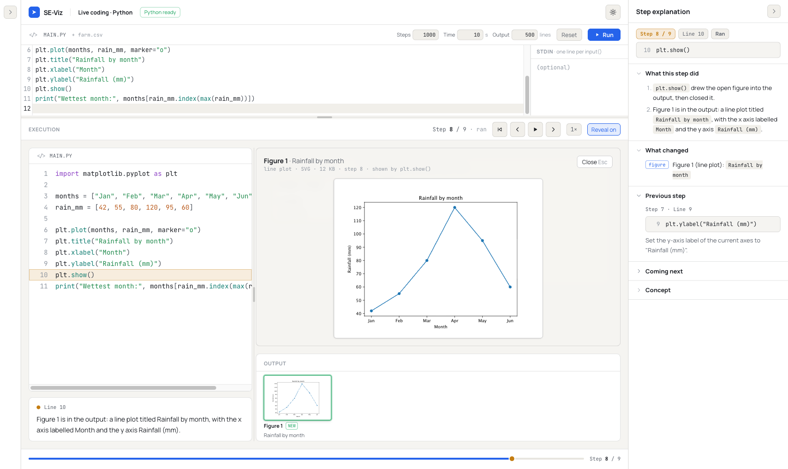
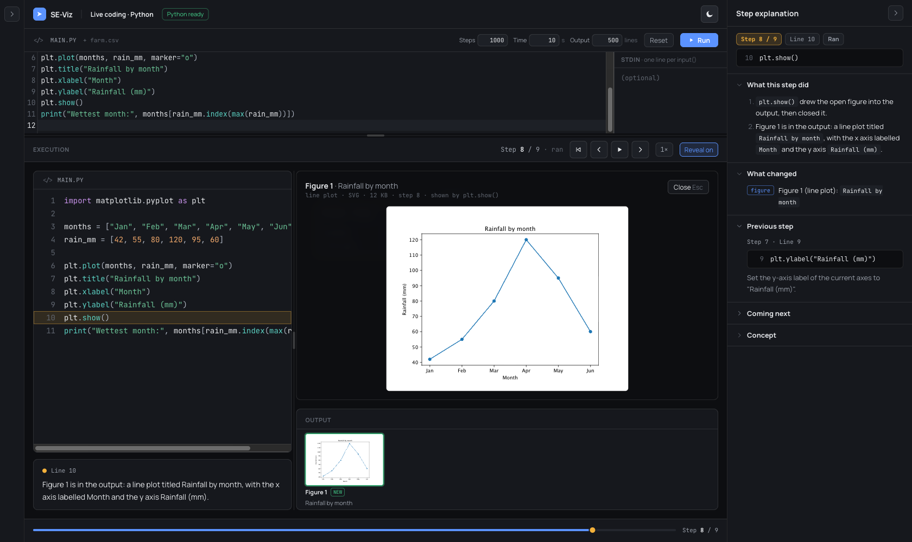

`histogram.py` at the last step: two figures from two `plt.show()` calls.

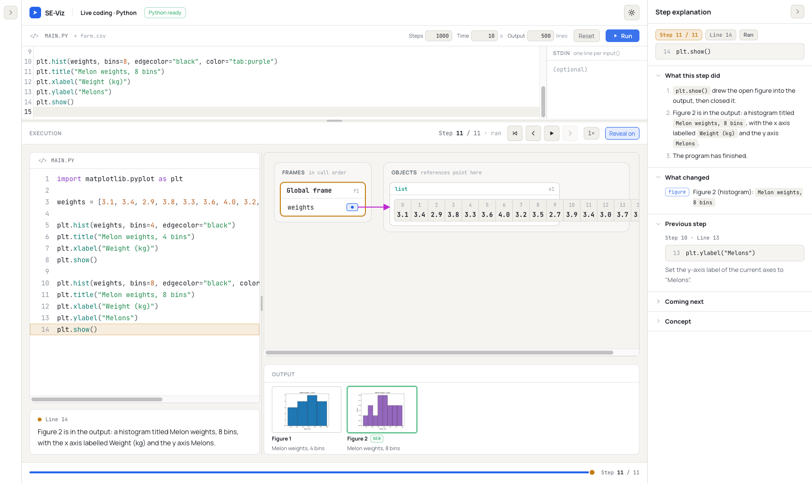
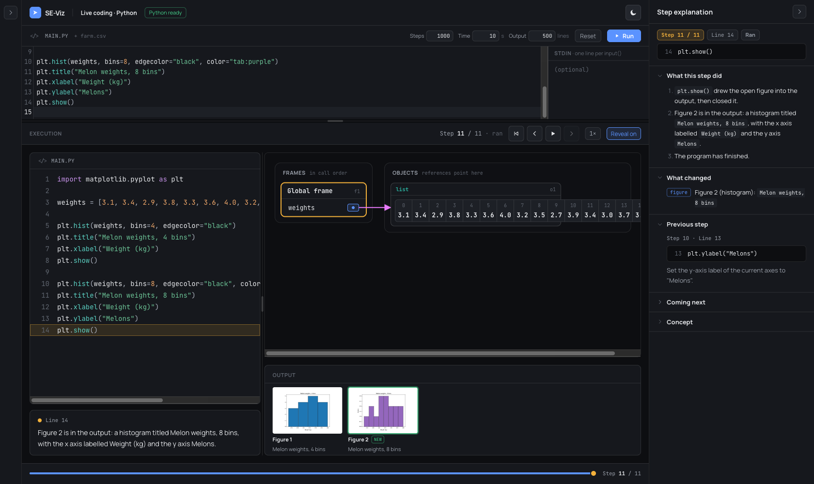

The same trace stepped back to step 10: Figure 2 is gone, and Figure 1 stays.

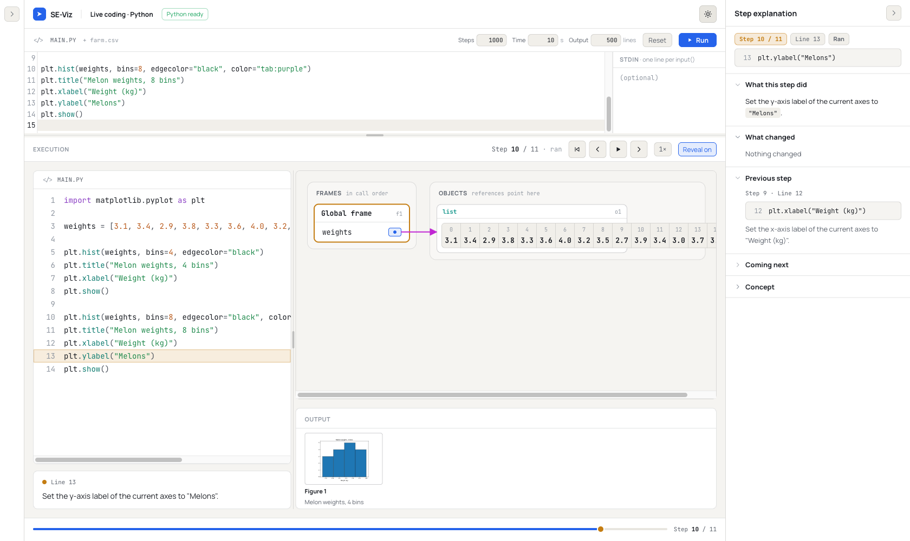
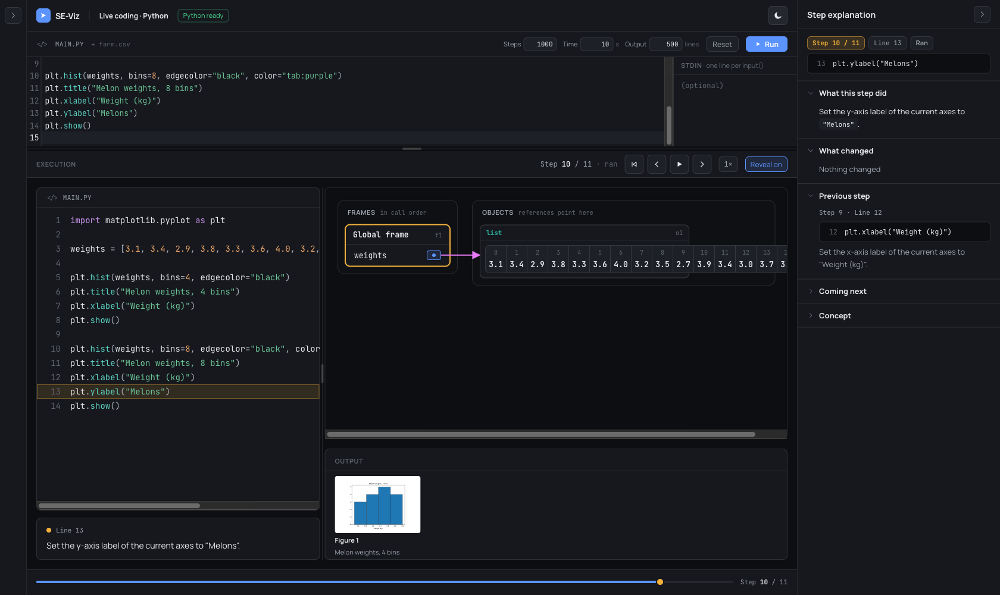

`subplots.py`: one figure, two subplots, in the large view.

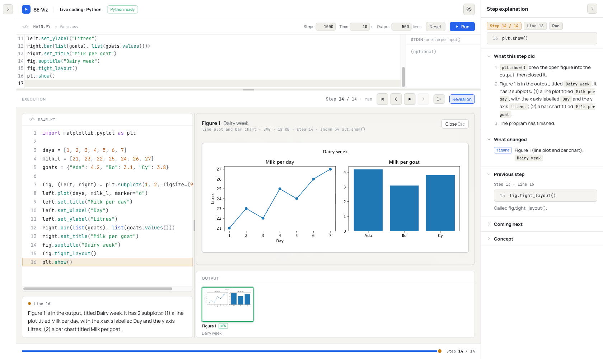
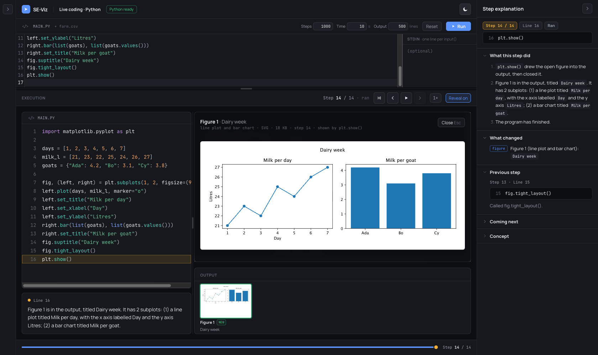

`bar.py`: never shown with `plt.show()`, so captured when the program ended (last step).

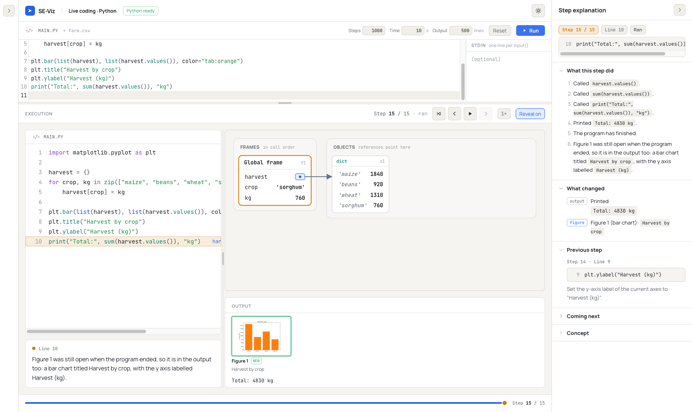
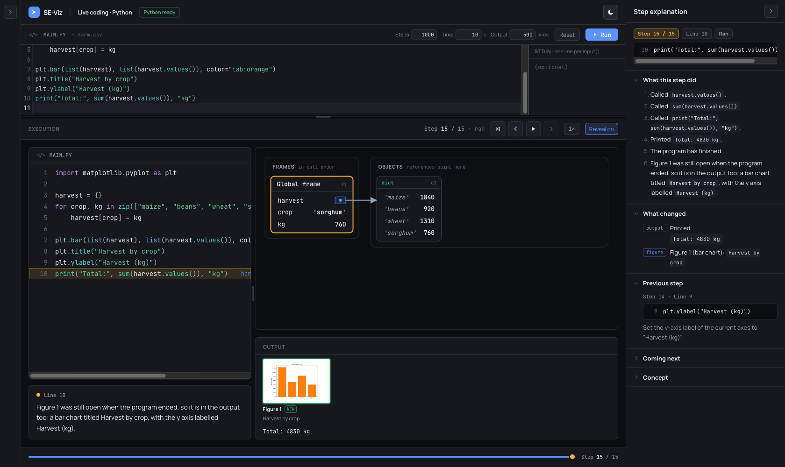

Eight figures in a loop: six kept, Figures 7 and 8 listed as notes (the strip is scrolled to its
end).

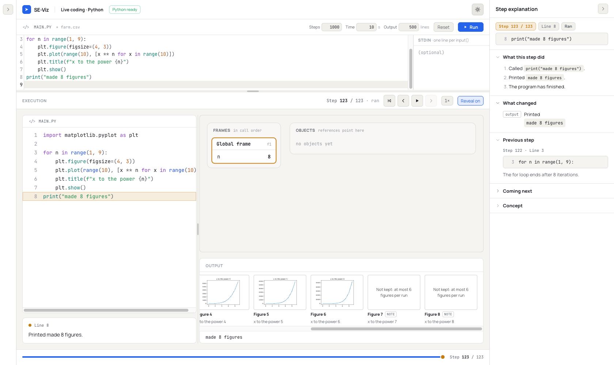
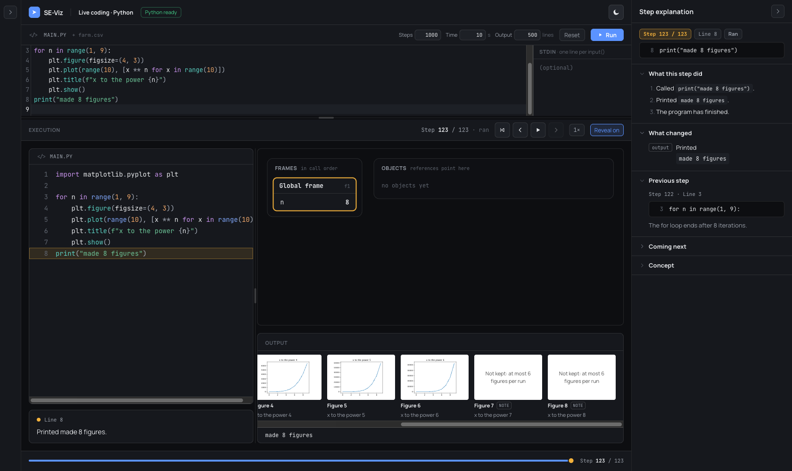

Large figures: a 6,000-point scatter as a PNG (its SVG is over 300 KB), and a 40 × 40 inch figure
as a "too large" note.

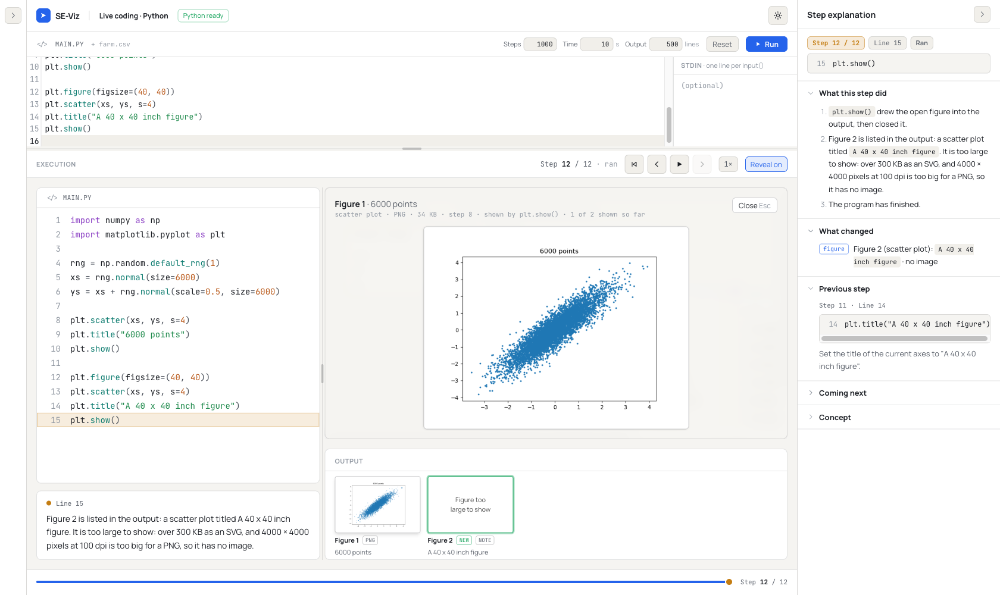
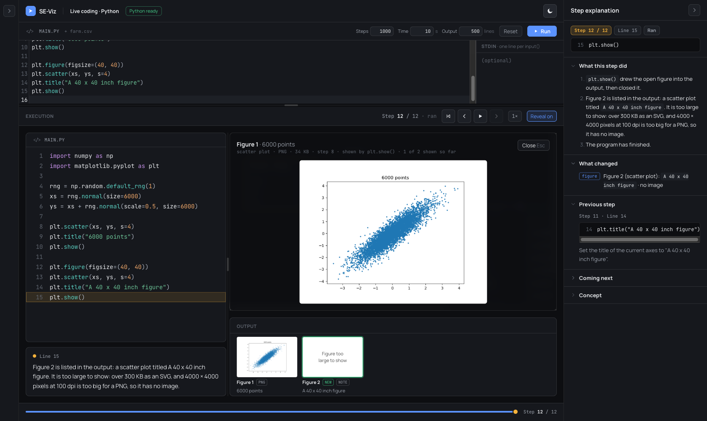
