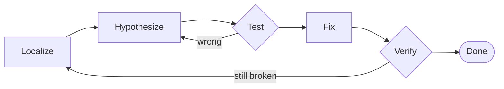

## Why debugging matters

Writing code is half the job; making it actually do the right thing is the other half. **Debugging**
is the skill of finding *why* a program misbehaves — and it's a method, not luck.

> [!idea] What a bug really is
> A bug is a **gap between what you think the code does and what it actually does**. Debugging is
> closing that gap by *observing* the real behavior instead of trusting your assumptions.

---

## The method

Work it like a scientist, not by random edits:

1. **Reproduce** — get a reliable input that triggers the wrong result
2. **Localize** — narrow down *where* it goes wrong
3. **Hypothesize** — form a specific guess about the cause
4. **Test** — check that guess (a value, a print, a step-through)
5. **Fix** — change the one thing
6. **Verify** — confirm it's fixed and nothing else broke

---

## The method is a loop

Once the bug **reproduces**, the rest is a loop. A wrong guess isn't a failure — it sends you back
with a **narrower** search:



---

## Read like the machine

The cause of most bugs is an **assumption**: "this loop obviously stops at..." Don't assume — trace
it.

- Follow the values **line by line**, exactly as the CPU would
- Check each variable's value at each step against what you *expect*
- The first place reality and expectation diverge is your bug

A step-through visualization does this for you.

---

## Debug by comparison

> [!idea] Two runs, find the first difference
> When you have a **known-good** run and a **broken** run of the same program, scan them side by side
> and find the **first row where they differ**. The bug lives at that row — everything after it is
> just *downstream* of the original mistake.

---

## The example: max of an array

Scan `a[] = {3, 7, 2, 9}`, seeding `max` with the first element. One operator is flipped:

```c
int max = a[0];                 /* seed: max = 3 */
for (int i = 1; i < 4; i++)
    if (a[i] > max)             /* fixed.  buggy wrote:  a[i] < max */
        max = a[i];
printf("%d\n", max);
```

The buggy version tests `a[i] < max`. Same program, one character — `<` instead of `>`.

---

## The first divergence

| step | buggy `a[i] < max` | fixed `a[i] > max` |
| --- | --- | --- |
| seed | max = 3 | max = 3 |
| i=1, a=7 | 7 < 3 false → skip | 7 > 3 true → max = 7 |
| i=2, a=2 | 2 < 3 true → max = 2 | 2 > 7 false → skip |
| i=3, a=9 | 9 < 2 false → skip | 9 > 7 true → max = 9 |
| result | **2** (wrong) | **9** (correct) |

The runs first differ at **i = 1** — that row is the bug. Everything below it is downstream.

---

## Common pitfalls

> [!watch-out] Debugging anti-patterns
> - **Fixing the symptom, not the cause** — patching the final value instead of the flipped operator.
> - **Changing many things at once** — then you can't tell what helped. Change one thing, re-test.
> - **Assuming instead of checking** — "it can't be that line." Verify the value; it often is.
> - Easy-to-miss typos: `=` vs `==`, `<` vs `>`, `i <= n` vs `i < n`.

---

## Recap

> [!recap] What to hold onto
> Debugging is a method: **reproduce → localize → hypothesize → test → fix → verify**. Trace real
> values instead of assuming. When you can compare a good run with a broken one, the bug is at the
> **first row they differ** — the flipped `<`/`>` here — and everything after is downstream.

---

## See it run

The **Max of array** visualization is a **dual-trace**: the buggy and fixed runs side by side.

- step until the columns first diverge (i = 1) — the highlighted **first divergence**
- watch the buggy run drift to `2` while the fixed run climbs to the true max `9`

Press **Continue to the visualization →** to debug by comparison.
