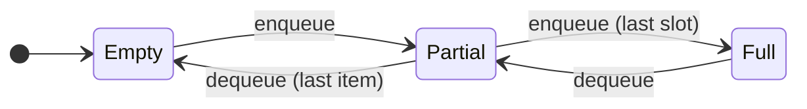

## Why this matters

A **stack** and a **queue** are *abstract data types* — defined by their **access rule**, not their
storage:

- **Stack — LIFO** (last in, first out): add and remove at the **same** end
- **Queue — FIFO** (first in, first out): add at one end, remove from the **other**

This slice implements both on a **fixed array**. Same storage, two different rules.

---

## Stack: one moving end

A `top` index marks the next free slot; push and pop both happen there:

```c
int s[CAP];
int top = 0;                 /* number of items / next free slot */

void push(int x) {
    if (top == CAP) return;  /* full → overflow */
    s[top++] = x;
}
int pop(void) {
    if (top == 0) return -1; /* empty → underflow */
    return s[--top];
}
```

Push 1, 2, 3 then pop → you get **3** (the last in). That's LIFO.

---

## Queue: two moving ends (a ring)

A queue removes from the opposite end it adds to, so it needs **two** cursors — `front` and `rear` —
and the array is treated as a **circle** so they can wrap:

```c
int q[CAP];
int front = 0, rear = 0, count = 0;
```

`count` tracks live elements: `count == 0` is empty, `count == CAP` is full.

---

## Empty, partial, full

`count` alone decides the state — **Empty** is `count == 0`, **Full** is `count == CAP` — and
each end state has one operation that must be **refused**. Every other move is a safe step:



---

## Wrapping around

> [!idea] Modulo makes the array a ring
> Advancing a cursor with `(i + 1) % CAP` wraps it from the last slot back to slot 0 — a **ring
> buffer**. That's how a fixed array serves a queue without ever shifting elements:
> ```c
> void enqueue(int x) {
>     if (count == CAP) return;     /* full */
>     q[rear] = x;
>     rear = (rear + 1) % CAP;      /* advance, wrap */
>     count++;
> }
> ```
> Dequeue mirrors it: read `q[front]`, then `front = (front + 1) % CAP; count--;`.

---

## Common pitfalls

> [!watch-out] Array ADT traps
> - **Overflow / underflow** — always guard `full` before adding and `empty` before removing.
> - **Forgetting `% CAP`** — without the wrap, `rear`/`front` run off the end of the array.
> - **Using `front == rear` to mean empty** — it's ambiguous (also true when full). Track `count`.
> - **Fixed capacity** — an array stack/queue can't grow past `CAP` (Part 2 fixes that with a list).

---

## Recap

> [!recap] What to hold onto
> A stack is **LIFO** — one `top` index, push/pop at the same end. A queue is **FIFO** — separate
> `front` and `rear` cursors over a **ring buffer**, advanced with `(i + 1) % CAP` so a fixed array
> wraps. Track `count` for empty/full; guard overflow and underflow every time.

---

## See it run

This topic's visualizations show both rules on a fixed array:

- **Array stack (LIFO)** — `top` rises on push and falls on pop; the last value pushed is the first
  popped
- **Circular queue (FIFO)** — `front` and `rear` chase around the ring, wrapping with `% CAP`, while
  `count` guards empty and full

Press **Continue to the visualization →** to push onto a stack.
